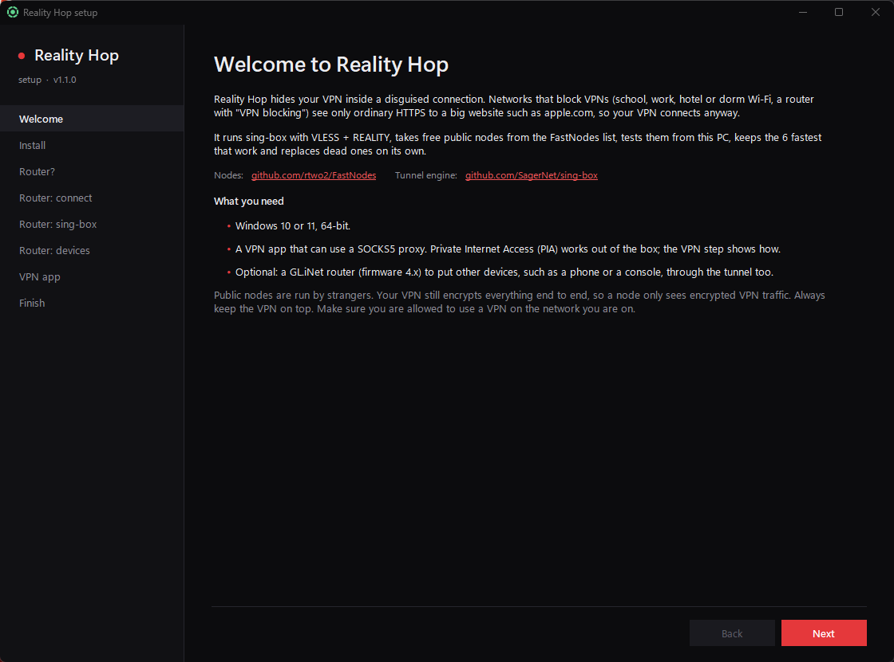
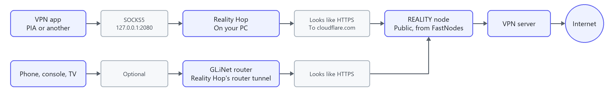
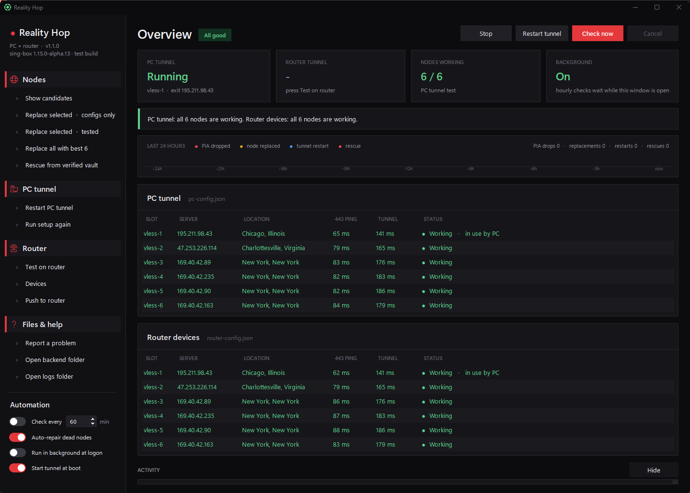
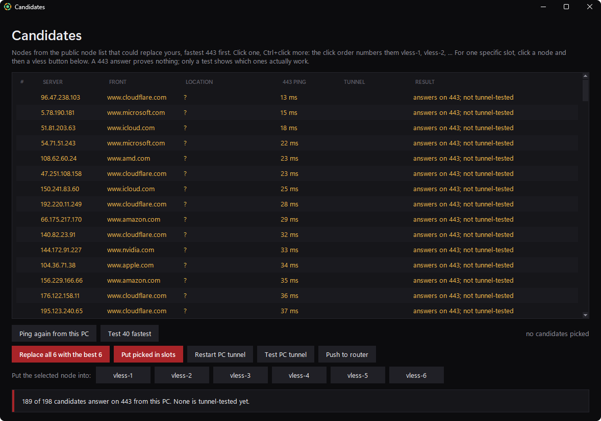
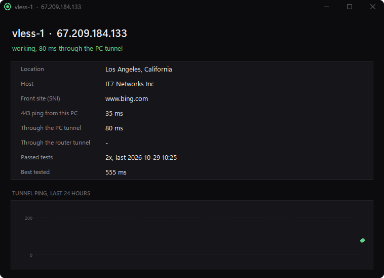
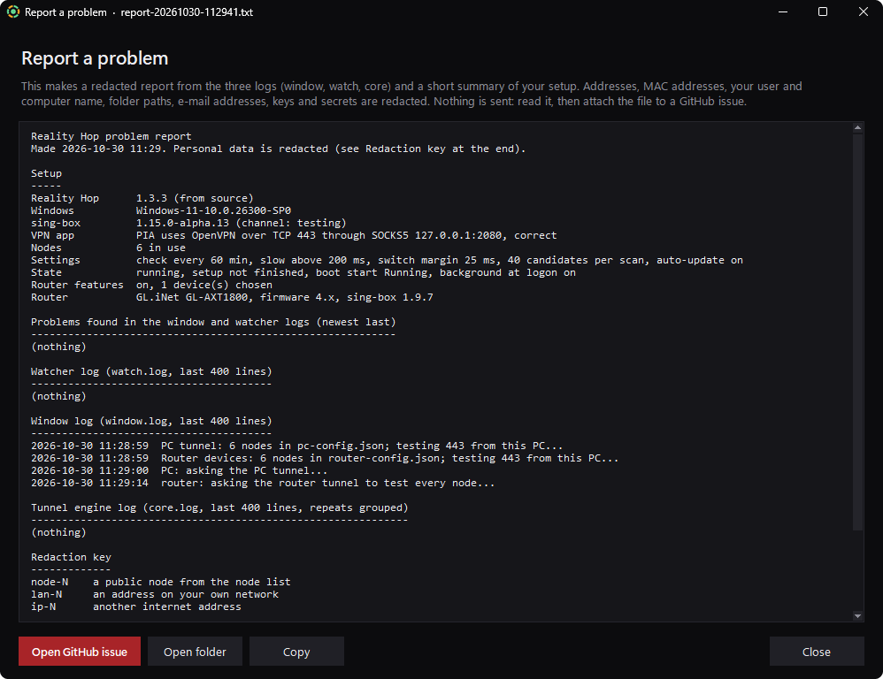
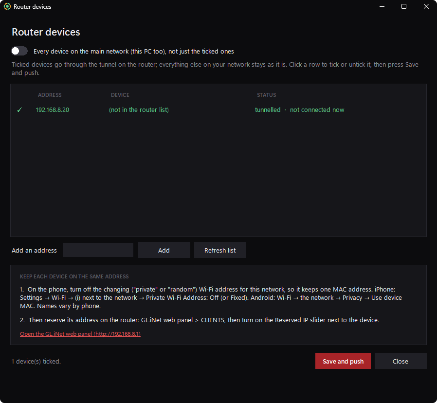
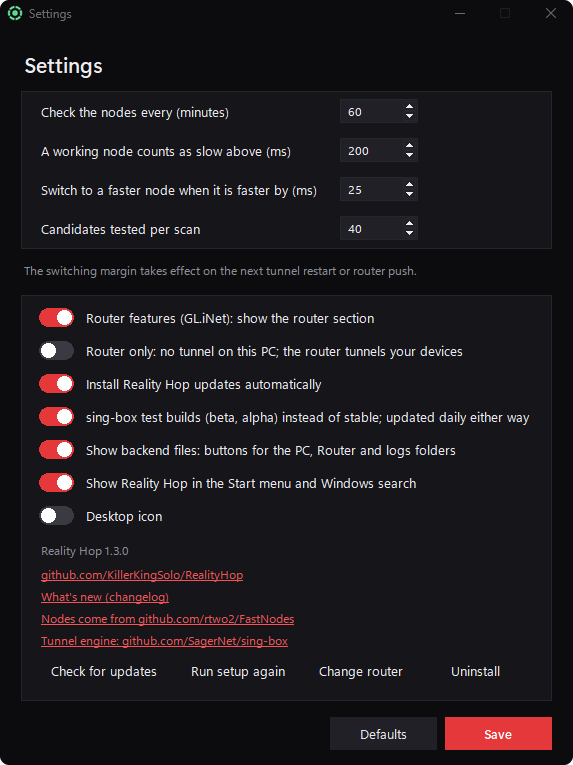
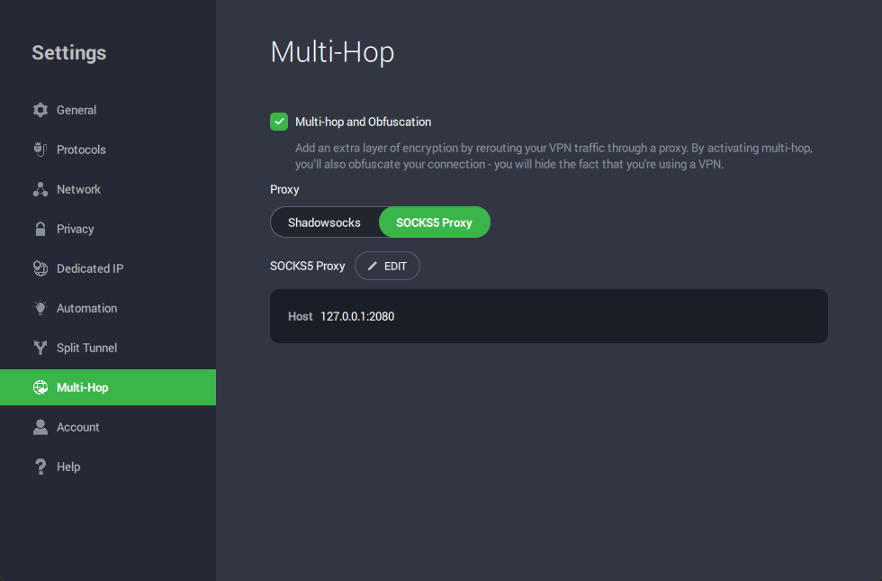

# Reality Hop

<p align="center">
  <a href="../../stargazers"></a>
  <a href="../../releases"></a>
  <a href="../../releases/latest"></a>
  <a href="LICENSE"></a>
</p>

**Get your VPN through networks that block VPNs.** Reality Hop wraps your VPN connection in a VLESS + REALITY tunnel
([sing-box](https://github.com/SagerNet/sing-box)). To the network it looks like ordinary HTTPS to a big website,
such as cloudflare.com. It is made for networks that block VPNs:

- school, work, hotel and dorm Wi-Fi
- public Wi-Fi in airports, cafés, trains and libraries
- routers with "VPN blocking", and internet providers that throttle or block VPN traffic
- countries that filter the internet, such as China's Great Firewall, Russia, Iran, Turkmenistan and the UAE

It finds free
public nodes from [rtwo2/FastNodes](https://github.com/rtwo2/FastNodes), tests them itself, keeps the fastest working ones in use and replaces dead
ones on its own.

**What's new:** [CHANGELOG.md](CHANGELOG.md) (newest version first) · **Download:** [latest release](../../releases/latest)



<picture>
  <source media="(prefers-color-scheme: dark)" srcset="docs/images/flow-dark.png">
  
</picture>

The network in between only sees an ordinary encrypted connection to a big website. Your VPN's own encryption stays
inside it the whole way.

## Screenshots

|  |  |
|---|---|
| **Main window:** every node tested through the live tunnel, the last 24 hours, the router tunnel. | **Candidates:** nodes from the public list, pinged and tested on your PC; put any of them in a slot. |
|  |  |
| **Node details:** where a node is, how it tests, its ping over 24 hours. | **Report a problem:** the logs with everything personal redacted, ready for a GitHub issue. |
|  |  |
| **Router devices:** choose which devices use the router tunnel, and how to keep their address fixed. | **Settings:** checks, router features, updates, the sing-box channel, shortcuts. |

## Features

- **One exe, guided setup.** Download `RealityHop.exe`, run it, and the wizard does the rest: install, sing-box, the
  first nodes, your VPN app, start at boot.
- **Finds and tests nodes for you.** It downloads the public node list, runs a real REALITY handshake and an HTTPS
  fetch through each candidate, and keeps the 6 fastest that work.
- **Repairs itself.** A background watcher with a tray icon checks the nodes every hour. It replaces a dead node and
  rescues from a vault of known-good nodes when all are down. With PIA, it reacts the moment the VPN drops.
- **Tray icon shows the state.** The center is the overall state. The ring has one segment per node: green working,
  amber slow, red dead.
- **Start menu and Windows search.** Press the Windows key and type Reality Hop. A desktop icon is optional.
- **Optional GL.iNet router support,** with a **Devices** window: choose which devices use the tunnel, and how to
  keep their address fixed (no changing MAC on the phone, Reserved IP for it in the GL.iNet panel's Clients list).
- **GL.iNet router:** Put a phone, console or TV through the tunnel too, with nothing installed on
  them. Turn it off and the router section disappears.
- **Router only.** No tunnel on the PC: the router tunnels the devices you choose, or every device on its main
  network, so all your traffic goes through the tunnel.
- **Shows the sing-box build** in use (stable or test build) under the name in the window.
- **Stop / Start for when you travel.** One button turns everything off, including the start at boot, until you press
  Start.
- **Automatic updates.** Reality Hop updates itself from this repo's Releases (SHA-256 checked).
- **sing-box keeps itself current on its own**, daily, on the channel you choose: **stable** (default) or **test
  builds** (beta, alpha). This does not wait for a Reality Hop release.
- **See what runs behind the scenes.** Turn on *Show backend files* to get buttons for the `PC`, `Router` and `logs`
  folders: the live sing-box configs, the router scripts and the three logs.
- **Anonymous problem reports.** *Report a problem* bundles the three logs with addresses, names, keys and secrets
  replaced by tokens. You read it first, then attach it to a GitHub issue. Nothing is sent automatically.
- **One folder for everything.** Installs to `C:\Program Files\RealityHop`, or a folder you pick in the setup, with
  one UAC prompt. The program, the tunnel engine, the configs and the logs all stay there, readable by your Windows
  user only. Updates install there without asking again. The program never runs as administrator. No telemetry.

## Install

1. Download **`RealityHop.exe`** from [Releases](../../releases/latest).
2. Run it. Windows SmartScreen may warn because the exe is not code-signed: click **More info → Run anyway**. Some
   antivirus programs flag PyInstaller apps by mistake; the source is all here, and you can
   [build it yourself](docs/building.md).
3. Follow the setup wizard:
   - **Install** copies Reality Hop to `C:\Program Files\RealityHop` (one UAC prompt), downloads sing-box, finds the first nodes
     and starts the tunnel. This takes about a minute.
   - **Router?** answers whether you also want a GL.iNet router set up. If you answer yes, the wizard guides you
     through it step by step ([details](docs/router-setup.md)). If you answer no, Reality Hop shows only the PC part.
   - **VPN app** shows how to point your VPN at the tunnel ([details](docs/vpn-setup.md)).
   - **Finish** sets the background start at logon, the start at boot, and automatic updates.

Requirements: Windows 10 or 11 (64-bit), and a VPN app that can use a SOCKS5 proxy.

## Set up your VPN app

Reality Hop listens on **SOCKS5 `127.0.0.1` port `2080`**, with no username or password.

Your VPN must use **OpenVPN over TCP, port 443**. A SOCKS5 proxy carries TCP only, and 443 is the normal HTTPS port.

**Private Internet Access (PIA):**
Settings → Protocols: Protocol **OpenVPN**, Transport **TCP**, Remote Port **443**. Then Settings → Multi-Hop: tick
**Multi-hop and Obfuscation**, choose **SOCKS5 Proxy**, click **EDIT**, enter host `127.0.0.1` and port `2080`, and
save.



**Other VPN apps:** any app with a SOCKS5 proxy setting works the same way, using OpenVPN over TCP port 443. In an
OpenVPN config file, use `proto tcp`, the server's port `443`, and add `socks-proxy 127.0.0.1 2080`. See
[docs/vpn-setup.md](docs/vpn-setup.md).

## Controls

| Where | What |
|---|---|
| Tray&nbsp;icon | Double-click opens the window. Right-click: Restart tunnel, Check now, Rescue, Quit. |
| **Check&nbsp;now** | Tests every node through the running tunnel. |
| **Restart&nbsp;tunnel** | Restarts the tunnel on the current nodes (about 2 seconds). |
| **Stop&nbsp;/&nbsp;Start** | Turns everything off, including the start at boot, for when you are away. Turn the VPN app's proxy off while stopped. |
| Nodes&nbsp;→&nbsp;**Show&nbsp;candidates** | Lists nodes from the public list; test them and put any of them in a slot, then restart and test the PC tunnel from the same window. |
| Nodes&nbsp;→&nbsp;**Rescue** | Use when every node is dead. Tests the vault of known-good nodes and puts the best 6 in. |
| Help&nbsp;→&nbsp;**Report&nbsp;a&nbsp;problem** | Makes a redacted report of the logs and opens a GitHub issue for you to attach it to. |
| Files&nbsp;(optional) | **Open backend folder** (`PC`, `Router`, `logs`, `anonymous-logs`) and **Open logs folder**. |
| **Settings** | Check interval, slow threshold, switching margin, router features on/off, sing-box stable or test builds, show backend files, updates, run setup again, uninstall. |

**Uninstall:** use Settings → Uninstall, or Windows Settings → Apps → Reality Hop.

## Where the nodes come from

- **Node list:** [rtwo2/FastNodes](https://github.com/rtwo2/FastNodes), file
  [`sub/verified_tls.txt`](https://raw.githubusercontent.com/rtwo2/FastNodes/main/sub/verified_tls.txt). Reality Hop
  keeps only VLESS + REALITY + XTLS-Vision nodes on port 443 that use a well-known front site. It then tests them
  itself; the list's own verification is not trusted.
- **Tunnel engine:** [SagerNet/sing-box](https://github.com/SagerNet/sing-box), downloaded from its official GitHub
  releases. Stable is the newest full release; test builds are the newest of all, alpha and beta included. The SHA-256
  checksum is checked, and the new build must accept the config before it replaces the old one. On your PC it runs as
  `rh-core.exe`.
- **Protocol:** VLESS with REALITY and XTLS-Vision, from [XTLS](https://github.com/XTLS).

## Privacy and security

- **Public nodes are run by strangers.** Your VPN still encrypts everything end to end, so a node sees only
  encrypted VPN traffic and its destination, the VPN server. Keep the VPN on top. Do not send private traffic through
  Reality Hop without a VPN.
- **What Reality Hop contacts:**
  - GitHub, for the node list, the sing-box releases and the Reality Hop releases.
  - `api.ipify.org`, fetched through each node when it is tested.
  - `www.gstatic.com/generate_204`, the latency test through the tunnel.
  - `ip-api.com`, for node locations, asked through the tunnel.
  - Quad9 DNS (`9.9.9.9`), through the tunnel.

  Nothing about you is sent anywhere, and there is no telemetry.
- **What it keeps:** configs, the node vault, logs and settings in its install folder (folders `PC`, `Router`, `logs`,
  `anonymous-logs`), which only your Windows user can open. The router key is
  an SSH key made on your PC. Your router password is typed into Windows' own `ssh` and is never seen or stored by
  Reality Hop.
- Make sure you are allowed to use a VPN on the network you are on, and in the country you are in. Some countries
  restrict or ban VPNs; Reality Hop does not change the law where you are.

See [SECURITY.md](SECURITY.md) for security problems. For anything else, use **Report a problem** in the window and
attach the anonymous report to an issue. Never attach `pc-config.json`, `router-config.json` or `vault.json`.

## Star history

**If Reality Hop helps you, please give it a star.** It is free and takes one click. Stars show me that people are
using it, help others find it, and keep me motivated to fix problems and add new features.

<a href="https://www.star-history.com/#KillerKingSolo/RealityHop&Date">
 <picture>
   <source media="(prefers-color-scheme: dark)" srcset="https://api.star-history.com/svg?repos=KillerKingSolo/RealityHop&type=Date&theme=dark" />
   <source media="(prefers-color-scheme: light)" srcset="https://api.star-history.com/svg?repos=KillerKingSolo/RealityHop&type=Date" />
   
 </picture>
</a>

## Documentation

- [How it works](docs/how-it-works.md)
- [GL.iNet router setup](docs/router-setup.md)
- [VPN app setup](docs/vpn-setup.md)
- [Troubleshooting](docs/troubleshooting.md)
- [Building from source and releasing](docs/building.md)

## Run from source

```
pip install -r requirements.txt
python src/realityhop.pyw
```

## License

[CC BY-NC-ND 4.0](LICENSE) (Creative Commons Attribution-NonCommercial-NoDerivatives 4.0). In short:

- **Share it unchanged, with credit:** Reality Hop by KillerKingSolo, sing-box by SagerNet and FastNodes by rtwo2, with
  their links (see [LICENSE](LICENSE)).
- **No changed versions:** you may not share an edited copy.
- **No commercial use:** you may not sell it or use it for profit.

Anything beyond that needs permission. sing-box (GPL-3.0-or-later) and FastNodes (MIT) are separate projects under
their own licenses; Reality Hop downloads them at run time and does not ship them.
