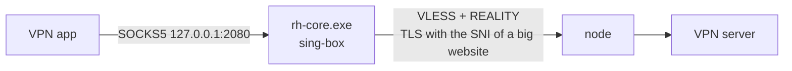

# How it works

## The tunnel



- **REALITY** makes the node answer like the real front site (www.apple.com, www.microsoft.com, ...) to anyone who
  probes it, and lets only clients with the right key through. To the network it is a normal TLS 1.3 connection to a
  well-known site.
- **XTLS-Vision** removes the tell-tale "TLS inside TLS" pattern of tunnelling an encrypted VPN.
- sing-box picks the lowest-latency node of the 6 with a `urltest` group. It re-tests every 10 minutes and switches
  when another node is faster by the switching margin (Settings, 25 ms by default).
- DNS for the tunnel goes to Quad9 over HTTPS, through the tunnel.

## Finding nodes

1. Download the public list ([rtwo2/FastNodes](https://github.com/rtwo2/FastNodes), `sub/verified_tls.txt`). The
   download is reused for 15 minutes.
2. Keep only VLESS + REALITY + XTLS-Vision, port 443, a numeric address, a well-formed key, and a front site from a
   short list of big websites.
3. Ping port 443 of each from this PC and sort by connect time.
4. Test the 40 fastest (Settings) with a throwaway sing-box (`rh-test.exe`) on this PC. Each node does a real REALITY
   handshake plus an HTTPS fetch of `api.ipify.org`, timed end to end, 5 at a time. A node that only answers on 443
   proves nothing: a rejected key is silently forwarded to the front site and looks healthy.
5. Keep the 6 fastest that pass, ordered so `vless-1` is the fastest.

Every node that ever passes goes into the **vault** (`vault.json`, up to 200 entries). A node that fails 3 tests in a
row leaves it. **Rescue** tests the vault, and that works even when the node list cannot be downloaded.

## The background watcher

`RealityHop.exe --watch` starts at logon from a Startup-folder shortcut and shows the tray icon.

- At logon it starts the tunnel first, so the VPN app finds the proxy. It shows the last known state at once, then
  checks as soon as the tunnel answers.
- Every 60 minutes (Settings) it tests each node through the running tunnel. A dead node is re-checked after 30
  seconds, then given a second opinion from a fresh test instance. Only then is it replaced with the best tested
  spare. If every node is dead, it runs Rescue.
- With PIA, it follows `piactl monitor connectionstate`. That is PIA's own event feed: there is no polling and no
  network traffic. If PIA is still not connected a minute after a drop, the nodes are checked at once. If all of them
  are fine, the tunnel is restarted.
- Once a day it checks for a new sing-box build on your channel (stable or test builds) and for a new Reality Hop
  release. sing-box updates do not depend on Reality Hop releases. Switching the channel in Settings installs that
  channel's newest build at once, even if it is older. The window also does the daily sing-box check when the watcher is
  not running.
- While the window is open, the window does the checks and the watcher waits.

## Start at boot

The optional scheduled task **RealityHop tunnel** starts `rh-core.exe` at boot, before logon and before the VPN app.
It runs as your user in "do not store password" mode. Creating or removing the task needs one UAC prompt.

## Files

Everything is in one folder: `C:\Program Files\RealityHop` unless you picked another one in the setup. The
setup gives that folder to your Windows user alone (plus SYSTEM and administrators), because it holds the
router key, the node keys and the API secret. Updates replace the exe there without a UAC prompt.

| In the install folder | What |
|---|---|
| `RealityHop.exe` | the program |
| `PC\pc-config.json` | PC tunnel config (its API secret is random per install) |
| `PC\rh-core.exe` | sing-box (official release, stable or test builds) |
| `Router\router-config.json` | router tunnel config |
| `Router\nft-devices.sh`, `Router\heal.sh` | copies of the router scripts as last pushed |
| `logs\` | `window.log`, `watch.log` (1 MB plus one older copy each), `core.log` (sing-box warnings) |
| `anonymous-logs\` | problem reports made with Report a problem (the last 5) |
| `vault.json`, `nodes.txt` | known-good nodes, the last scan |
| `settings.json`, `this-pc.json` | settings, setup state |
| `router_ed25519` | SSH key for the router (only with router features) |

With **Show backend files** on (Settings or the last setup step), the window has buttons for these folders. You can
read and edit the configs. **Restart tunnel** applies `pc-config.json`, and **Push to router** applies
`router-config.json`. Reality Hop rewrites the `vless-1` to `vless-6` entries whenever it replaces nodes.

## Anonymous problem reports

**Report a problem** writes `anonymous-logs\report-<date>.txt`. It holds a short summary (versions, settings, router
model) and the last 400 lines of each log. Every IP and MAC address becomes a token: `node-N` for a public node,
`lan-N` for an address on your network, `ip-N` for any other address. The same token always means the same
address. Your user and computer name, folder paths, e-mail addresses, keys, IDs and secrets are replaced as well.
The report is shown before anything else happens. **Open GitHub issue** opens a new issue with the summary filled
in, and you attach the file yourself.

## Command line (from source)

```
python src/engine.py               scan, rank and offer to apply
python src/engine.py --apply 6     apply the 6 best
python src/engine.py --check       live check of the nodes in use
python src/engine.py --watch       the background watcher
python src/realityhop.pyw --once   one local check, printed
```
