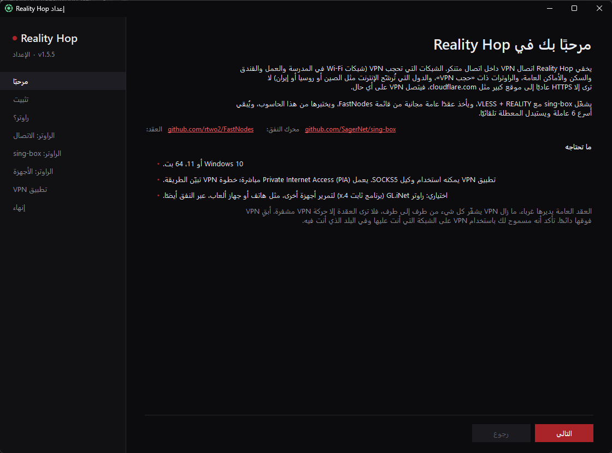
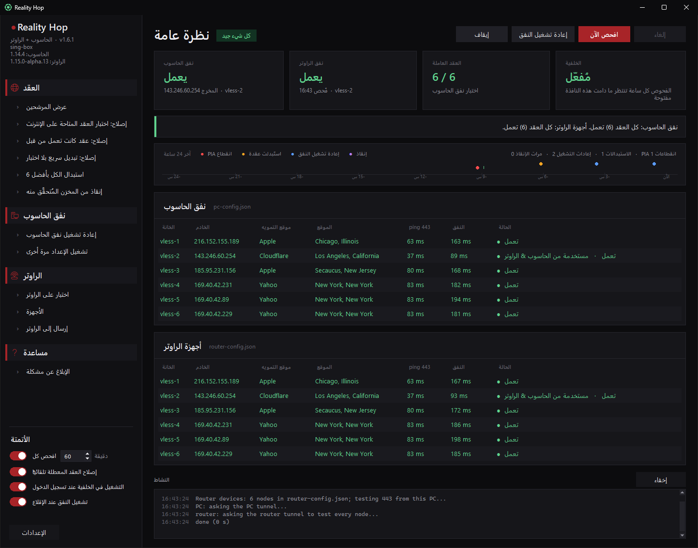
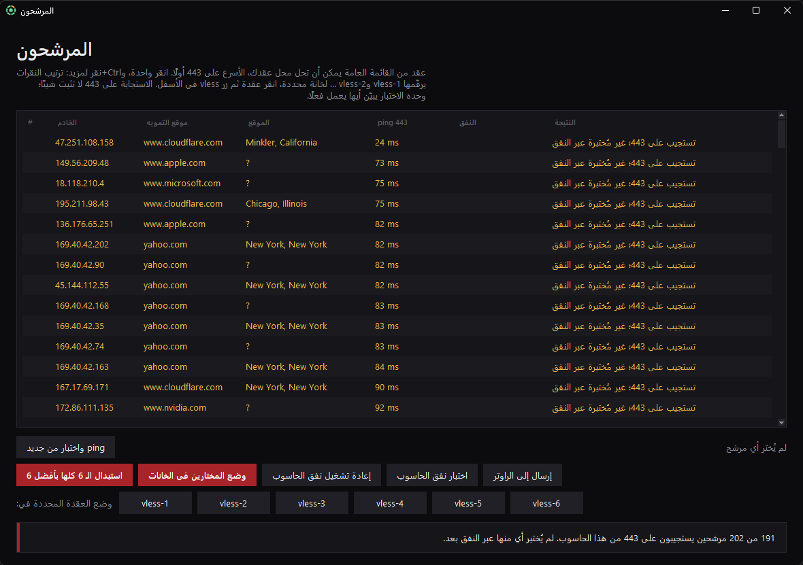
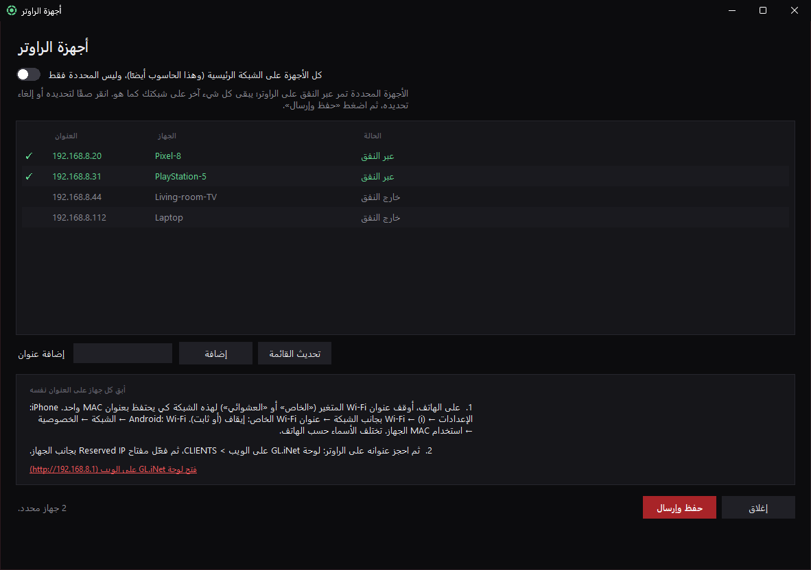
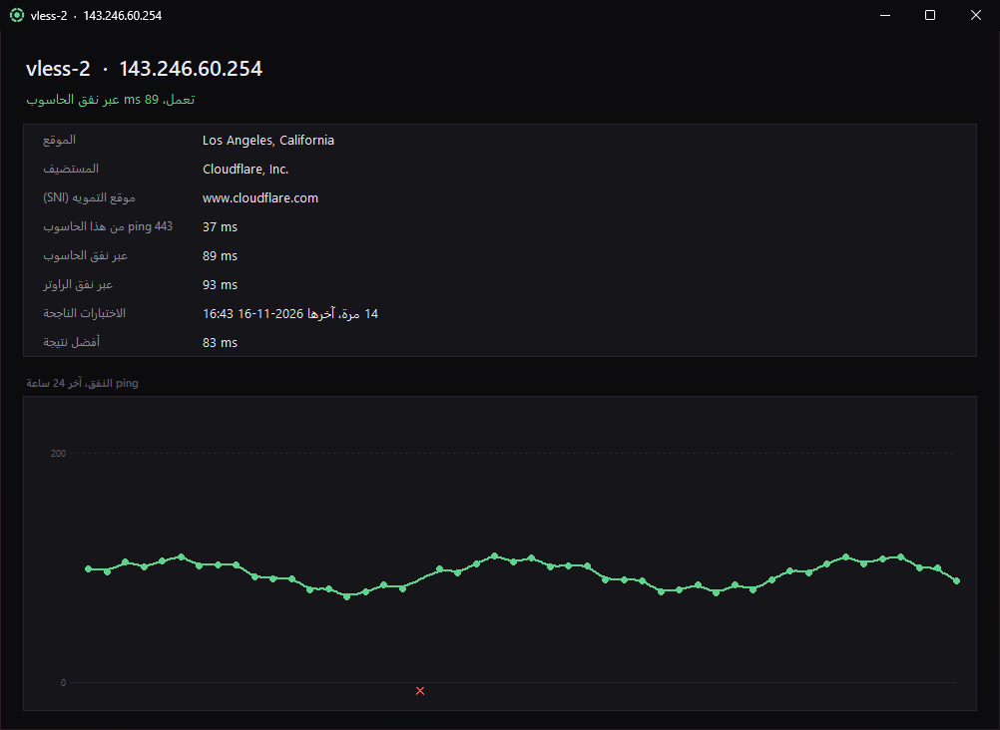
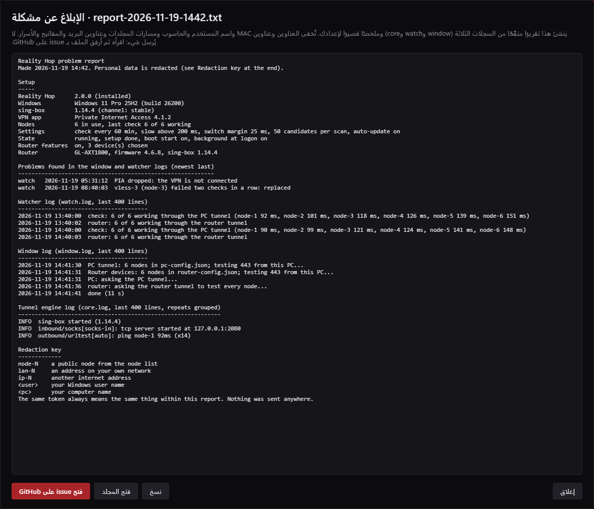
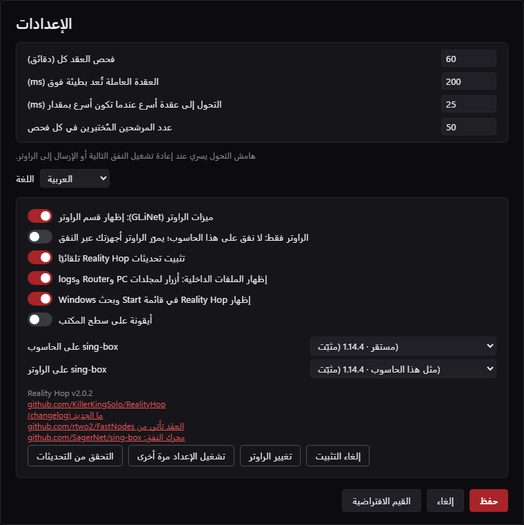

# Reality Hop (العربية)

<p align="center">
  <a href="https://github.com/KillerKingSolo/RealityHop/stargazers"></a>
  <a href="https://github.com/KillerKingSolo/RealityHop/releases"></a>
  <a href="https://github.com/KillerKingSolo/RealityHop/releases/latest"></a>
  <a href="../../LICENSE"></a>
  <br>
  <a href="https://github.com/KillerKingSolo/RealityHop/releases/latest"></a>
  <a href="#التثبيت"></a>
</p>

<p align="center">
  <a href="../../README.md">English</a> · <a href="README.es.md">Español</a> · <a href="README.zh.md">简体中文</a> ·
  <a href="README.ru.md">Русский</a> · <a href="README.uk.md">Українська</a> ·
  <a href="README.fa.md">فارسی</a> · <b>العربية</b> ·
  <a href="README.tr.md">Türkçe</a> · <a href="README.vi.md">Tiếng Việt</a>
</p>

<div dir="rtl">

> هذه ترجمة آلية لملف README الإنجليزي. إذا كان شيء غير واضح، فالنسخة الإنجليزية هي المرجع. نرحب بالتصحيحات في issue على GitHub.

**مرّر VPN الخاص بك عبر الشبكات التي تحظر VPN.** يغلّف Reality Hop اتصال VPN الخاص بك داخل نفق VLESS + REALITY
([sing-box](https://github.com/SagerNet/sing-box)). بالنسبة للشبكة يبدو كأنه HTTPS عادي إلى موقع كبير، مثل
cloudflare.com. صُنع للشبكات التي تحظر VPN:

- شبكات Wi-Fi في المدرسة والعمل والفندق والسكن الجامعي
- شبكات Wi-Fi العامة في المطارات والمقاهي والقطارات والمكتبات
- أجهزة الراوتر التي تحظر VPN، ومزوّدو الإنترنت الذين يبطئون أو يحظرون حركة VPN
- الدول التي تُرشِّح الإنترنت، مثل جدار الحماية العظيم في الصين وروسيا وإيران وتركمانستان والإمارات

يأخذ عُقدًا عامة مجانية من [rtwo2/FastNodes](https://github.com/rtwo2/FastNodes)، ويختبرها بنفسه، ويستخدم الأسرع
منها التي تعمل، ويستبدل المعطلة تلقائيًا.

**الجديد:** [CHANGELOG.md](../../CHANGELOG.md) (الأحدث أولًا) · **التنزيل:** [أحدث إصدار](https://github.com/KillerKingSolo/RealityHop/releases/latest)



<picture>
  <source media="(prefers-color-scheme: dark)" srcset="../images/flow-dark.png">
  
</picture>

لا ترى الشبكة الوسيطة إلا اتصالًا مشفّرًا عاديًا إلى موقع كبير. ويبقى تشفير VPN الخاص بك في داخله طوال الطريق.

## لقطات الشاشة

<table>
<tr><td colspan="2"><br><b>النافذة الرئيسية:</b> كل عقدة تُختبر عبر النفق العامل، وآخر 24 ساعة، ونفق الراوتر.</td></tr>
<tr><td width="50%" valign="top"><br><b>المرشحون:</b> عقد من القائمة العامة، يُقاس زمن استجابتها وتُختبر على حاسوبك؛ ضع أيًّا منها في خانة.</td><td width="50%" valign="top"><br><b>أجهزة الراوتر:</b> اختر الأجهزة التي تستخدم نفق الراوتر، وكيف تُبقي عنوانها ثابتًا.</td></tr>
<tr><td width="50%" valign="top"><br><b>تفاصيل العقدة:</b> أين توجد العقدة، وكيف تنجح في الاختبارات، وزمن استجابتها خلال 24 ساعة.</td><td width="50%" valign="top"><br><b>الإبلاغ عن مشكلة:</b> السجلات بعد إخفاء كل ما هو شخصي، جاهزة لـ issue على GitHub.</td></tr>
<tr><td colspan="2" align="center"><br><b>الإعدادات:</b> الفحوص، ميزات الراوتر، التحديثات، قناة sing-box، الاختصارات.</td></tr>
</table>

## الميزات

- **ملف exe واحد، وإعداد موجَّه.** نزّل `RealityHop.exe` وشغّله، والمعالج يقوم بالباقي: التثبيت، وsing-box،
  وأولى العقد، وتطبيق VPN الخاص بك، والتشغيل عند الإقلاع.
- **يجد العقد ويختبرها نيابةً عنك.** ينزّل القائمة العامة للعقد، ويجري مصافحة REALITY حقيقية وجلبًا عبر HTTPS من
  خلال كل مرشح، ويحتفظ بأسرع 6 عقد تعمل.
- **يصلح نفسه.** مراقب في الخلفية بأيقونة في شريط النظام يفحص العقد كل ساعة. يستبدل العقدة المعطلة، وعندما تتعطل
  كلها ينقذها من خزنة لعقد سليمة معروفة. مع PIA، يتفاعل لحظة انقطاع VPN.
- **أيقونة شريط النظام تُظهر الحالة.** المركز هو الحالة العامة. والحلقة فيها جزء لكل عقدة: أخضر تعمل، كهرماني
  بطيئة، أحمر معطلة.
- **قائمة ابدأ وبحث ويندوز.** اضغط مفتاح ويندوز واكتب Reality Hop. أيقونة سطح المكتب اختيارية.
- **دعم اختياري لراوتر GL.iNet** مع نافذة **الأجهزة**: اختر الأجهزة التي تستخدم النفق، وكيف تُبقي عنوانها ثابتًا
  (دون MAC متغيّر على الهاتف، وReserved IP له في قائمة Clients في لوحة GL.iNet).
- **راوتر GL.iNet:** مرّر الهاتف أو جهاز الألعاب أو التلفاز عبر النفق أيضًا، دون تثبيت أي شيء عليها. أوقف الميزة
  فيختفي قسم الراوتر.
- **الراوتر فقط.** لا نفق على الحاسوب: يمرّر الراوتر الأجهزة التي تختارها، أو كل الأجهزة على شبكته الرئيسية، عبر
  النفق، فتمر كل حركة بياناتك عبر النفق.
- **يعرض إصدار sing-box المستخدَم** (مستقر أو تجريبي) تحت الاسم في النافذة.
- **إيقاف / تشغيل لأوقات السفر.** زر واحد يوقف كل شيء، بما في ذلك التشغيل عند الإقلاع، حتى تضغط تشغيل.
- **9 لغات.** الإنجليزية والإسبانية والصينية المبسطة والروسية والأوكرانية والفارسية والعربية والتركية والفيتنامية.
  اختر واحدة عند أول تشغيل؛ وغيّرها من الإعدادات. يبقى سجل النشاط وتقارير المشاكل بالإنجليزية.
- **تحديثات تلقائية.** يحدّث Reality Hop نفسه من إصدارات هذا المستودع (مع التحقق من SHA-256).
- **يبقى sing-box محدّثًا من تلقاء نفسه**، يوميًا، على القناة التي تختارها: **مستقر** (الافتراضي) أو **إصدارات
  تجريبية (بيتا، ألفا)**. ولا ينتظر إصدارًا جديدًا من Reality Hop.
- **شاهد ما يعمل خلف الكواليس.** فعّل *إظهار الملفات الداخلية* لتحصل على أزرار لمجلدات `PC` و`Router` و`logs`:
  إعدادات sing-box الحالية، وسكربتات الراوتر، والسجلات الثلاثة.
- **تقارير مشاكل مجهولة الهوية.** يجمع *الإبلاغ عن مشكلة* السجلات الثلاثة مع استبدال العناوين والأسماء والمفاتيح
  والأسرار برموز. تقرؤه أولًا، ثم ترفقه بـ issue على GitHub. لا يُرسَل شيء تلقائيًا.
- **مجلد واحد لكل شيء.** يُثبَّت في `C:\Program Files\RealityHop`، أو في مجلد تختاره أثناء الإعداد، مع طلب UAC
  واحد. يبقى البرنامج ومحرك النفق والإعدادات والسجلات هناك، ولا يقرؤها إلا مستخدم ويندوز الخاص بك. تُثبَّت
  التحديثات هناك دون أن يسأل مجددًا. لا يعمل البرنامج أبدًا بصلاحيات المسؤول. لا قياس عن بُعد.

## التثبيت

1. نزّل **`RealityHop.exe`** من [أحدث إصدار](https://github.com/KillerKingSolo/RealityHop/releases/latest).
2. شغّله. قد يحذّر Windows SmartScreen لأن ملف exe غير موقّع: انقر **More info → Run anyway** (مزيد من المعلومات →
   تشغيل على أي حال). بعض برامج مكافحة الفيروسات تَسِم التطبيقات غير الموقّعة خطأً؛ الشيفرة المصدرية كلها هنا،
   ويمكنك [بناؤه بنفسك](../building.md) (بالإنجليزية).
3. اتبع معالج الإعداد:
   - **تثبيت** ينسخ Reality Hop إلى `C:\Program Files\RealityHop` (طلب UAC واحد)، وينزّل sing-box، ويجد أولى
     العقد، ويشغّل النفق. يستغرق ذلك نحو دقيقة.
   - **راوتر؟** يسألك هل تريد إعداد راوتر GL.iNet أيضًا. إن أجبت بنعم، يرشدك المعالج خطوة بخطوة
     ([التفاصيل](../router-setup.md)، بالإنجليزية). وإن أجبت بلا، يعرض Reality Hop جزء الحاسوب فقط.
   - **تطبيق VPN** يبيّن كيف توجّه VPN الخاص بك إلى النفق ([التفاصيل](../vpn-setup.md)، بالإنجليزية).
   - **إنهاء** يضبط التشغيل في الخلفية عند تسجيل الدخول، والتشغيل عند الإقلاع، والتحديثات التلقائية.

المتطلبات: ويندوز 10 أو 11 (64 بت) مع Microsoft Edge WebView2 (جزء من ويندوز 11 وويندوز 10 الحالي)، وتطبيق VPN
يمكنه استخدام وكيل SOCKS5.

### Mac

1. نزّل **`RealityHop-mac-apple-silicon.dmg`** (M1 وأحدث) أو **`RealityHop-mac-intel.dmg`** من
   [أحدث إصدار](https://github.com/KillerKingSolo/RealityHop/releases/latest).
2. افتحه واسحب **Reality Hop** إلى **Applications** (التطبيقات). شغّله من التطبيقات، لا من صورة القرص.
3. افتح Reality Hop من التطبيقات. في المرة الأولى يحظره macOS، لأن Apple لم توثّق التطبيق (يتطلب ذلك حساب مطوّر
   مدفوعًا لدى Apple). اسمح به مرة واحدة:
   1. يقول macOS إنه لا يستطيع التحقق من Reality Hop. انقر **Done** (تم)، لا **Move to Trash** (نقل إلى سلة
      المهملات).
   2. افتح **System Settings → Privacy & Security** (إعدادات النظام → الخصوصية والأمن) ومرّر إلى الأسفل حتى
      **Security** (الأمن).
   3. بجانب «Reality Hop» was blocked، انقر **Open Anyway** (فتح على أي حال)، ثم **Open Anyway** مرة أخرى وأدخل كلمة
      سر جهاز Mac.

   تفعل ذلك مرة واحدة فقط. تُفتح التحديثات دون أن تسأل مجددًا. النقر بزر الماوس الأيمن → **فتح** لم يعد يعمل في
   macOS 15 وأحدث. الشيفرة المصدرية كلها هنا، ويمكنك [بناؤه بنفسك](../building.md).
   [مزيد من المساعدة](../troubleshooting.md#mac-reality-hop-cannot-be-opened) (بالإنجليزية).
4. اتبع معالج الإعداد نفسه. لا حاجة إلى كلمة سر المسؤول: يبقى كل شيء في `~/Library/Application Support/RealityHop`،
   ولا يقرؤه إلا مستخدمك، ويظهر المراقب في الخلفية في شريط القوائم.
5. PIA على Mac: لا شيء لضبطه في Split Tunnel. يضيف Reality Hop نفسه (Bypass VPN) ويحتفظ هناك بعناوين عقده، فيمكن
   أن يبقى kill switch في PIA مفعّلًا. شغّل تطبيق DNS واحدًا في كل مرة ([التفاصيل](../vpn-setup.md)).

المتطلبات: macOS 15 أو أحدث، Apple silicon أو Intel، وتطبيق VPN يمكنه استخدام وكيل SOCKS5. احصل على PIA لـ Mac من
[موقعه](https://www.privateinternetaccess.com/download/mac-vpn)، لا من Mac App Store: نسخة App Store لا تحتوي على
Multi-Hop ولا Split Tunnel، لذا لا يمكنها الاتصال عبر Reality Hop.

## إعداد تطبيق VPN

يستمع Reality Hop على **SOCKS5 `127.0.0.1` المنفذ `2080`**، دون اسم مستخدم أو كلمة سر.

يجب أن يستخدم VPN الخاص بك **OpenVPN عبر TCP، المنفذ 443**. وكيل SOCKS5 لا يحمل إلا TCP، و443 هو منفذ HTTPS
المعتاد.

**Private Internet Access (PIA):**
Settings → Protocols: Protocol **OpenVPN**، Transport **TCP**، Remote Port **443**. ثم Settings → Multi-Hop: فعّل
**Multi-hop and Obfuscation**، واختر **SOCKS5 Proxy**، وانقر **EDIT**، وأدخل المضيف `127.0.0.1` والمنفذ `2080`،
واحفظ. لا يحتاج Split Tunnel منك إلى شيء: يضيف Reality Hop بنفسه `rh-core.exe` ونسخته التجريبية `rh-test.exe`
بوضع **Bypass VPN**. لا يعرض معالج الإعداد الخطوة اليدوية إلا إذا رفض سطر أوامر PIA: في Settings → Split Tunnel أضف
`C:\Program Files\RealityHop\PC\rh-core.exe` واضبطه على **Bypass VPN**.


**تطبيقات VPN أخرى:** أي تطبيق فيه إعداد وكيل SOCKS5 يعمل بالطريقة نفسها، باستخدام OpenVPN عبر TCP على المنفذ 443.
في ملف إعداد OpenVPN استخدم `proto tcp` ومنفذ الخادم `443` وأضف `socks-proxy 127.0.0.1 2080`. انظر
[docs/vpn-setup.md](../vpn-setup.md) (بالإنجليزية).

## عناصر التحكم

| أين | ماذا |
|---|---|
| أيقونة شريط النظام | النقر المزدوج يفتح النافذة. النقر بالزر الأيمن: إعادة تشغيل النفق، افحص الآن، إنقاذ، خروج. |
| **افحص الآن** | يختبر كل عقدة عبر النفق العامل. |
| **إعادة تشغيل النفق** | يعيد تشغيل النفق على العقد الحالية (نحو ثانيتين). |
| **إيقاف / تشغيل** | يوقف كل شيء، بما في ذلك التشغيل عند الإقلاع، لأوقات غيابك. أوقف وكيل تطبيق VPN ما دام متوقفًا. |
| العقد → **عرض المرشحين** | يعرض عقدًا من القائمة العامة؛ اختبرها وضع أيًّا منها في خانة، ثم أعد تشغيل نفق الحاسوب واختبره من النافذة نفسها. |
| العقد → **إنقاذ** | استخدمه عندما تتعطل كل العقد. يختبر خزنة العقد السليمة المعروفة ويضع أفضل 6 منها. |
| مساعدة → **الإبلاغ عن مشكلة** | ينشئ تقريرًا منقّحًا من السجلات ويفتح issue على GitHub لترفقه به. |
| الملفات (اختياري) | **فتح المجلد الداخلي** (`PC`، `Router`، `logs`، `anonymous-logs`) و**فتح مجلد السجلات**. |
| **الإعدادات** | فاصل الفحص، حد البطء، هامش التبديل، تشغيل/إيقاف ميزات الراوتر، sing-box مستقر أو تجريبي (الحاسوب والراوتر)، إظهار الملفات الداخلية، التحديثات، تشغيل الإعداد مرة أخرى، إلغاء التثبيت. |

**إلغاء التثبيت:** لوحة التحكم → البرامج → إلغاء تثبيت برنامج → Reality Hop. وكذلك إعدادات ويندوز → التطبيقات →
التطبيقات المثبتة → Reality Hop، والإعدادات → إلغاء التثبيت داخل Reality Hop نفسه.

## من أين تأتي العقد

- **قائمة العقد:** [rtwo2/FastNodes](https://github.com/rtwo2/FastNodes)، الملف
  [`sub/verified_tls.txt`](https://raw.githubusercontent.com/rtwo2/FastNodes/main/sub/verified_tls.txt). يحتفظ
  Reality Hop فقط بعقد VLESS + REALITY + XTLS-Vision على المنفذ 443 التي تستخدم موقع واجهة معروفًا. ثم يختبرها بنفسه؛
  ولا يثق بتحقق القائمة نفسها.
- **محرك النفق:** [SagerNet/sing-box](https://github.com/SagerNet/sing-box)، يُنزَّل من إصداراته الرسمية على GitHub.
  المستقر هو أحدث إصدار كامل؛ والإصدارات التجريبية هي الأحدث بينها جميعًا، بما فيها ألفا وبيتا. يُتحقق من مجموع
  SHA-256، ويجب أن يقبل الإصدار الجديد الإعدادات قبل أن يحل محل القديم. يعمل على حاسوبك باسم `rh-core.exe`.
- **محرك الراوتر:** نسخة Reality Hop الخاصة من sing-box لأجهزة الراوتر arm64، مبنية من الشيفرة الرسمية دون كل ما لا
  يستخدمه الراوتر (18 ميغابايت بدلًا من 27 ميغابايت لحزمة GL.iNet 1.9.7). تتبع قناة الحاسوب ما لم تعطِ الإعدادات
  الراوتر قناة خاصة به. يسأل Reality Hop قبل تحديث الراوتر، ويحتفظ بالنسخة القديمة في ذاكرة RAM للراوتر، ويعيدها إن
  لم تبدأ النسخة الجديدة. تظل صفحة Plug-ins في الراوتر تعرض حزمة GL.iNet 1.9.7؛ ويعرض الشريط الجانبي الإصدار الذي
  يعمل فعلًا. كيف تُبنى وتُفحص: [`router-core/`](../../router-core/README.md) (بالإنجليزية).
- **البروتوكول:** VLESS مع REALITY وXTLS-Vision، من [XTLS](https://github.com/XTLS).

## الخصوصية والأمان

- **العقد العامة يديرها غرباء.** يظل VPN الخاص بك يشفّر كل شيء من طرف إلى طرف، فلا ترى العقدة إلا حركة VPN مشفّرة
  ووجهتها، أي خادم VPN. أبقِ VPN دائمًا في الأعلى. لا ترسل حركة خاصة عبر Reality Hop دون VPN.
- **ما الذي يتصل به Reality Hop:**
  - GitHub، لقائمة العقد وإصدارات sing-box وإصدارات الراوتر وإصدارات Reality Hop.
  - `api.ipify.org`، يُطلب عبر كل عقدة عند اختبارها.
  - `www.gstatic.com/generate_204`، اختبار زمن الاستجابة عبر النفق.
  - `ip-api.com`، لمواقع العقد، يُسأل عبر النفق.
  - DNS من Quad9 (`9.9.9.9`)، عبر النفق.

  لا يُرسَل أي شيء عنك إلى أي مكان، ولا يوجد قياس عن بُعد.
- **ما الذي يحتفظ به:** الإعدادات، وخزنة العقد، والسجلات، والتفضيلات في مجلد تثبيته (المجلدات `PC` و`Router`
  و`logs` و`anonymous-logs`)، ولا يفتحها إلا مستخدم ويندوز الخاص بك. مفتاح الراوتر هو مفتاح SSH أُنشئ على حاسوبك.
  تُكتب كلمة سر الراوتر في `ssh` الخاص بويندوز نفسه، ولا يراها Reality Hop أو يحفظها أبدًا.
- تأكد أنه مسموح لك باستخدام VPN على الشبكة التي تستخدمها وفي البلد الذي أنت فيه. بعض الدول تقيّد VPN أو تحظره؛ ولا
  يغيّر Reality Hop القانون حيث أنت.

لمشاكل الأمان انظر [SECURITY.md](../../SECURITY.md). ولأي شيء آخر، استخدم **الإبلاغ عن مشكلة** في النافذة وأرفق
التقرير المجهول بـ issue. لا ترفق أبدًا `pc-config.json` أو `router-config.json` أو `vault.json`.

## سجل النجوم

**إن كان Reality Hop يساعدك، فامنحه نجمة من فضلك.** إنها مجانية وتستغرق نقرة واحدة. تُريني النجوم أن الناس
يستخدمونه، وتساعد الآخرين على إيجاده، وتحفّزني على إصلاح المشاكل وإضافة ميزات جديدة.

<a href="https://www.star-history.com/#KillerKingSolo/RealityHop&Date">
 <picture>
   <source media="(prefers-color-scheme: dark)" srcset="https://api.star-history.com/svg?repos=KillerKingSolo/RealityHop&type=Date&theme=dark" />
   <source media="(prefers-color-scheme: light)" srcset="https://api.star-history.com/svg?repos=KillerKingSolo/RealityHop&type=Date" />
   
 </picture>
</a>

## التوثيق

الأدلة بالإنجليزية:

- [كيف يعمل](../how-it-works.md)
- [إعداد راوتر GL.iNet](../router-setup.md)
- [إعداد تطبيق VPN](../vpn-setup.md)
- [حل المشاكل](../troubleshooting.md)
- [البناء من الشيفرة المصدرية والإصدار](../building.md)

## التشغيل من الشيفرة المصدرية

Reality Hop مكتوب بلغة Rust مع [Tauri](https://github.com/tauri-apps/tauri). مع تثبيت
[Rust](https://rustup.rs):

```
cd rust
cargo run -p realityhop-app
```

التفاصيل وبناء نسخة Mac وخطوات الإصدار: [docs/building.md](../building.md).

## الترخيص

[CC BY-NC-ND 4.0](../../LICENSE) (المشاع الإبداعي، نسب المصنف - غير تجاري - منع الاشتقاق 4.0). باختصار:

- **شاركه دون تغيير ومع نسبته لأصحابه:** Reality Hop من KillerKingSolo، وsing-box من SagerNet، وFastNodes من rtwo2،
  مع روابطها (انظر [LICENSE](../../LICENSE)).
- **لا نسخ معدّلة:** لا يجوز لك مشاركة نسخة محرَّرة.
- **لا استخدام تجاري:** لا يجوز لك بيعه أو استخدامه لتحقيق الربح.

أي شيء غير ذلك يحتاج إلى إذن. sing-box (GPL-3.0-or-later) وFastNodes (MIT) مشروعان منفصلان بترخيصيهما الخاصين؛
ينزّلهما Reality Hop وقت التشغيل ولا يوزّعهما معه.

</div>
