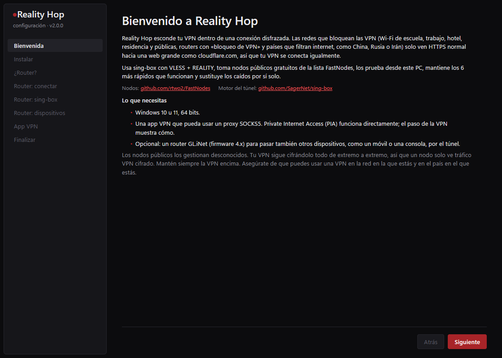
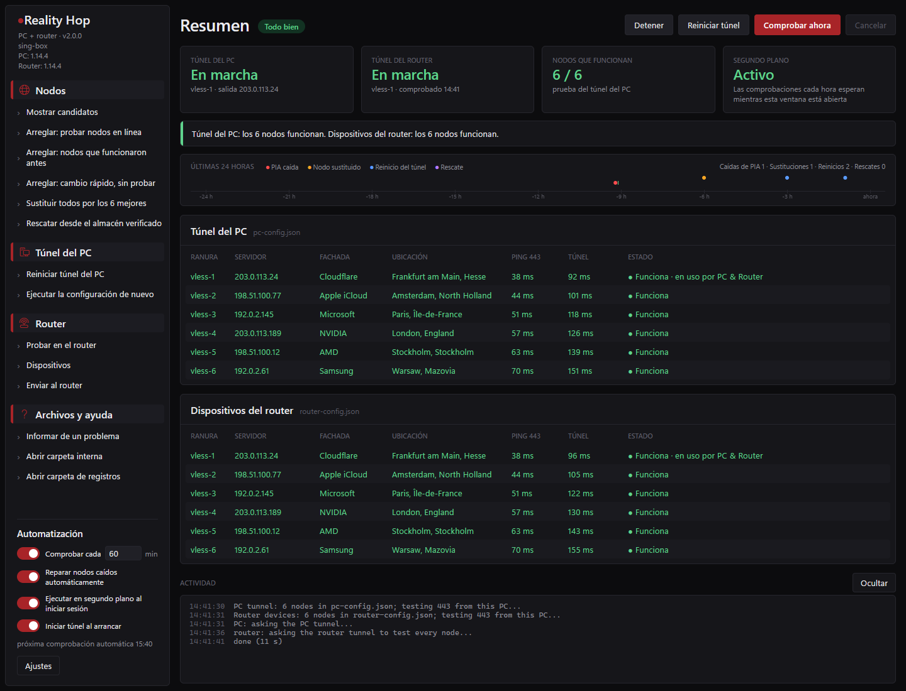
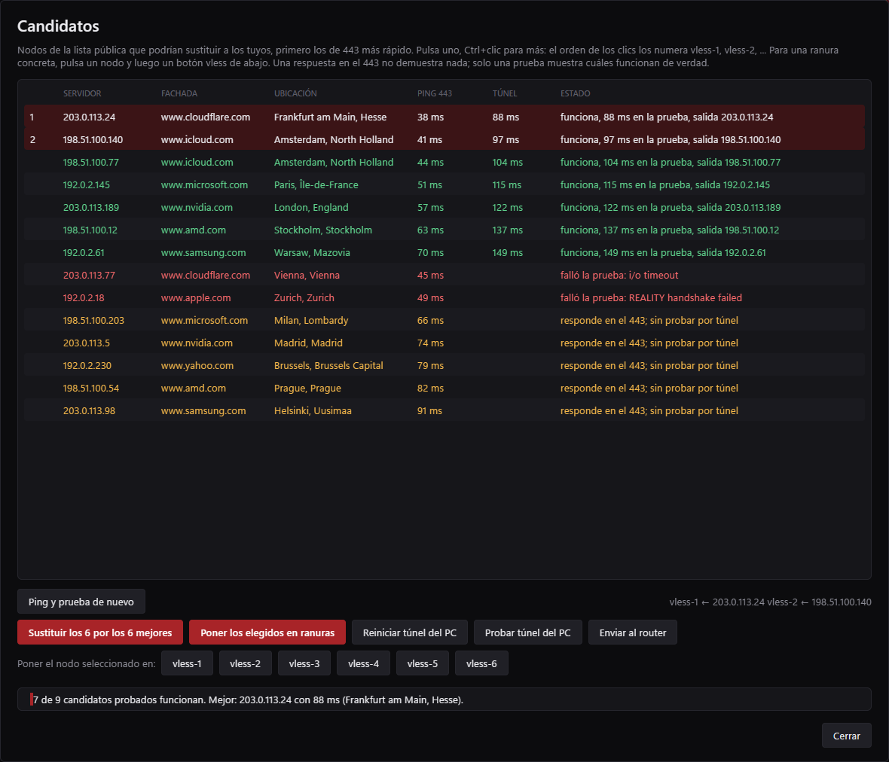
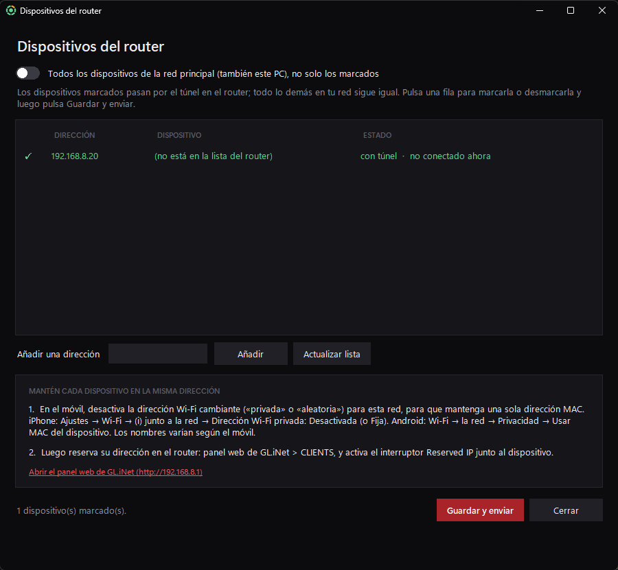
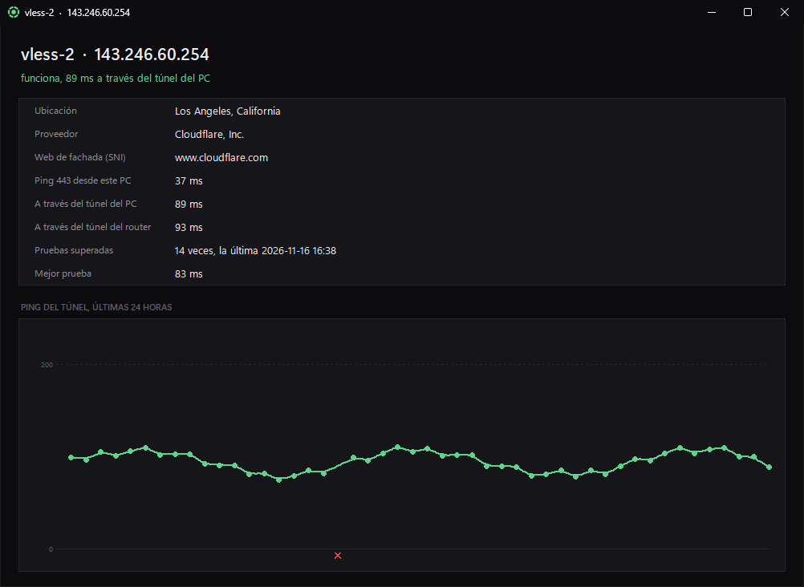
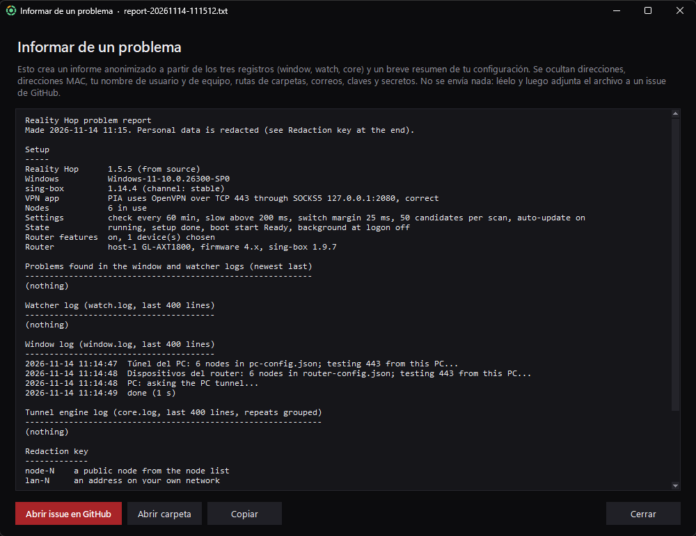
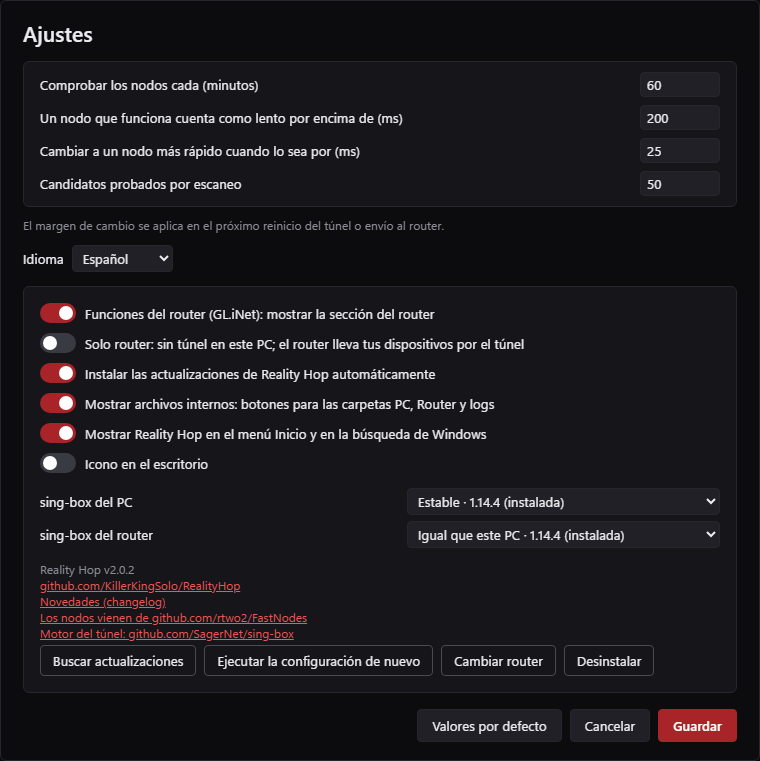

# Reality Hop (Español)

<p align="center">
  <a href="https://github.com/KillerKingSolo/RealityHop/stargazers"></a>
  <a href="https://github.com/KillerKingSolo/RealityHop/releases"></a>
  <a href="https://github.com/KillerKingSolo/RealityHop/releases/latest"></a>
  <a href="../../LICENSE"></a>
  <br>
  <a href="https://github.com/KillerKingSolo/RealityHop/releases/latest"></a>
  <a href="#instalar"></a>
</p>

<p align="center">
  <a href="../../README.md">English</a> · <b>Español</b> · <a href="README.zh.md">简体中文</a> ·
  <a href="README.ru.md">Русский</a> · <a href="README.uk.md">Українська</a> ·
  <a href="README.fa.md">فارسی</a> · <a href="README.ar.md">العربية</a> ·
  <a href="README.tr.md">Türkçe</a> · <a href="README.vi.md">Tiếng Việt</a>
</p>

> Traducción automática del README en inglés. Si algo no está claro, la versión en inglés es la referencia. Las correcciones son bienvenidas en un issue de GitHub.

**Haz que tu VPN funcione en redes que bloquean las VPN.** Reality Hop envuelve la conexión de tu VPN en un túnel
VLESS + REALITY ([sing-box](https://github.com/SagerNet/sing-box)). Para la red parece HTTPS normal hacia una web
grande, como cloudflare.com. Está hecho para redes que bloquean las VPN:

- Wi-Fi de escuela, trabajo, hotel y residencia
- Wi-Fi pública en aeropuertos, cafeterías, trenes y bibliotecas
- routers con «bloqueo de VPN» y proveedores de internet que frenan o bloquean el tráfico VPN
- países que filtran internet, como la Gran Muralla de China, Rusia, Irán, Turkmenistán y los EAU

Toma nodos públicos gratuitos de [rtwo2/FastNodes](https://github.com/rtwo2/FastNodes), los prueba él mismo, usa los
más rápidos que funcionan y sustituye los caídos por sí solo.

**Novedades:** [CHANGELOG.md](../../CHANGELOG.md) (la versión más nueva primero) · **Descarga:** [última versión](https://github.com/KillerKingSolo/RealityHop/releases/latest)



<picture>
  <source media="(prefers-color-scheme: dark)" srcset="../images/flow-dark.png">
  
</picture>

La red intermedia solo ve una conexión cifrada normal hacia una web grande. El cifrado propio de tu VPN sigue dentro
durante todo el camino.

## Capturas de pantalla

<table>
<tr><td colspan="2"><br><b>Ventana principal:</b> cada nodo probado a través del túnel activo, las últimas 24 horas, el túnel del router.</td></tr>
<tr><td width="50%" valign="top"><br><b>Candidatos:</b> nodos de la lista pública, con ping y probados en tu PC; pon cualquiera en una ranura.</td><td width="50%" valign="top"><br><b>Dispositivos del router:</b> elige qué dispositivos usan el túnel del router y cómo mantener fija su dirección.</td></tr>
<tr><td width="50%" valign="top"><br><b>Detalles del nodo:</b> dónde está un nodo, cómo responde a las pruebas, su ping en 24 horas.</td><td width="50%" valign="top"><br><b>Informar de un problema:</b> los registros con todo lo personal ocultado, listos para un issue de GitHub.</td></tr>
<tr><td colspan="2" align="center"><br><b>Ajustes:</b> comprobaciones, funciones del router, actualizaciones, el canal de sing-box, accesos directos.</td></tr>
</table>

## Funciones

- **Un exe, configuración guiada.** Descarga `RealityHop.exe`, ejecútalo y el asistente hace el resto: instalación,
  sing-box, los primeros nodos, tu app VPN, inicio con el sistema.
- **Encuentra y prueba nodos por ti.** Descarga la lista pública de nodos, hace un handshake REALITY real y una
  descarga HTTPS a través de cada candidato, y se queda con los 6 más rápidos que funcionan.
- **Se repara solo.** Un vigilante en segundo plano con icono en la bandeja comprueba los nodos cada hora. Sustituye
  un nodo caído y rescata desde una reserva de nodos buenos conocidos cuando todos fallan. Con PIA, reacciona en cuanto
  la VPN se cae.
- **El icono de la bandeja muestra el estado.** El centro es el estado general. El anillo tiene un segmento por nodo:
  verde funciona, ámbar lento, rojo caído.
- **Menú Inicio y búsqueda de Windows.** Pulsa la tecla Windows y escribe Reality Hop. El icono del escritorio es
  opcional.
- **Soporte opcional para routers GL.iNet,** con una ventana **Dispositivos**: elige qué dispositivos usan el túnel y
  cómo mantener fija su dirección (sin MAC cambiante en el móvil, IP reservada para él en la lista Clients del panel
  de GL.iNet).
- **Router GL.iNet:** pasa también un móvil, una consola o una TV por el túnel, sin instalar nada en ellos.
  Desactívalo y la sección del router desaparece.
- **Solo router.** Sin túnel en el PC: el router lleva por el túnel los dispositivos que elijas, o todos los de su red
  principal, así que todo tu tráfico pasa por el túnel.
- **Muestra la versión de sing-box** en uso (estable o de prueba) bajo el nombre en la ventana.
- **Detener / Iniciar para cuando viajas.** Un botón lo apaga todo, incluido el inicio con el sistema, hasta que
  pulses Iniciar.
- **9 idiomas.** Inglés, español, chino simplificado, ruso, ucraniano, persa, árabe, turco y vietnamita. Elige uno en
  el primer inicio; cámbialo en Ajustes. El registro de actividad y los informes de problemas siguen en inglés.
- **Actualizaciones automáticas.** Reality Hop se actualiza solo desde las versiones de este repositorio (con
  comprobación SHA-256).
- **sing-box se mantiene al día por sí solo**, a diario, en el canal que elijas: **Estable** (por defecto) o
  **Versiones de prueba (beta, alfa)**. No espera a una versión de Reality Hop.
- **Mira lo que funciona por detrás.** Activa *Mostrar archivos internos* para tener botones para las carpetas `PC`,
  `Router` y `logs`: las configuraciones activas de sing-box, los scripts del router y los tres registros.
- **Informes de problemas anónimos.** *Informar de un problema* junta los tres registros con direcciones, nombres,
  claves y secretos sustituidos por marcadores. Primero lo lees tú y luego lo adjuntas a un issue de GitHub. No se
  envía nada automáticamente.
- **Una carpeta para todo.** Se instala en `C:\Program Files\RealityHop`, o en una carpeta que eliges en la
  configuración, con un aviso de UAC. El programa, el motor del túnel, las configuraciones y los registros se quedan
  ahí, legibles solo por tu usuario de Windows. Las actualizaciones se instalan ahí sin volver a preguntar. El programa
  nunca se ejecuta como administrador. Sin telemetría.

## Instalar

1. Descarga **`RealityHop.exe`** de la [última versión](https://github.com/KillerKingSolo/RealityHop/releases/latest).
2. Ejecútalo. Windows SmartScreen puede avisar porque el exe no está firmado: haz clic en **More info → Run anyway**
  (Más información → Ejecutar de todas formas). Algunos antivirus marcan por error las apps sin firmar; todo el código
  está aquí y puedes [compilarlo tú mismo](../building.md) (en inglés).
3. Sigue el asistente de configuración:
   - **Instalar** copia Reality Hop a `C:\Program Files\RealityHop` (un aviso de UAC), descarga sing-box, encuentra
     los primeros nodos e inicia el túnel. Tarda alrededor de un minuto.
   - **¿Router?** pregunta si también quieres configurar un router GL.iNet. Si respondes que sí, el asistente te guía
     paso a paso ([detalles](../router-setup.md), en inglés). Si respondes que no, Reality Hop solo muestra la parte
     del PC.
   - **App VPN** muestra cómo apuntar tu VPN al túnel ([detalles](../vpn-setup.md), en inglés).
   - **Finalizar** activa el inicio en segundo plano al iniciar sesión, el inicio con el sistema y las
     actualizaciones automáticas.

Requisitos: Windows 10 u 11 (64 bits) con Microsoft Edge WebView2 (incluido en Windows 11 y en Windows 10 actual), y
una app VPN que pueda usar un proxy SOCKS5.

### Mac

1. Descarga **`RealityHop-mac-apple-silicon.dmg`** (M1 o posterior) o **`RealityHop-mac-intel.dmg`** de la
   [última versión](https://github.com/KillerKingSolo/RealityHop/releases/latest).
2. Ábrelo y arrastra **Reality Hop** a **Applications** (Aplicaciones). Ejecútalo desde Aplicaciones, no desde la
   imagen de disco.
3. Abre Reality Hop desde Aplicaciones. La primera vez, macOS lo bloquea porque Apple no lo ha notarizado (eso requiere
   una cuenta de desarrollador de pago). Permítelo una vez:
   1. macOS dice que no puede verificar Reality Hop. Haz clic en **Done** (Listo), no en **Move to Trash** (Trasladar
      a la papelera).
   2. Abre **System Settings → Privacy & Security** (Ajustes del Sistema → Privacidad y seguridad) y baja hasta
      **Security** (Seguridad).
   3. Junto a «Reality Hop» was blocked, haz clic en **Open Anyway** (Abrir de todos modos), otra vez en **Open
      Anyway** e introduce la contraseña de tu Mac.

   Solo lo haces una vez. Las actualizaciones se abren sin volver a preguntar. Clic derecho → **Abrir** ya no funciona
   en macOS 15 y posteriores. Todo el código está aquí y puedes [compilarlo tú mismo](../building.md).
   [Más ayuda](../troubleshooting.md#mac-reality-hop-cannot-be-opened) (en inglés).
4. Sigue el mismo asistente. No hace falta contraseña de administrador: todo queda en `~/Library/Application
   Support/RealityHop`, legible solo por tu usuario, y el vigilante en segundo plano aparece en la barra de menús.
5. PIA en Mac: no hay nada que ajustar en Split Tunnel. Reality Hop se añade a sí mismo (Bypass VPN) y mantiene ahí
   las direcciones de sus nodos, así que el kill switch de PIA puede seguir activo. Usa una sola app de DNS a la vez
   ([detalles](../vpn-setup.md)).

Requisitos: macOS 15 o posterior, Apple silicon o Intel, y una app VPN que pueda usar un proxy SOCKS5. Descarga PIA
para Mac de [su sitio web](https://www.privateinternetaccess.com/download/mac-vpn), no de la Mac App Store: la versión
de la App Store no tiene Multi-Hop ni Split Tunnel, así que no puede conectarse a través de Reality Hop.

## Configurar la app VPN

Reality Hop escucha en **SOCKS5 `127.0.0.1`, puerto `2080`**, sin usuario ni contraseña.

Tu VPN debe usar **OpenVPN sobre TCP, puerto 443**. Un proxy SOCKS5 solo lleva TCP, y 443 es el puerto HTTPS normal.

**Private Internet Access (PIA):**
Settings → Protocols: Protocol **OpenVPN**, Transport **TCP**, Remote Port **443**. Después Settings → Multi-Hop:
marca **Multi-hop and Obfuscation**, elige **SOCKS5 Proxy**, haz clic en **EDIT**, pon host `127.0.0.1` y puerto
`2080`, y guarda. Split Tunnel no necesita nada de ti: Reality Hop añade `rh-core.exe` y su copia de prueba
`rh-test.exe` como **Bypass VPN** por sí solo. Solo si la línea de comandos de PIA se niega, el asistente muestra el
paso manual: en Settings → Split Tunnel, añade `C:\Program Files\RealityHop\PC\rh-core.exe` y ponlo en **Bypass VPN**.


**Otras apps VPN:** cualquier app con ajuste de proxy SOCKS5 funciona igual, con OpenVPN sobre TCP en el puerto 443.
En un archivo de configuración de OpenVPN, usa `proto tcp`, el puerto `443` del servidor y añade
`socks-proxy 127.0.0.1 2080`. Ver [docs/vpn-setup.md](../vpn-setup.md) (en inglés).

## Controles

| Dónde | Qué |
|---|---|
| Icono de la bandeja | Doble clic abre la ventana. Clic derecho: Reiniciar túnel, Comprobar ahora, Rescate, Salir. |
| **Comprobar ahora** | Prueba cada nodo a través del túnel activo. |
| **Reiniciar túnel** | Reinicia el túnel con los nodos actuales (unos 2 segundos). |
| **Detener / Iniciar** | Lo apaga todo, incluido el inicio con el sistema, para cuando no estás. Desactiva el proxy de la app VPN mientras esté detenido. |
| Nodos → **Mostrar candidatos** | Lista nodos de la lista pública; pruébalos y pon cualquiera en una ranura, y luego reinicia y prueba el túnel del PC desde la misma ventana. |
| Nodos → **Rescate** | Úsalo cuando todos los nodos están caídos. Prueba la reserva de nodos buenos conocidos y pone los 6 mejores. |
| Ayuda → **Informar de un problema** | Crea un informe anonimizado de los registros y abre un issue de GitHub para que lo adjuntes. |
| Archivos (opcional) | **Abrir carpeta interna** (`PC`, `Router`, `logs`, `anonymous-logs`) y **Abrir carpeta de registros**. |
| **Ajustes** | Intervalo de comprobación, umbral de lentitud, margen de cambio, funciones del router sí/no, sing-box estable o de prueba (PC y router), mostrar archivos internos, actualizaciones, ejecutar la configuración de nuevo, desinstalar. |

**Desinstalar:** Panel de control → Programas → Desinstalar un programa → Reality Hop. Configuración de Windows →
Aplicaciones → Aplicaciones instaladas → Reality Hop y Ajustes → Desinstalar dentro de Reality Hop hacen lo mismo.

## De dónde vienen los nodos

- **Lista de nodos:** [rtwo2/FastNodes](https://github.com/rtwo2/FastNodes), archivo
  [`sub/verified_tls.txt`](https://raw.githubusercontent.com/rtwo2/FastNodes/main/sub/verified_tls.txt). Reality Hop
  solo conserva nodos VLESS + REALITY + XTLS-Vision en el puerto 443 que usan un sitio de fachada conocido. Luego los
  prueba él mismo; no se fía de la verificación de la lista.
- **Motor del túnel:** [SagerNet/sing-box](https://github.com/SagerNet/sing-box), descargado de sus versiones oficiales
  en GitHub. Estable es la versión completa más nueva; las versiones de prueba son las más nuevas de todas, alfa y beta
  incluidas. Se comprueba la suma SHA-256, y la nueva versión debe aceptar la configuración antes de sustituir a la
  anterior. En tu PC se ejecuta como `rh-core.exe`.
- **Motor del router:** la versión propia de sing-box de Reality Hop para routers arm64, hecha desde el código oficial
  sin todo lo que el router no usa (18 MB en vez de 27 MB del paquete 1.9.7 de GL.iNet). Sigue el canal del PC salvo
  que Ajustes le dé al router uno propio. Reality Hop pregunta antes de actualizar el router, guarda la versión anterior
  en la RAM del router y la restaura si la nueva no arranca. La página Plug-ins del router sigue mostrando el paquete
  1.9.7 de GL.iNet; la barra lateral muestra la versión que realmente funciona. Cómo se compila y se comprueba:
  [`router-core/`](../../router-core/README.md) (en inglés).
- **Protocolo:** VLESS con REALITY y XTLS-Vision, de [XTLS](https://github.com/XTLS).

## Privacidad y seguridad

- **Los nodos públicos los gestionan desconocidos.** Tu VPN sigue cifrándolo todo de extremo a extremo, así que un
  nodo solo ve tráfico VPN cifrado y su destino, el servidor VPN. Mantén siempre la VPN encima. No envíes tráfico
  privado por Reality Hop sin una VPN.
- **Con qué se conecta Reality Hop:**
  - GitHub, para la lista de nodos, las versiones de sing-box, las versiones del router y las de Reality Hop.
  - `api.ipify.org`, consultado a través de cada nodo al probarlo.
  - `www.gstatic.com/generate_204`, la prueba de latencia a través del túnel.
  - `ip-api.com`, para la ubicación de los nodos, consultado a través del túnel.
  - DNS de Quad9 (`9.9.9.9`), a través del túnel.

  No se envía nada sobre ti a ningún sitio y no hay telemetría.
- **Qué guarda:** configuraciones, la reserva de nodos, registros y ajustes en su carpeta de instalación (carpetas
  `PC`, `Router`, `logs`, `anonymous-logs`), que solo tu usuario de Windows puede abrir. La clave del router es una
  clave SSH creada en tu PC. La contraseña de tu router se escribe en el `ssh` propio de Windows y Reality Hop nunca la
  ve ni la guarda.
- Asegúrate de que puedes usar una VPN en la red en la que estás y en el país en el que estás. Algunos países
  restringen o prohíben las VPN; Reality Hop no cambia la ley donde estás.

Para problemas de seguridad, ver [SECURITY.md](../../SECURITY.md). Para todo lo demás, usa **Informar de un problema**
en la ventana y adjunta el informe anónimo a un issue. Nunca adjuntes `pc-config.json`, `router-config.json` ni
`vault.json`.

## Historial de estrellas

**Si Reality Hop te ayuda, dale una estrella.** Es gratis y es un clic. Las estrellas me muestran que la gente lo usa,
ayudan a otros a encontrarlo y me motivan a corregir problemas y añadir funciones nuevas.

<a href="https://www.star-history.com/#KillerKingSolo/RealityHop&Date">
 <picture>
   <source media="(prefers-color-scheme: dark)" srcset="https://api.star-history.com/svg?repos=KillerKingSolo/RealityHop&type=Date&theme=dark" />
   <source media="(prefers-color-scheme: light)" srcset="https://api.star-history.com/svg?repos=KillerKingSolo/RealityHop&type=Date" />
   
 </picture>
</a>

## Documentación

Las guías están en inglés:

- [Cómo funciona](../how-it-works.md)
- [Configurar un router GL.iNet](../router-setup.md)
- [Configurar la app VPN](../vpn-setup.md)
- [Solución de problemas](../troubleshooting.md)
- [Compilar desde el código y publicar](../building.md)

## Ejecutar desde el código

Reality Hop está escrito en Rust con [Tauri](https://github.com/tauri-apps/tauri). Con
[Rust](https://rustup.rs) instalado:

```
cd rust
cargo run -p realityhop-app
```

Detalles, la compilación para Mac y los pasos de publicación: [docs/building.md](../building.md).

## Licencia

[CC BY-NC-ND 4.0](../../LICENSE) (Creative Commons Atribución-NoComercial-SinDerivadas 4.0). En resumen:

- **Compártelo sin cambios y con crédito:** Reality Hop de KillerKingSolo, sing-box de SagerNet y FastNodes de rtwo2,
  con sus enlaces (ver [LICENSE](../../LICENSE)).
- **Sin versiones modificadas:** no puedes compartir una copia editada.
- **Sin uso comercial:** no puedes venderlo ni usarlo con fines de lucro.

Cualquier otra cosa requiere permiso. sing-box (GPL-3.0-or-later) y FastNodes (MIT) son proyectos aparte con sus
propias licencias; Reality Hop los descarga al ejecutarse y no los incluye.
