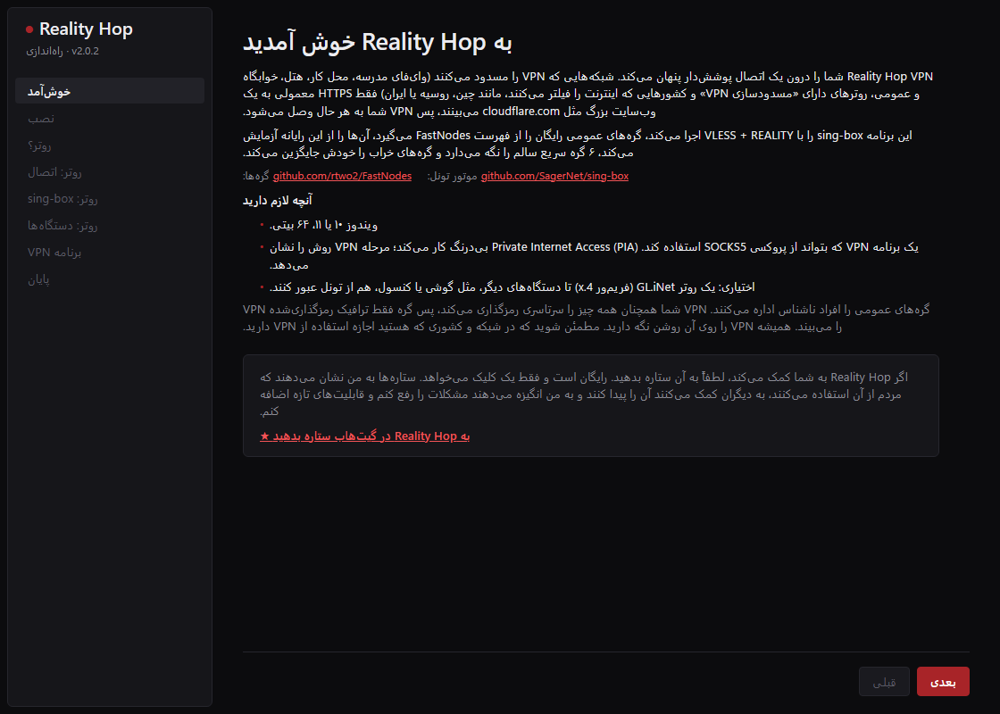
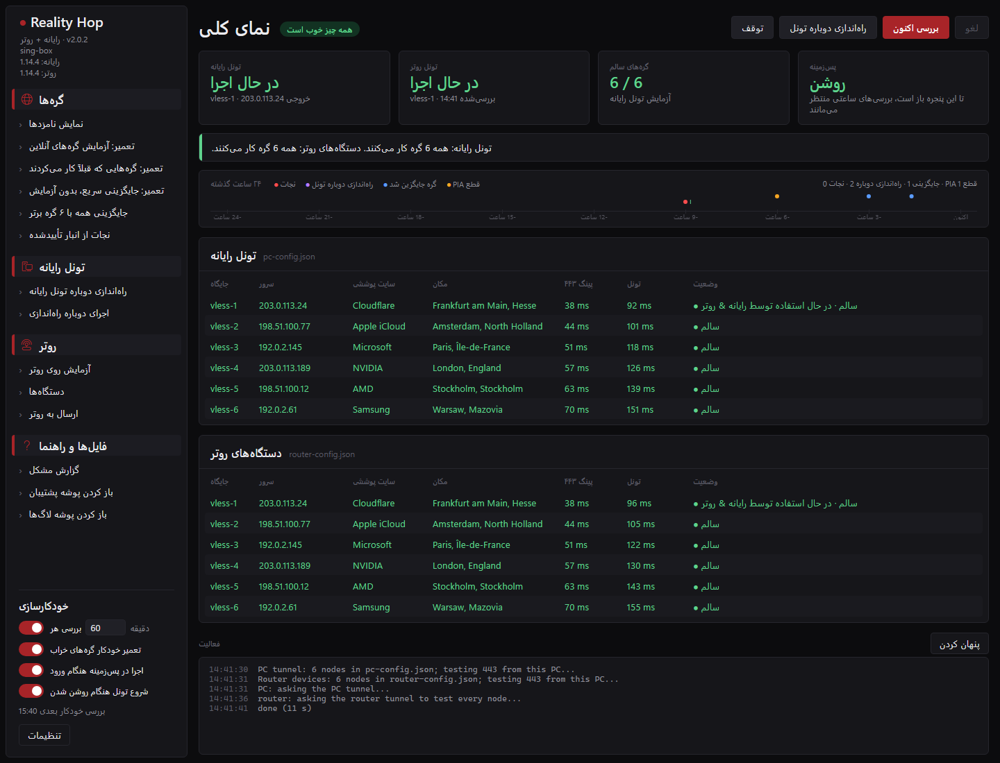
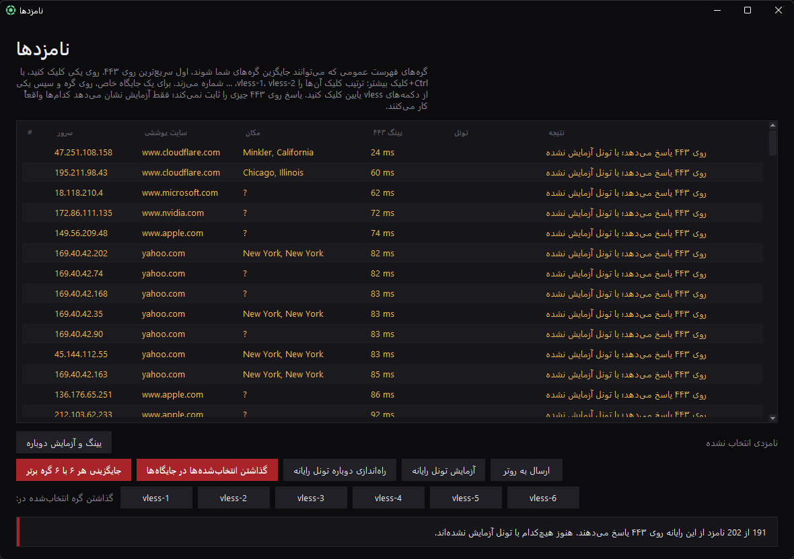
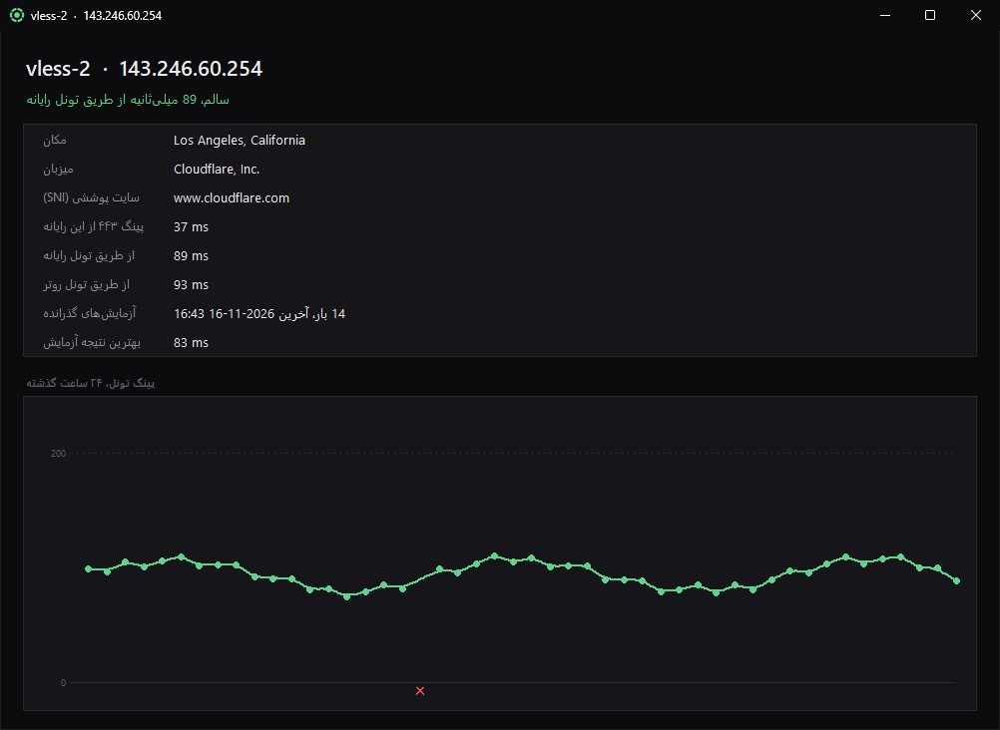
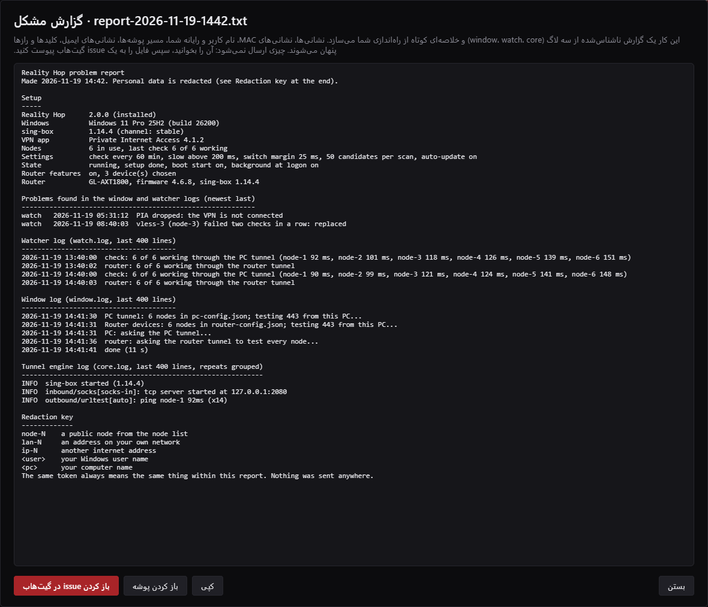

# Reality Hop (فارسی)

  
  
  
  
   
  
  

  <a href="../../README.md">English</a> · <a href="README.es.md">Español</a> · <a href="README.zh.md">简体中文</a> ·
  <a href="README.ru.md">Русский</a> · <a href="README.uk.md">Українська</a> ·
  <b>فارسی</b> · <a href="README.ar.md">العربية</a> ·
  <a href="README.tr.md">Türkçe</a> · <a href="README.vi.md">Tiếng Việt</a>

> این متن ترجمه ماشینی README انگلیسی است. اگر چیزی روشن نیست، نسخه انگلیسی مرجع است. اصلاحات را در یک issue گیت‌هاب بفرستید.

**VPN خود را از شبکه‌هایی که VPN را مسدود می‌کنند عبور دهید.** Reality Hop اتصال VPN شما را درون یک تونل VLESS + REALITY ([sing-box](https://github.com/SagerNet/sing-box)) می‌پیچد. برای شبکه، این مثل HTTPS معمولی به یک وب‌سایت بزرگ مانند cloudflare.com دیده می‌شود. برای این موارد ساخته شده:

- وای‌فای مدرسه، محل کار، هتل و خوابگاه
- وای‌فای عمومی در فرودگاه، کافه، قطار و کتابخانه
- روترهای دارای «مسدودسازی VPN» و اینترنت‌دهنده‌هایی که ترافیک VPN را کند یا مسدود می‌کنند
- کشورهایی که اینترنت را فیلتر می‌کنند، مانند دیوار آتش بزرگ چین، روسیه، ایران، ترکمنستان و امارات

گره‌های عمومی رایگان را از [rtwo2/FastNodes](https://github.com/rtwo2/FastNodes) می‌گیرد، خودش آن‌ها را آزمایش می‌کند، از سریع‌ترین گره‌های سالم استفاده می‌کند و گره‌های خراب را خودش جایگزین می‌کند.

## چگونه کار می‌کند

برنامه VPN ← Reality Hop روی رایانه شما (SOCKS5 `127.0.0.1:2080`) ← گره عمومی REALITY (شبیه HTTPS به cloudflare.com) ← سرور VPN ← اینترنت. رمزگذاری خود VPN در تمام مسیر درون آن باقی می‌ماند.

## تصاویر

<table>
<tr><td colspan="2"> <b>پنجره اصلی:</b> هر گره از طریق تونل فعال آزمایش می‌شود، ۲۴ ساعت گذشته، تونل روتر.</td></tr>
<tr><td width="50%" valign="top"> <b>نامزدها:</b> گره‌های فهرست عمومی که روی رایانه شما پینگ و آزمایش شده‌اند؛ هر کدام را در یک جایگاه بگذارید.</td><td width="50%" valign="top"> <b>دستگاه‌های روتر:</b> انتخاب کنید کدام دستگاه‌ها از تونل روتر استفاده کنند و چطور نشانی آن‌ها ثابت بماند.</td></tr>
<tr><td width="50%" valign="top"> <b>جزئیات گره:</b> محل گره، نتیجه آزمایش‌ها و پینگ آن در ۲۴ ساعت.</td><td width="50%" valign="top"> <b>گزارش مشکل:</b> گزارش‌ها با حذف همه اطلاعات شخصی، آماده برای یک issue در GitHub.</td></tr>
<tr><td colspan="2" align="center"> <b>تنظیمات:</b> بررسی‌ها، امکانات روتر، به‌روزرسانی‌ها، کانال sing-box، میان‌برها.</td></tr>
</table>

## نصب

1. `RealityHop.exe` را از [آخرین نسخه](https://github.com/KillerKingSolo/RealityHop/releases/latest) دانلود کنید. ویندوز ۱۰ یا ۱۱، ۶۴ بیتی لازم است. در Mac: `RealityHop-mac-apple-silicon.dmg` (M1 و جدیدتر) یا `RealityHop-mac-intel.dmg`. macOS 15 یا جدیدتر لازم است. PIA برای Mac را از [وب‌سایت خودش](https://www.privateinternetaccess.com/download/mac-vpn) بگیرید، نه از Mac App Store: نسخهٔ App Store گزینه‌های Multi-Hop و Split Tunnel را ندارد.
2. آن را اجرا کنید و زبان خود را انتخاب کنید.
3. دستیار، Reality Hop را نصب می‌کند (یک درخواست UAC)، sing-box را از نسخه‌های رسمی دانلود می‌کند (چکیده SHA-256 را بررسی می‌کند)، اولین گره‌ها را پیدا می‌کند و تونل را شروع می‌کند. حدود یک دقیقه.

## زبان

Reality Hop در اولین اجرا زبان را می‌پرسد. بعداً آن را در **تنظیمات ← زبان** تغییر دهید. گزارش فعالیت و گزارش‌های مشکل به انگلیسی می‌مانند تا پشتیبانی بتواند آن‌ها را بخواند.

## تنظیم برنامه VPN

برنامه VPN را به پروکسی SOCKS5 با نشانی `127.0.0.1`، درگاه `2080`، بدون نام کاربری و رمز وصل کنید. از **OpenVPN روی TCP، درگاه ۴۴۳** استفاده کنید: پروکسی SOCKS5 فقط TCP را حمل می‌کند.

**Private Internet Access (PIA):**

1. PIA ← **Settings → Protocols**: گزینه Protocol روی **OpenVPN**، Transport روی **TCP**، Remote Port روی **443**.
2. **Settings → Multi-Hop**: گزینه **Multi-hop and Obfuscation** را علامت بزنید و **SOCKS5 Proxy** را انتخاب کنید.
3. روی **EDIT** کلیک کنید، میزبان `127.0.0.1`، درگاه `2080`، نام کاربری و رمز خالی، و ذخیره کنید.
4. Reality Hop این قانون را خودش اضافه می‌کند؛ راهنمای نصب این مرحله را فقط وقتی نشان می‌دهد که این کار ناموفق باشد. فقط اگر در Split Tunnel گزینه **All Other Apps** روی **Use VPN** است: **Settings → Split Tunnel**، **Add Application**، فایل `C:\Program Files\RealityHop\PC\rh-core.exe` را انتخاب کنید و روی **Bypass VPN** بگذارید. اگر All Other Apps روی Bypass VPN است، این قانون لازم نیست.
5. وصل شوید.

**دیگر برنامه‌های VPN:** هر برنامه‌ای که تنظیم پروکسی SOCKS5 دارد همین‌طور کار می‌کند. در فایل OpenVPN: `proto tcp`، سرور روی درگاه ۴۴۳ و خط `socks-proxy 127.0.0.1 2080`. جزئیات به انگلیسی: [VPN app setup](../vpn-setup.md).

## روتر GL.iNet (اختیاری)

با روتر GL.iNet (فریم‌ور 4.x)، دستگاه‌هایی که انتخاب می‌کنید (گوشی، کنسول، تلویزیون) هم از تونل عبور می‌کنند، بدون نصب چیزی روی آن‌ها. حالت **فقط روتر** روی رایانه چیزی اجرا نمی‌کند: روتر دستگاه‌های انتخاب‌شده یا کل شبکه را از تونل عبور می‌دهد. راهنمای انگلیسی: [router setup](../router-setup.md).

## استفاده روزانه

- **نماد سینی:** مرکز آن وضعیت کلی است؛ حلقه برای هر گره یک بخش دارد (سبز سالم، کهربایی کند، قرمز خراب).
- **بررسی اکنون**، **راه‌اندازی دوباره تونل**، **نمایش نامزدها** (آزمایش گره‌ها و گذاشتن در جایگاه‌ها)، و **نجات** وقتی همه گره‌ها خراب‌اند.
- **توقف / شروع** برای سفر. هنگام توقف، پروکسی برنامه VPN را خاموش کنید.
- Reality Hop خودش از نسخه‌های گیت‌هاب به‌روز می‌شود (با بررسی SHA-256).

## حریم خصوصی و امنیت

- **گره‌های عمومی را افراد ناشناس اداره می‌کنند.** VPN شما همچنان همه چیز را سرتاسری رمزگذاری می‌کند، پس گره فقط ترافیک رمزگذاری‌شده VPN را می‌بیند. همیشه VPN را روشن نگه دارید.
- Reality Hop با گیت‌هاب (فهرست گره‌ها، sing-box، نسخه‌های Reality Hop) و از طریق تونل با `api.ipify.org`، `www.gstatic.com/generate_204`، `ip-api.com` و DNS سرویس Quad9 تماس می‌گیرد. هیچ چیزی درباره شما فرستاده نمی‌شود و تله‌متری ندارد.
- مطمئن شوید که در شبکه و کشوری که هستید اجازه استفاده از VPN دارید. Reality Hop قانون محل شما را تغییر نمی‌دهد.

## مشکلات

در پنجره از **گزارش مشکل** استفاده کنید: یک گزارش ناشناس‌شده برای پیوست به issue گیت‌هاب می‌سازد. هرگز `pc-config.json`، `router-config.json` یا `vault.json` را پیوست نکنید. راهنمای انگلیسی: [troubleshooting](../troubleshooting.md).

## مجوز

[CC BY-NC-ND 4.0](../../LICENSE): بدون تغییر و با ذکر منبع به اشتراک بگذارید، نسخه تغییریافته منتشر نکنید و استفاده تجاری نکنید.

