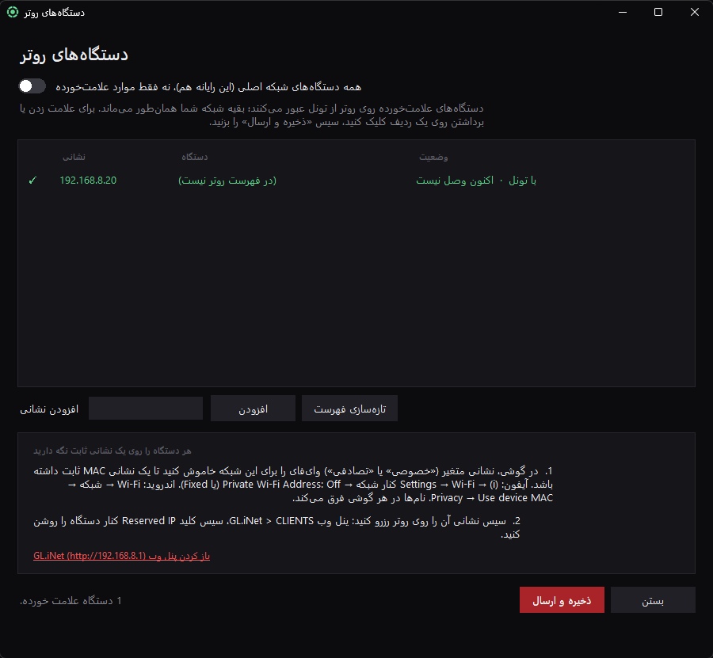
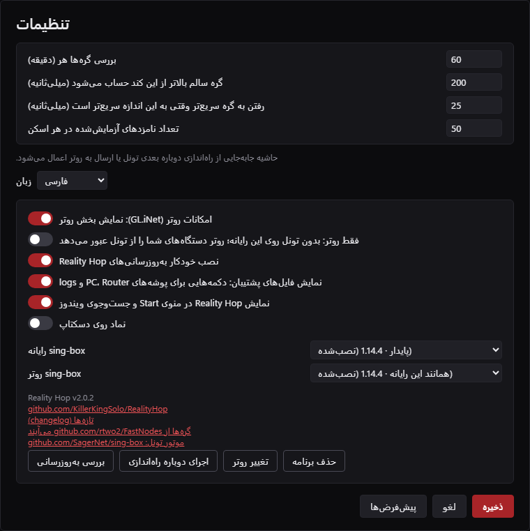

# Reality Hop (فارسی)

<p align="center">
  <a href="https://github.com/KillerKingSolo/RealityHop/stargazers"></a>
  <a href="https://github.com/KillerKingSolo/RealityHop/releases"></a>
  <a href="https://github.com/KillerKingSolo/RealityHop/releases/latest"></a>
  <a href="../../LICENSE"></a>
  <br>
  <a href="https://github.com/KillerKingSolo/RealityHop/releases/latest"></a>
  <a href="#نصب"></a>
</p>

<p align="center">
  <a href="../../README.md">English</a> · <a href="README.es.md">Español</a> · <a href="README.zh.md">简体中文</a> ·
  <a href="README.ru.md">Русский</a> · <a href="README.uk.md">Українська</a> ·
  <b>فارسی</b> · <a href="README.ar.md">العربية</a> ·
  <a href="README.tr.md">Türkçe</a> · <a href="README.vi.md">Tiếng Việt</a>
</p>

<div dir="rtl">

> این متن ترجمه ماشینی README انگلیسی است. اگر چیزی روشن نیست، نسخه انگلیسی مرجع است. اصلاحات را در یک issue گیت‌هاب بفرستید.

**VPN خود را از شبکه‌هایی که VPN را مسدود می‌کنند عبور دهید.** Reality Hop اتصال VPN شما را درون یک تونل
VLESS + REALITY ([sing-box](https://github.com/SagerNet/sing-box)) می‌پیچد. برای شبکه، این مثل HTTPS معمولی به یک
وب‌سایت بزرگ مانند cloudflare.com دیده می‌شود. برای شبکه‌هایی ساخته شده که VPN را مسدود می‌کنند:

- Wi-Fi مدرسه، محل کار، هتل و خوابگاه
- Wi-Fi عمومی در فرودگاه‌ها، کافه‌ها، قطارها و کتابخانه‌ها
- روترهایی با «مسدودسازی VPN» و ارائه‌دهندگان اینترنتی که ترافیک VPN را کند یا مسدود می‌کنند
- کشورهایی که اینترنت را فیلتر می‌کنند، مانند دیوار آتش بزرگ چین، روسیه، ایران، ترکمنستان و امارات

گره‌های عمومی رایگان را از [morpheusadam/v2ray-config](https://github.com/morpheusadam/v2ray-config) و [rtwo2/FastNodes](https://github.com/rtwo2/FastNodes) می‌گیرد، خودش آن‌ها را آزمایش
می‌کند، سریع‌ترین گره‌های سالم را به کار می‌برد و گره‌های از کار افتاده را خودش جایگزین می‌کند.

**تازه‌ها:** [CHANGELOG.md](../../CHANGELOG.md) (جدیدترین نسخه اول) · **دانلود:** [آخرین نسخه](https://github.com/KillerKingSolo/RealityHop/releases/latest)


<picture>
  <source media="(prefers-color-scheme: dark)" srcset="../images/flow-dark.png">
  
</picture>

شبکه میانی فقط یک اتصال رمزگذاری‌شده معمولی به یک وب‌سایت بزرگ می‌بیند. رمزگذاری خود VPN شما در تمام مسیر درون آن
می‌ماند.

## تصاویر

<table>
<tr><td colspan="2"><br><b>پنجره اصلی:</b> هر گره از طریق تونل فعال آزمایش می‌شود، ۲۴ ساعت گذشته، تونل روتر.</td></tr>
<tr><td width="50%" valign="top"><br><b>نامزدها:</b> گره‌های فهرست عمومی، پینگ و آزمایش‌شده روی رایانه شما؛ هر کدام را در یک جایگاه بگذارید.</td><td width="50%" valign="top"><br><b>دستگاه‌های روتر:</b> انتخاب کنید کدام دستگاه‌ها از تونل روتر استفاده کنند و چگونه نشانی آن‌ها ثابت بماند.</td></tr>
<tr><td width="50%" valign="top"><br><b>جزئیات گره:</b> گره کجاست، در آزمایش‌ها چگونه است، پینگ آن در ۲۴ ساعت.</td><td width="50%" valign="top"><br><b>گزارش مشکل:</b> لاگ‌ها با پنهان شدن هر چیز شخصی، آماده برای یک issue در گیت‌هاب.</td></tr>
<tr><td colspan="2" align="center"><br><b>تنظیمات:</b> بررسی‌ها، قابلیت‌های روتر، به‌روزرسانی‌ها، کانال sing-box، میان‌برها.</td></tr>
</table>

## قابلیت‌ها

- **یک فایل exe، راه‌اندازی با راهنما.** `RealityHop.exe` را دانلود و اجرا کنید؛ راهنما بقیه کار را انجام می‌دهد:
  نصب، sing-box، نخستین گره‌ها، برنامه VPN شما، اجرا هنگام روشن شدن رایانه.
- **گره‌ها را برایتان پیدا و آزمایش می‌کند.** فهرست عمومی گره‌ها را دانلود می‌کند، از طریق هر نامزد یک دست‌دهی واقعی
  REALITY و یک دریافت HTTPS انجام می‌دهد و ۶ گره سریع‌ترِ سالم را نگه می‌دارد.
- **خودش را تعمیر می‌کند.** یک ناظر پس‌زمینه با نماد در سینی سیستم، هر ساعت گره‌ها را بررسی می‌کند. گره از کار
  افتاده را جایگزین می‌کند و وقتی همه از کار افتاده‌اند، از گنجینه‌ای از گره‌های سالمِ شناخته‌شده نجات می‌دهد. با
  PIA، همان لحظه که VPN قطع شود واکنش نشان می‌دهد.
- **نماد سینی وضعیت را نشان می‌دهد.** مرکز وضعیت کلی است. حلقه برای هر گره یک بخش دارد: سبز سالم، کهربایی کند،
  قرمز از کار افتاده.
- **منوی Start و جست‌وجوی ویندوز.** کلید ویندوز را بزنید و Reality Hop را تایپ کنید. نماد روی دسکتاپ اختیاری است.
- **پشتیبانی اختیاری از روتر GL.iNet** با پنجره **دستگاه‌ها**: انتخاب کنید کدام دستگاه‌ها از تونل استفاده کنند و
  چگونه نشانی آن‌ها ثابت بماند (بدون MAC متغیر روی گوشی، Reserved IP برای آن در فهرست Clients پنل GL.iNet).
- **روتر GL.iNet:** گوشی، کنسول یا تلویزیون را هم بدون نصب چیزی روی آن‌ها از تونل عبور دهید. آن را خاموش کنید و
  بخش روتر ناپدید می‌شود.
- **فقط روتر.** بدون تونل روی رایانه: روتر دستگاه‌هایی را که انتخاب می‌کنید، یا همه دستگاه‌های شبکه اصلی‌اش را، از
  تونل عبور می‌دهد تا همه ترافیک شما از تونل بگذرد.
- **نسخه sing-box در حال استفاده را نشان می‌دهد** (پایدار یا آزمایشی)، زیر نام در پنجره.
- **توقف / شروع برای وقتی در سفرید.** یک دکمه همه‌چیز، از جمله اجرا هنگام روشن شدن رایانه، را خاموش می‌کند تا وقتی
  شروع را بزنید.
- **۹ زبان.** انگلیسی، اسپانیایی، چینی ساده‌شده، روسی، اوکراینی، فارسی، عربی، ترکی و ویتنامی. در نخستین اجرا یکی را
  انتخاب کنید؛ در تنظیمات تغییرش دهید. گزارش فعالیت و گزارش‌های مشکل به انگلیسی می‌مانند.
- **به‌روزرسانی خودکار.** Reality Hop خودش را از Releases این مخزن به‌روز می‌کند (با بررسی SHA-256).
- **sing-box خودش را به‌روز نگه می‌دارد**، روزانه، روی کانالی که انتخاب می‌کنید: **پایدار** (پیش‌فرض) یا
  **نسخه‌های آزمایشی (بتا، آلفا)**. منتظر نسخه جدید Reality Hop نمی‌ماند.
- **ببینید پشت صحنه چه اجرا می‌شود.** *نمایش فایل‌های پشتیبان* را روشن کنید تا دکمه‌هایی برای پوشه‌های `PC`،
  `Router` و `logs` داشته باشید: پیکربندی‌های فعال sing-box، اسکریپت‌های روتر و سه لاگ.
- **گزارش‌های ناشناس مشکل.** *گزارش مشکل* سه لاگ را با جایگزینی نشانی‌ها، نام‌ها، کلیدها و رمزها با نشانه جمع می‌کند.
  اول خودتان آن را می‌خوانید، سپس به یک issue گیت‌هاب پیوست می‌کنید. هیچ چیزی خودکار فرستاده نمی‌شود.
- **یک پوشه برای همه‌چیز.** با یک درخواست UAC در `C:\Program Files\RealityHop` یا پوشه‌ای که در راه‌اندازی انتخاب
  می‌کنید نصب می‌شود. برنامه، موتور تونل، پیکربندی‌ها و لاگ‌ها همه همان‌جا می‌مانند و فقط کاربر ویندوز شما می‌تواند
  آن‌ها را بخواند. به‌روزرسانی‌ها بدون پرسش دوباره همان‌جا نصب می‌شوند. برنامه هرگز با دسترسی مدیر اجرا نمی‌شود. بدون
  تله‌متری.

## نصب

1. **`RealityHop.exe`** را از [آخرین نسخه](https://github.com/KillerKingSolo/RealityHop/releases/latest) دانلود کنید.
2. آن را اجرا کنید. ممکن است Windows SmartScreen هشدار دهد چون exe امضای کد ندارد: روی **More info → Run anyway**
   (اطلاعات بیشتر → در هر صورت اجرا شود) کلیک کنید. برخی آنتی‌ویروس‌ها برنامه‌های بدون امضا را به اشتباه علامت
   می‌زنند؛ همه کد منبع اینجاست و می‌توانید [خودتان آن را بسازید](../building.md) (انگلیسی).
3. راهنمای راه‌اندازی را دنبال کنید:
   - **نصب** Reality Hop را در `C:\Program Files\RealityHop` کپی می‌کند (یک درخواست UAC)، sing-box را دانلود
     می‌کند، نخستین گره‌ها را پیدا می‌کند و تونل را شروع می‌کند. حدود یک دقیقه طول می‌کشد.
   - **روتر؟** می‌پرسد آیا روتر GL.iNet را هم می‌خواهید راه‌اندازی کنید. اگر بله بگویید، راهنما قدم به قدم شما را
     همراهی می‌کند ([جزئیات](../router-setup.md)، انگلیسی). اگر نه بگویید، Reality Hop فقط بخش رایانه را نشان می‌دهد.
   - **برنامه VPN** نشان می‌دهد چگونه VPN خود را به تونل وصل کنید ([جزئیات](../vpn-setup.md)، انگلیسی).
   - **پایان** اجرای پس‌زمینه هنگام ورود، اجرا هنگام روشن شدن رایانه و به‌روزرسانی خودکار را تنظیم می‌کند.

نیازمندی‌ها: ویندوز ۱۰ یا ۱۱ (۶۴ بیتی) با Microsoft Edge WebView2 (بخشی از ویندوز ۱۱ و ویندوز ۱۰ فعلی) و یک برنامه
VPN که بتواند از پراکسی SOCKS5 استفاده کند.

### Mac

1. **`RealityHop-mac-apple-silicon.dmg`** (M1 و جدیدتر) یا **`RealityHop-mac-intel.dmg`** را از
   [آخرین نسخه](https://github.com/KillerKingSolo/RealityHop/releases/latest) دانلود کنید.
2. آن را باز کنید و **Reality Hop** را به **Applications** بکشید. از Applications اجرا کنید، نه از دیسک ایمیج.
3. Reality Hop را از Applications باز کنید. بار اول، macOS آن را مسدود می‌کند، چون برنامه توسط Apple تأیید
   (notarize) نشده است (این کار به حساب توسعه‌دهنده پولی Apple نیاز دارد). یک بار اجازه دهید:
   1. macOS می‌گوید نمی‌تواند Reality Hop را تأیید کند. روی **Done** کلیک کنید، نه **Move to Trash**.
   2. **System Settings → Privacy & Security** را باز کنید و تا **Security** پایین بروید.
   3. کنار «Reality Hop» was blocked روی **Open Anyway** کلیک کنید، سپس دوباره **Open Anyway** را بزنید و رمز Mac
      خود را وارد کنید.

   این کار را فقط یک بار انجام می‌دهید. به‌روزرسانی‌ها بدون پرسش دوباره باز می‌شوند. کلیک راست → **Open** دیگر در
   macOS 15 و جدیدتر کار نمی‌کند. همه کد منبع اینجاست و می‌توانید [خودتان آن را بسازید](../building.md).
   [راهنمای بیشتر](../troubleshooting.md#mac-reality-hop-cannot-be-opened) (انگلیسی).
4. همان راهنمای راه‌اندازی را دنبال کنید. رمز مدیر لازم نیست: همه‌چیز در `~/Library/Application Support/RealityHop`
   می‌ماند و فقط کاربر شما می‌تواند آن را بخواند، و ناظر پس‌زمینه در نوار منو دیده می‌شود.
5. PIA روی Mac: در Split Tunnel چیزی برای تنظیم نیست. Reality Hop خودش را اضافه می‌کند (Bypass VPN) و نشانی گره‌هایش
   را آنجا نگه می‌دارد، پس kill switch در PIA می‌تواند روشن بماند. هر بار فقط یک برنامه DNS اجرا کنید
   ([جزئیات](../vpn-setup.md)).

نیازمندی‌ها: macOS 15 یا جدیدتر، Apple silicon یا Intel، و یک برنامه VPN که بتواند از پراکسی SOCKS5 استفاده کند.
PIA برای Mac را از [وب‌سایت آن](https://www.privateinternetaccess.com/download/mac-vpn) بگیرید، نه از Mac App Store:
نسخه App Store قابلیت Multi-Hop و Split Tunnel ندارد، پس نمی‌تواند از طریق Reality Hop وصل شود.

## تنظیم برنامه VPN

Reality Hop روی **SOCKS5 `127.0.0.1` پورت `2080`** گوش می‌دهد، بدون نام کاربری و رمز.

VPN شما باید از **OpenVPN روی TCP، پورت 443** استفاده کند. پراکسی SOCKS5 فقط TCP را حمل می‌کند و 443 پورت معمول
HTTPS است.

**Private Internet Access (PIA):**
Settings → Protocols: Protocol **OpenVPN**، Transport **TCP**، Remote Port **443**. سپس Settings → Multi-Hop: گزینه
**Multi-hop and Obfuscation** را تیک بزنید، **SOCKS5 Proxy** را انتخاب کنید، روی **EDIT** کلیک کنید، میزبان
`127.0.0.1` و پورت `2080` را وارد کنید و ذخیره کنید. Split Tunnel کاری از شما نمی‌خواهد: Reality Hop خودش
`rh-core.exe` و نسخه آزمایشی آن `rh-test.exe` را به‌صورت **Bypass VPN** اضافه می‌کند. فقط اگر خط فرمان PIA نپذیرد،
راهنمای راه‌اندازی مرحله دستی را نشان می‌دهد: در Settings → Split Tunnel فایل
`C:\Program Files\RealityHop\PC\rh-core.exe` را اضافه کنید و روی **Bypass VPN** بگذارید.


**برنامه‌های VPN دیگر:** هر برنامه‌ای که تنظیم پراکسی SOCKS5 دارد به همین شکل کار می‌کند، با OpenVPN روی TCP پورت
443. در فایل پیکربندی OpenVPN از `proto tcp` و پورت `443` سرور استفاده کنید و `socks-proxy 127.0.0.1 2080` را اضافه
کنید. [docs/vpn-setup.md](../vpn-setup.md) (انگلیسی) را ببینید.

## کنترل‌ها

| کجا | چه |
|---|---|
| نماد سینی | دوبار کلیک پنجره را باز می‌کند. کلیک راست: راه‌اندازی دوباره تونل، بررسی اکنون، نجات، خروج. |
| **بررسی اکنون** | هر گره را از طریق تونل فعال آزمایش می‌کند. |
| **راه‌اندازی دوباره تونل** | تونل را با گره‌های فعلی دوباره راه می‌اندازد (حدود ۲ ثانیه). |
| **توقف / شروع** | برای وقتی که نیستید، همه‌چیز از جمله اجرا هنگام روشن شدن رایانه را خاموش می‌کند. در زمان توقف، پراکسی برنامه VPN را خاموش کنید. |
| گره‌ها → **نمایش نامزدها** | گره‌های فهرست عمومی را نشان می‌دهد؛ آن‌ها را آزمایش کنید و هر کدام را در یک جایگاه بگذارید، سپس تونل رایانه را از همان پنجره دوباره راه‌اندازی و آزمایش کنید. |
| گره‌ها → **نجات** | وقتی همه گره‌ها از کار افتاده‌اند استفاده کنید. گنجینه گره‌های سالم شناخته‌شده را آزمایش می‌کند و ۶ تای بهتر را می‌گذارد. |
| راهنما → **گزارش مشکل** | از لاگ‌ها گزارشی پاک‌سازی‌شده می‌سازد و یک issue گیت‌هاب باز می‌کند تا آن را پیوست کنید. |
| فایل‌ها (اختیاری) | **باز کردن پوشه پشتیبان** (`PC`، `Router`، `logs`، `anonymous-logs`) و **باز کردن پوشه لاگ‌ها**. |
| **تنظیمات** | فاصله بررسی، آستانه کندی، حاشیه جابه‌جایی، روشن/خاموش قابلیت‌های روتر، sing-box پایدار یا آزمایشی (رایانه و روتر)، نمایش فایل‌های پشتیبان، به‌روزرسانی‌ها، اجرای دوباره راه‌اندازی، حذف برنامه. |

**حذف برنامه:** Control Panel → Programs → Uninstall a program → Reality Hop. همچنین Settings ویندوز → Apps →
Installed apps → Reality Hop و تنظیمات → حذف برنامه در خود Reality Hop همین کار را می‌کنند.

## گره‌ها از کجا می‌آیند

- **فهرست‌های گره:** [morpheusadam/v2ray-config](https://github.com/morpheusadam/v2ray-config)، فایل
  [`subs/bundles/reality.txt`](https://raw.githubusercontent.com/morpheusadam/v2ray-config/main/subs/bundles/reality.txt)؛ [rtwo2/FastNodes](https://github.com/rtwo2/FastNodes)، فایل
  [`sub/verified_tls.txt`](https://raw.githubusercontent.com/rtwo2/FastNodes/outputs/sub/verified_tls.txt). Reality Hop
  فقط گره‌های VLESS + REALITY + XTLS-Vision روی پورت 443 را نگه می‌دارد که از یک سایت پوششی شناخته‌شده استفاده
  می‌کنند. سپس خودش آن‌ها را آزمایش می‌کند؛ به تأیید خود فهرست اعتماد نمی‌کند.
- **موتور تونل:** [SagerNet/sing-box](https://github.com/SagerNet/sing-box)، دانلودشده از نسخه‌های رسمی آن در
  گیت‌هاب. پایدار جدیدترین نسخه کامل است؛ نسخه‌های آزمایشی جدیدترینِ همه هستند، از جمله آلفا و بتا. جمع کنترلی
  SHA-256 بررسی می‌شود و نسخه جدید باید پیکربندی را بپذیرد تا جای نسخه قدیمی را بگیرد. روی رایانه شما با نام
  `rh-core.exe` اجرا می‌شود.
- **موتور روتر:** نسخه خود Reality Hop از sing-box برای روترهای arm64، ساخته‌شده از کد منبع رسمی و بدون هر چیزی که
  روتر استفاده نمی‌کند (۱۸ مگابایت به جای ۲۷ مگابایتِ بسته 1.9.7 GL.iNet). از کانال رایانه پیروی می‌کند، مگر اینکه
  تنظیمات کانال جداگانه‌ای به روتر بدهد. Reality Hop پیش از به‌روزرسانی روتر می‌پرسد، نسخه قدیمی را در RAM روتر نگه
  می‌دارد و اگر نسخه جدید شروع نشود آن را برمی‌گرداند. صفحه Plug-ins روتر همچنان بسته 1.9.7 GL.iNet را نشان می‌دهد؛
  نوار کناری نسخه‌ای را نشان می‌دهد که واقعاً اجرا می‌شود. چگونگی ساخت و بررسی:
  [`router-core/`](../../router-core/README.md) (انگلیسی).
- **پروتکل:** VLESS با REALITY و XTLS-Vision، از [XTLS](https://github.com/XTLS).

## حریم خصوصی و امنیت

- **گره‌های عمومی را غریبه‌ها اداره می‌کنند.** VPN شما همچنان همه‌چیز را سرتاسری رمزگذاری می‌کند، پس یک گره فقط
  ترافیک رمزگذاری‌شده VPN و مقصد آن، یعنی سرور VPN، را می‌بیند. همیشه VPN را روی آن نگه دارید. ترافیک خصوصی را بدون
  VPN از Reality Hop نفرستید.
- **Reality Hop با چه چیزهایی تماس می‌گیرد:**
  - گیت‌هاب، برای فهرست گره‌ها، نسخه‌های sing-box، نسخه‌های روتر و نسخه‌های Reality Hop.
  - `api.ipify.org`، هنگام آزمایش هر گره از طریق همان گره دریافت می‌شود.
  - `www.gstatic.com/generate_204`، آزمون تأخیر از طریق تونل.
  - `ip-api.com`، برای موقعیت گره‌ها، از طریق تونل پرسیده می‌شود.
  - DNS Quad9 (`9.9.9.9`)، از طریق تونل.

  هیچ چیزی درباره شما به جایی فرستاده نمی‌شود و تله‌متری وجود ندارد.
- **چه چیزهایی نگه می‌دارد:** پیکربندی‌ها، گنجینه گره‌ها، لاگ‌ها و تنظیمات در پوشه نصبش (پوشه‌های `PC`، `Router`،
  `logs`، `anonymous-logs`) که فقط کاربر ویندوز شما می‌تواند باز کند. کلید روتر یک کلید SSH ساخته‌شده روی رایانه
  شماست. رمز روتر شما در `ssh` خود ویندوز تایپ می‌شود و Reality Hop هرگز آن را نمی‌بیند یا ذخیره نمی‌کند.
- مطمئن شوید که استفاده از VPN در شبکه‌ای که هستید و در کشوری که هستید برایتان مجاز است. برخی کشورها VPN را محدود
  یا ممنوع می‌کنند؛ Reality Hop قانون محل زندگی شما را تغییر نمی‌دهد.

برای مشکلات امنیتی [SECURITY.md](../../SECURITY.md) را ببینید. برای هر چیز دیگر، در پنجره از **گزارش مشکل** استفاده
کنید و گزارش ناشناس را به یک issue پیوست کنید. هرگز `pc-config.json`، `router-config.json` یا `vault.json` را پیوست
نکنید.

## تاریخچه ستاره‌ها

**اگر Reality Hop به شما کمک می‌کند، لطفاً به آن ستاره بدهید.** رایگان است و یک کلیک طول می‌کشد. ستاره‌ها به من نشان
می‌دهند که مردم از آن استفاده می‌کنند، به دیگران کمک می‌کنند آن را پیدا کنند و به من انگیزه می‌دهند مشکلات را رفع کنم
و قابلیت‌های تازه اضافه کنم.

<a href="https://www.star-history.com/#KillerKingSolo/RealityHop&Date">
 <picture>
   <source media="(prefers-color-scheme: dark)" srcset="https://api.star-history.com/svg?repos=KillerKingSolo/RealityHop&type=Date&theme=dark" />
   <source media="(prefers-color-scheme: light)" srcset="https://api.star-history.com/svg?repos=KillerKingSolo/RealityHop&type=Date" />
   
 </picture>
</a>

## مستندات

راهنماها به انگلیسی هستند:

- [چگونه کار می‌کند](../how-it-works.md)
- [راه‌اندازی روتر GL.iNet](../router-setup.md)
- [تنظیم برنامه VPN](../vpn-setup.md)
- [رفع اشکال](../troubleshooting.md)
- [ساخت از کد منبع و انتشار](../building.md)

## اجرا از کد منبع

Reality Hop با Rust و [Tauri](https://github.com/tauri-apps/tauri) نوشته شده است. با نصب بودن
[Rust](https://rustup.rs):

```
cd rust
cargo run -p realityhop-app
```

جزئیات، ساخت برای Mac و مراحل انتشار: [docs/building.md](../building.md).

## مجوز

[CC BY-NC-ND 4.0](../../LICENSE) (کریتیو کامنز انتساب-غیرتجاری-بدون اشتقاق 4.0). به‌طور خلاصه:

- **بدون تغییر و با ذکر منبع به اشتراک بگذارید:** Reality Hop از KillerKingSolo، sing-box از SagerNet، v2ray-config از morpheusadam و FastNodes از
  rtwo2، همراه با پیوندهایشان (نگاه کنید به [LICENSE](../../LICENSE)).
- **بدون نسخه تغییریافته:** نمی‌توانید نسخه ویرایش‌شده را به اشتراک بگذارید.
- **بدون استفاده تجاری:** نمی‌توانید آن را بفروشید یا برای سود استفاده کنید.

هر چیزی فراتر از این نیاز به اجازه دارد. sing-box (GPL-3.0-or-later) و FastNodes (MIT) پروژه‌های جداگانه با
مجوزهای خودشان هستند؛ Reality Hop آن‌ها را هنگام اجرا دانلود می‌کند و همراه خود منتشر نمی‌کند. morpheusadam/v2ray-config مجوزی اعلام نکرده است؛ Reality Hop فقط فهرست آن را هنگام اجرا دانلود می‌کند.

</div>
