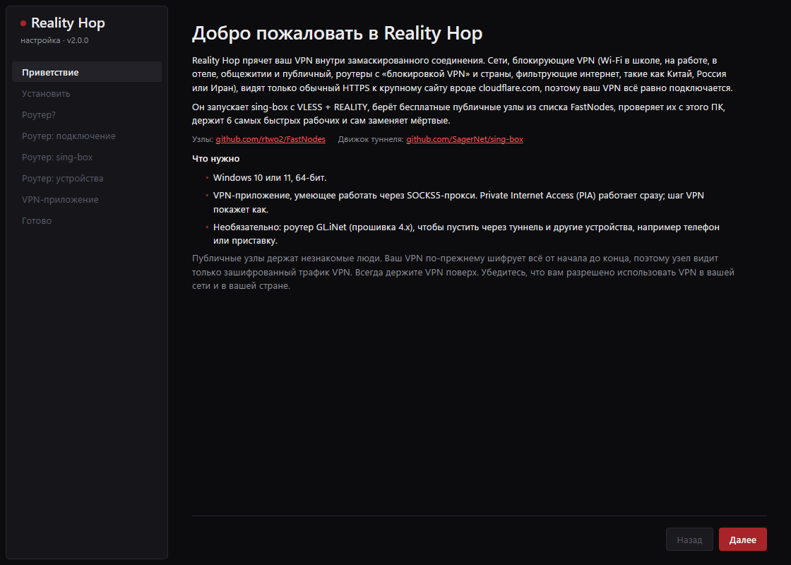
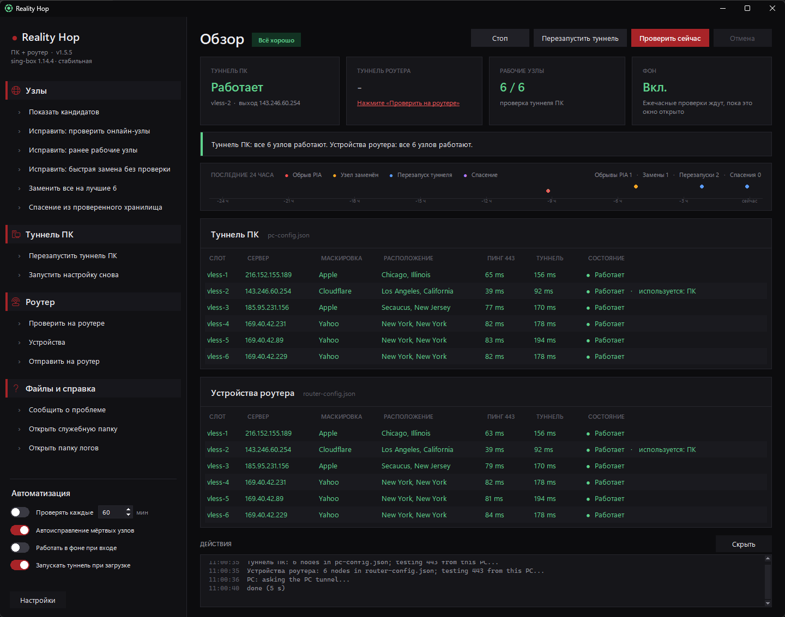
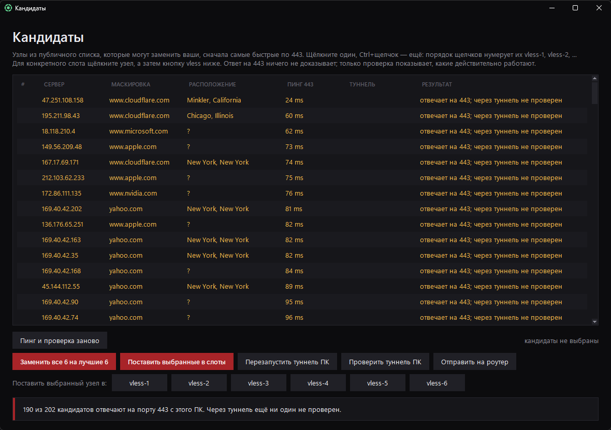
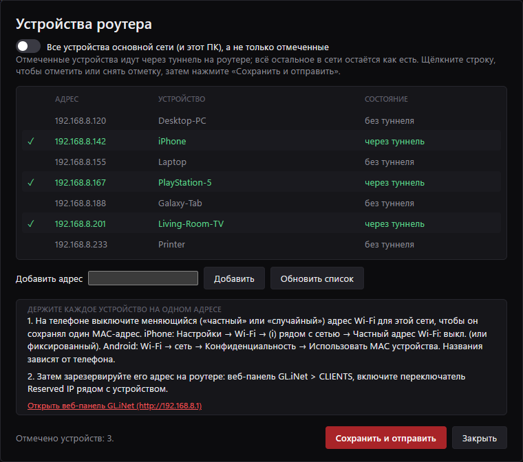
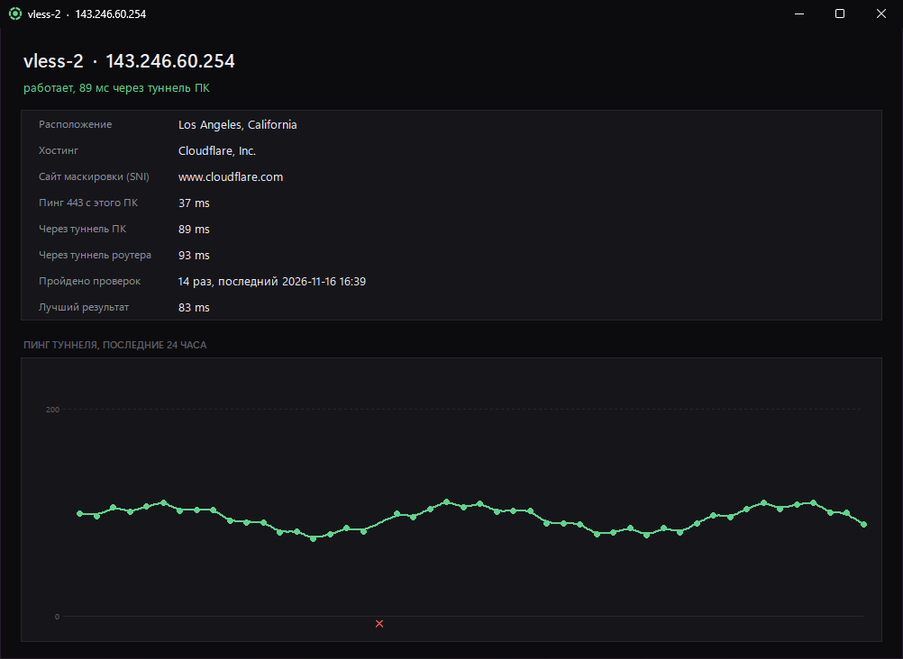
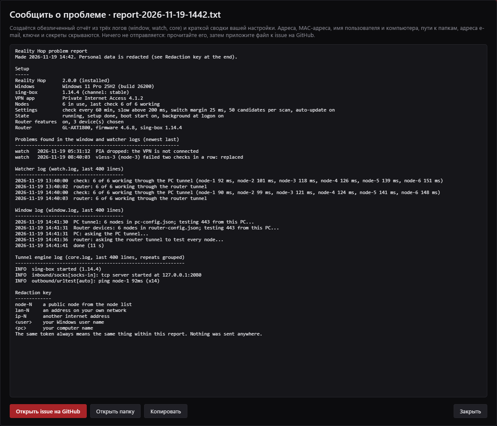
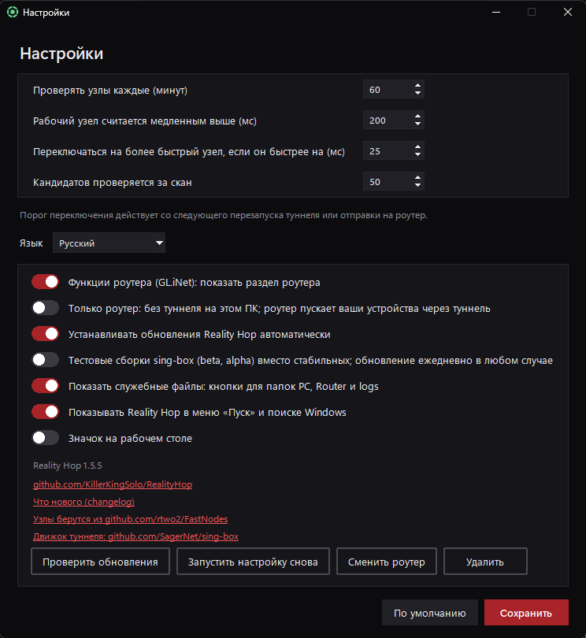

# Reality Hop (Русский)

<p align="center">
  <a href="https://github.com/KillerKingSolo/RealityHop/stargazers"></a>
  <a href="https://github.com/KillerKingSolo/RealityHop/releases"></a>
  <a href="https://github.com/KillerKingSolo/RealityHop/releases/latest"></a>
  <a href="../../LICENSE"></a>
  <br>
  <a href="https://github.com/KillerKingSolo/RealityHop/releases/latest"></a>
  <a href="#установка"></a>
</p>

<p align="center">
  <a href="../../README.md">English</a> · <a href="README.es.md">Español</a> · <a href="README.zh.md">简体中文</a> ·
  <b>Русский</b> · <a href="README.uk.md">Українська</a> ·
  <a href="README.fa.md">فارسی</a> · <a href="README.ar.md">العربية</a> ·
  <a href="README.tr.md">Türkçe</a> · <a href="README.vi.md">Tiếng Việt</a>
</p>

> Машинный перевод английского README. Если что-то непонятно, ориентируйтесь на английскую версию. Исправления приветствуются в issue на GitHub.

**Пропустите свой VPN через сети, которые блокируют VPN.** Reality Hop оборачивает VPN-соединение в туннель
VLESS + REALITY ([sing-box](https://github.com/SagerNet/sing-box)). Для сети это выглядит как обычный HTTPS к крупному
сайту, например cloudflare.com. Он сделан для сетей, которые блокируют VPN:

- Wi-Fi в школе, на работе, в отеле и в общежитии
- публичный Wi-Fi в аэропортах, кафе, поездах и библиотеках
- роутеры с «блокировкой VPN» и провайдеры, которые замедляют или блокируют VPN-трафик
- страны, которые фильтруют интернет: Великий китайский файрвол, Россия, Иран, Туркменистан и ОАЭ

Он берёт бесплатные публичные узлы из [rtwo2/FastNodes](https://github.com/rtwo2/FastNodes), сам их проверяет,
использует самые быстрые рабочие и сам заменяет нерабочие.

**Что нового:** [CHANGELOG.md](../../CHANGELOG.md) (сначала новые версии) · **Скачать:** [последний релиз](https://github.com/KillerKingSolo/RealityHop/releases/latest)



<picture>
  <source media="(prefers-color-scheme: dark)" srcset="../images/flow-dark.png">
  
</picture>

Сеть между вами и узлом видит только обычное зашифрованное соединение с крупным сайтом. Собственное шифрование вашего
VPN остаётся внутри на всём пути.

## Скриншоты

<table>
<tr><td colspan="2"><br><b>Главное окно:</b> каждый узел проверен через работающий туннель, последние 24 часа, туннель роутера.</td></tr>
<tr><td width="50%" valign="top"><br><b>Кандидаты:</b> узлы из публичного списка, пинг и проверка на вашем ПК; поставьте любой в слот.</td><td width="50%" valign="top"><br><b>Устройства роутера:</b> выберите, какие устройства используют туннель роутера, и как закрепить их адрес.</td></tr>
<tr><td width="50%" valign="top"><br><b>Сведения об узле:</b> где находится узел, как он проходит проверки, его пинг за 24 часа.</td><td width="50%" valign="top"><br><b>Сообщить о проблеме:</b> логи, из которых убрано всё личное, готовые для issue на GitHub.</td></tr>
<tr><td colspan="2" align="center"><br><b>Настройки:</b> проверки, функции роутера, обновления, канал sing-box, ярлыки.</td></tr>
</table>

## Возможности

- **Один exe, пошаговая настройка.** Скачайте `RealityHop.exe`, запустите, и мастер сделает остальное: установку,
  sing-box, первые узлы, ваше VPN-приложение, запуск при загрузке.
- **Сам находит и проверяет узлы.** Скачивает публичный список узлов, выполняет настоящий REALITY-хендшейк и
  HTTPS-запрос через каждого кандидата и оставляет 6 самых быстрых рабочих.
- **Сам себя чинит.** Фоновый наблюдатель с иконкой в трее проверяет узлы каждый час. Он заменяет нерабочий узел, а
  когда не работает ни один, спасает из хранилища проверенных узлов. С PIA он реагирует в момент, когда VPN падает.
- **Иконка в трее показывает состояние.** Центр показывает общее состояние. Кольцо разделено на сегменты по одному
  на узел: зелёный работает, жёлтый медленный, красный не работает.
- **Меню «Пуск» и поиск Windows.** Нажмите клавишу Windows и введите Reality Hop. Ярлык на рабочем столе по желанию.
- **Необязательная поддержка роутеров GL.iNet** с окном **Устройства**: выберите, какие устройства используют туннель,
  и как закрепить их адрес (без меняющегося MAC на телефоне, Reserved IP для него в списке Clients панели GL.iNet).
- **Роутер GL.iNet:** пустите через туннель и телефон, приставку или телевизор, ничего на них не устанавливая.
  Выключите эту функцию, и раздел роутера исчезнет.
- **Только роутер.** Без туннеля на ПК: роутер пропускает через туннель выбранные вами устройства или все устройства
  основной сети, так что весь ваш трафик идёт через туннель.
- **Показывает сборку sing-box** (стабильную или тестовую) под названием в окне.
- **Стоп / Старт для поездок.** Одна кнопка выключает всё, включая запуск при загрузке, пока вы не нажмёте Старт.
- **9 языков.** Английский, испанский, упрощённый китайский, русский, украинский, персидский, арабский, турецкий и
  вьетнамский. Выберите при первом запуске; поменяйте в настройках. Журнал действий и отчёты о проблемах остаются на
  английском.
- **Автоматические обновления.** Reality Hop обновляется сам из релизов этого репозитория (с проверкой SHA-256).
- **sing-box обновляется сам**, ежедневно, на выбранном канале: **Стабильная** (по умолчанию) или **Тестовые сборки
  (бета, альфа)**. Он не ждёт релиза Reality Hop.
- **Видно, что работает за кулисами.** Включите *Показать служебные файлы*, чтобы получить кнопки для папок `PC`,
  `Router` и `logs`: действующие конфиги sing-box, скрипты роутера и три лога.
- **Анонимные отчёты о проблемах.** *Сообщить о проблеме* собирает три лога, заменяя адреса, имена, ключи и секреты
  метками. Сначала вы читаете отчёт, потом прикрепляете его к issue на GitHub. Ничего не отправляется автоматически.
- **Одна папка для всего.** Устанавливается в `C:\Program Files\RealityHop` или в папку, выбранную при настройке, с
  одним запросом UAC. Программа, движок туннеля, конфиги и логи остаются там, доступные для чтения только вашему
  пользователю Windows. Обновления ставятся туда без повторных вопросов. Программа никогда не работает от имени
  администратора. Без телеметрии.

## Установка

1. Скачайте **`RealityHop.exe`** из [последнего релиза](https://github.com/KillerKingSolo/RealityHop/releases/latest).
2. Запустите его. Windows SmartScreen может предупредить, потому что exe не подписан: нажмите **More info → Run
   anyway** (Подробнее → Выполнить в любом случае). Некоторые антивирусы по ошибке помечают неподписанные приложения;
   весь исходный код здесь, и вы можете [собрать его сами](../building.md) (на английском).
3. Пройдите мастер настройки:
   - **Установить** копирует Reality Hop в `C:\Program Files\RealityHop` (один запрос UAC), скачивает sing-box,
     находит первые узлы и запускает туннель. Это занимает около минуты.
   - **Роутер?** спрашивает, нужно ли также настроить роутер GL.iNet. Если ответить «да», мастер проведёт вас по шагам
     ([подробнее](../router-setup.md), на английском). Если ответить «нет», Reality Hop показывает только часть для ПК.
   - **VPN-приложение** показывает, как направить VPN в туннель ([подробнее](../vpn-setup.md), на английском).
   - **Готово** включает фоновый запуск при входе в систему, запуск при загрузке и автоматические обновления.

Требования: Windows 10 или 11 (64-бит) с Microsoft Edge WebView2 (входит в Windows 11 и актуальную Windows 10) и
VPN-приложение, которое умеет работать через SOCKS5-прокси.

### Mac

1. Скачайте **`RealityHop-mac-apple-silicon.dmg`** (M1 и новее) или **`RealityHop-mac-intel.dmg`** из
   [последнего релиза](https://github.com/KillerKingSolo/RealityHop/releases/latest).
2. Откройте его и перетащите **Reality Hop** в **Applications** (Программы). Запускайте из «Программ», а не из
   образа диска.
3. Откройте Reality Hop из «Программ». В первый раз macOS заблокирует его, потому что приложение не нотаризовано Apple
   (для этого нужен платный аккаунт разработчика Apple). Разрешите один раз:
   1. macOS сообщит, что не может проверить Reality Hop. Нажмите **Done** (Готово), а не **Move to Trash**
      (Переместить в Корзину).
   2. Откройте **System Settings → Privacy & Security** (Системные настройки → Конфиденциальность и безопасность) и
      прокрутите вниз до **Security** (Безопасность).
   3. Рядом с «Reality Hop» was blocked нажмите **Open Anyway** (Всё равно открыть), затем ещё раз **Open Anyway** и
      введите пароль от Mac.

   Это нужно сделать только один раз. Обновления открываются без вопросов. Правый клик → **Открыть** больше не
   работает в macOS 15 и новее. Весь исходный код здесь, и вы можете [собрать его сами](../building.md).
   [Подробнее](../troubleshooting.md#mac-reality-hop-cannot-be-opened) (на английском).
4. Пройдите тот же мастер настройки. Пароль администратора не нужен: всё хранится в `~/Library/Application
   Support/RealityHop`, доступное для чтения только вашему пользователю, а фоновый наблюдатель виден в строке меню.
5. PIA на Mac: в Split Tunnel ничего настраивать не нужно. Reality Hop сам добавляет себя (Bypass VPN) и держит там
   адреса своих узлов, поэтому kill switch в PIA может оставаться включённым. Используйте одно DNS-приложение за раз
   ([подробнее](../vpn-setup.md)).

Требования: macOS 15 или новее, Apple silicon или Intel, и VPN-приложение, которое умеет работать через SOCKS5-прокси.
Скачивайте PIA для Mac с [его сайта](https://www.privateinternetaccess.com/download/mac-vpn), а не из Mac App Store:
в версии из App Store нет Multi-Hop и Split Tunnel, поэтому она не может подключиться через Reality Hop.

## Настройка VPN-приложения

Reality Hop слушает **SOCKS5 `127.0.0.1`, порт `2080`**, без имени пользователя и пароля.

Ваш VPN должен использовать **OpenVPN через TCP, порт 443**. SOCKS5-прокси передаёт только TCP, а 443 это обычный
порт HTTPS.

**Private Internet Access (PIA):**
Settings → Protocols: Protocol **OpenVPN**, Transport **TCP**, Remote Port **443**. Затем Settings → Multi-Hop:
отметьте **Multi-hop and Obfuscation**, выберите **SOCKS5 Proxy**, нажмите **EDIT**, введите хост `127.0.0.1` и порт
`2080` и сохраните. Split Tunnel от вас ничего не требует: Reality Hop сам добавляет `rh-core.exe` и его тестовую
копию `rh-test.exe` как **Bypass VPN**. Только если командная строка PIA откажет, мастер покажет ручной шаг: в
Settings → Split Tunnel добавьте `C:\Program Files\RealityHop\PC\rh-core.exe` и выберите **Bypass VPN**.


**Другие VPN-приложения:** любое приложение с настройкой SOCKS5-прокси работает так же, через OpenVPN по TCP на порту
443. В конфиге OpenVPN укажите `proto tcp`, порт сервера `443` и добавьте `socks-proxy 127.0.0.1 2080`. См.
[docs/vpn-setup.md](../vpn-setup.md) (на английском).

## Управление

| Где | Что |
|---|---|
| Иконка в трее | Двойной клик открывает окно. Правый клик: Перезапустить туннель, Проверить сейчас, Спасение, Выход. |
| **Проверить сейчас** | Проверяет каждый узел через работающий туннель. |
| **Перезапустить туннель** | Перезапускает туннель на текущих узлах (около 2 секунд). |
| **Стоп / Старт** | Выключает всё, включая запуск при загрузке, на время вашего отсутствия. Пока остановлено, выключите прокси в VPN-приложении. |
| Узлы → **Показать кандидатов** | Показывает узлы из публичного списка; проверьте их и поставьте любой в слот, затем перезапустите и проверьте туннель ПК в том же окне. |
| Узлы → **Спасение** | Используйте, когда не работает ни один узел. Проверяет хранилище проверенных узлов и ставит 6 лучших. |
| Справка → **Сообщить о проблеме** | Делает обезличенный отчёт из логов и открывает issue на GitHub, чтобы вы его прикрепили. |
| Файлы (по желанию) | **Открыть служебную папку** (`PC`, `Router`, `logs`, `anonymous-logs`) и **Открыть папку логов**. |
| **Настройки** | Интервал проверки, порог медленного узла, запас для переключения, функции роутера вкл/выкл, sing-box стабильная или тестовая сборка (ПК и роутер), показ служебных файлов, обновления, повторный запуск настройки, удаление. |

**Удаление:** Панель управления → Программы → Удаление программы → Reality Hop. Параметры Windows → Приложения →
Установленные приложения → Reality Hop и Настройки → Удалить в самом Reality Hop делают то же самое.

## Откуда берутся узлы

- **Список узлов:** [rtwo2/FastNodes](https://github.com/rtwo2/FastNodes), файл
  [`sub/verified_tls.txt`](https://raw.githubusercontent.com/rtwo2/FastNodes/main/sub/verified_tls.txt). Reality Hop
  оставляет только узлы VLESS + REALITY + XTLS-Vision на порту 443 с известным сайтом-прикрытием. Затем сам их
  проверяет; проверке самого списка он не доверяет.
- **Движок туннеля:** [SagerNet/sing-box](https://github.com/SagerNet/sing-box), скачивается из официальных релизов
  на GitHub. Стабильная это новейший полный релиз; тестовые сборки это самые новые из всех, включая альфу и бету.
  Проверяется контрольная сумма SHA-256, и новая сборка должна принять конфиг, прежде чем заменит старую. На вашем ПК
  он работает как `rh-core.exe`.
- **Движок роутера:** собственная сборка sing-box от Reality Hop для роутеров arm64, собранная из официального
  исходного кода без всего, что роутер не использует (18 МБ вместо 27 МБ у пакета GL.iNet 1.9.7). Она следует каналу
  ПК, если в настройках у роутера не задан свой. Reality Hop спрашивает перед обновлением роутера, держит старую
  сборку в оперативной памяти роутера и возвращает её, если новая не запустится. Страница Plug-ins роутера продолжает
  показывать пакет GL.iNet 1.9.7; боковая панель показывает версию, которая реально работает. Как она собирается и
  проверяется: [`router-core/`](../../router-core/README.md) (на английском).
- **Протокол:** VLESS с REALITY и XTLS-Vision от [XTLS](https://github.com/XTLS).

## Приватность и безопасность

- **Публичные узлы держат незнакомые люди.** Ваш VPN по-прежнему шифрует всё от начала до конца, поэтому узел видит
  только зашифрованный VPN-трафик и его адресата, VPN-сервер. Всегда держите VPN поверх. Не отправляйте личный трафик
  через Reality Hop без VPN.
- **С чем связывается Reality Hop:**
  - GitHub: список узлов, релизы sing-box, сборки для роутера и релизы Reality Hop.
  - `api.ipify.org`, запрашивается через каждый узел при его проверке.
  - `www.gstatic.com/generate_204`, проверка задержки через туннель.
  - `ip-api.com`, для местоположения узлов, запрашивается через туннель.
  - DNS Quad9 (`9.9.9.9`), через туннель.

  Никакие данные о вас никуда не отправляются, телеметрии нет.
- **Что он хранит:** конфиги, хранилище узлов, логи и настройки в своей папке установки (папки `PC`, `Router`,
  `logs`, `anonymous-logs`), открыть которую может только ваш пользователь Windows. Ключ роутера это SSH-ключ,
  созданный на вашем ПК. Пароль от роутера вы вводите в собственный `ssh` Windows, и Reality Hop его никогда не видит
  и не хранит.
- Убедитесь, что вам разрешено пользоваться VPN в вашей сети и в вашей стране. Некоторые страны ограничивают или
  запрещают VPN; Reality Hop не меняет закон там, где вы находитесь.

О проблемах безопасности см. [SECURITY.md](../../SECURITY.md). Для всего остального используйте **Сообщить о
проблеме** в окне и прикрепите анонимный отчёт к issue. Никогда не прикрепляйте `pc-config.json`, `router-config.json`
или `vault.json`.

## История звёзд

**Если Reality Hop вам помогает, поставьте ему звезду.** Это бесплатно и занимает один клик. Звёзды показывают мне,
что им пользуются, помогают другим его найти и мотивируют меня исправлять проблемы и добавлять новые функции.

<a href="https://www.star-history.com/#KillerKingSolo/RealityHop&Date">
 <picture>
   <source media="(prefers-color-scheme: dark)" srcset="https://api.star-history.com/svg?repos=KillerKingSolo/RealityHop&type=Date&theme=dark" />
   <source media="(prefers-color-scheme: light)" srcset="https://api.star-history.com/svg?repos=KillerKingSolo/RealityHop&type=Date" />
   
 </picture>
</a>

## Документация

Руководства на английском:

- [Как это работает](../how-it-works.md)
- [Настройка роутера GL.iNet](../router-setup.md)
- [Настройка VPN-приложения](../vpn-setup.md)
- [Решение проблем](../troubleshooting.md)
- [Сборка из исходного кода и выпуск релизов](../building.md)

## Запуск из исходного кода

Reality Hop написан на Rust с [Tauri](https://github.com/tauri-apps/tauri). Если установлен
[Rust](https://rustup.rs):

```
cd rust
cargo run -p realityhop-app
```

Подробности, сборка для Mac и шаги выпуска: [docs/building.md](../building.md).

## Лицензия

[CC BY-NC-ND 4.0](../../LICENSE) (Creative Commons «Атрибуция — Некоммерческое использование — Без производных
произведений» 4.0). Кратко:

- **Делитесь без изменений и с указанием авторов:** Reality Hop от KillerKingSolo, sing-box от SagerNet и FastNodes
  от rtwo2, со ссылками на них (см. [LICENSE](../../LICENSE)).
- **Без изменённых версий:** нельзя распространять отредактированную копию.
- **Без коммерческого использования:** нельзя продавать его или использовать ради прибыли.

Всё сверх этого требует разрешения. sing-box (GPL-3.0-or-later) и FastNodes (MIT) это отдельные проекты со своими
лицензиями; Reality Hop скачивает их во время работы и не распространяет вместе с собой.
