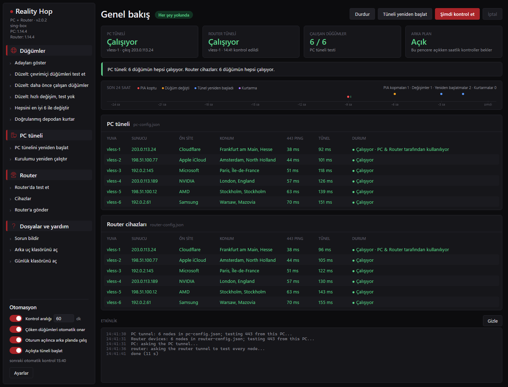
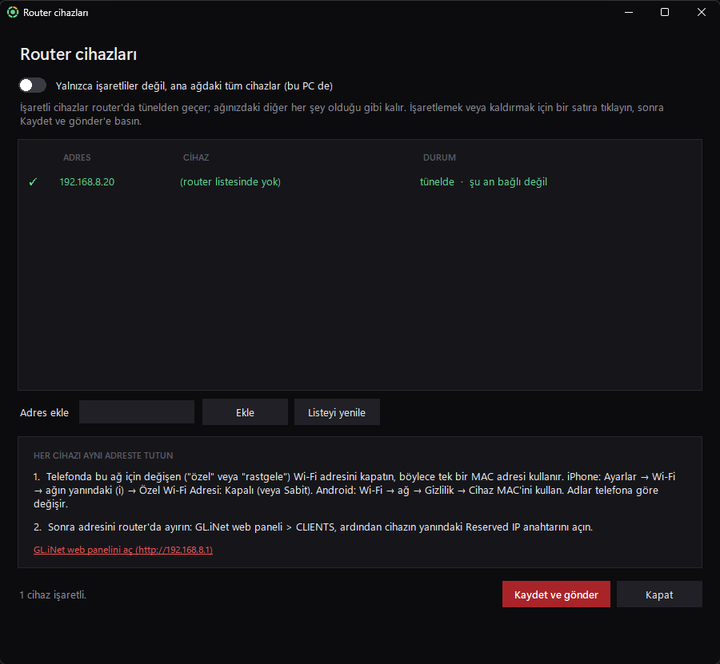
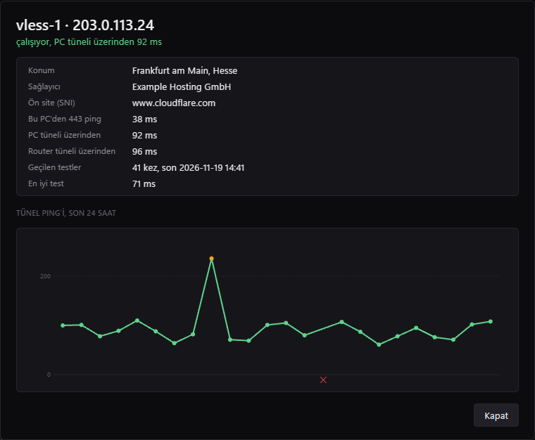
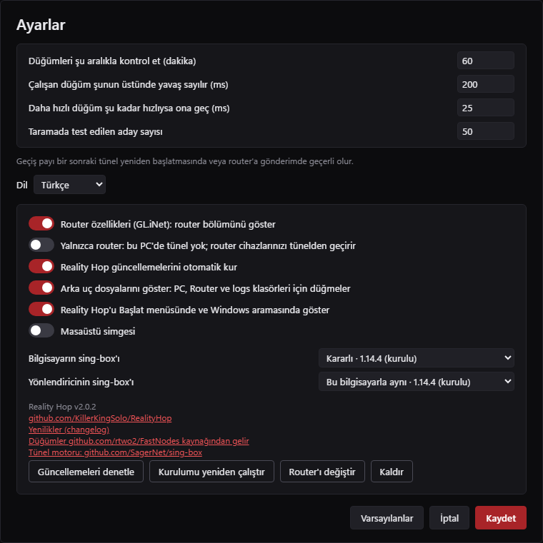

# Reality Hop (Türkçe)

<p align="center">
  <a href="https://github.com/KillerKingSolo/RealityHop/stargazers"></a>
  <a href="https://github.com/KillerKingSolo/RealityHop/releases"></a>
  <a href="https://github.com/KillerKingSolo/RealityHop/releases/latest"></a>
  <a href="../../LICENSE"></a>
  <br>
  <a href="https://github.com/KillerKingSolo/RealityHop/releases/latest"></a>
  <a href="#kurulum"></a>
</p>

<p align="center">
  <a href="../../README.md">English</a> · <a href="README.es.md">Español</a> · <a href="README.zh.md">简体中文</a> ·
  <a href="README.ru.md">Русский</a> · <a href="README.uk.md">Українська</a> ·
  <a href="README.fa.md">فارسی</a> · <a href="README.ar.md">العربية</a> ·
  <b>Türkçe</b> · <a href="README.vi.md">Tiếng Việt</a>
</p>

> İngilizce README'nin makine çevirisidir. Bir şey açık değilse İngilizce sürüm esastır. Düzeltmeler GitHub issue'su olarak memnuniyetle karşılanır.

**VPN'inizi VPN'leri engelleyen ağlardan geçirin.** Reality Hop, VPN bağlantınızı bir VLESS + REALITY tüneline sarar
([sing-box](https://github.com/SagerNet/sing-box)). Ağ için bu, cloudflare.com gibi büyük bir siteye giden sıradan
HTTPS gibi görünür. VPN'leri engelleyen ağlar için yapılmıştır:

- Okul, İş, Otel ve Yurt Wi-Fi'ı
- Havalimanı, Kafe, Tren ve Kütüphanelerdeki Herkese Açık Wi-Fi
- "VPN engelleme" özelliği olan router'lar ve VPN trafiğini yavaşlatan ya da engelleyen internet sağlayıcıları
- İnterneti filtreleyen Ülkeler: Çin'in Büyük Güvenlik Duvarı, Rusya, İran, Türkmenistan ve BAE gibi

[rtwo2/FastNodes](https://github.com/rtwo2/FastNodes) üzerinden ücretsiz herkese açık düğümleri bulur, kendisi test
eder, çalışan en hızlıları kullanır ve çalışmayanları kendiliğinden değiştirir.

**Yenilikler:** [CHANGELOG.md](../../CHANGELOG.md) (en yeni sürüm önce) · **İndir:** [son sürüm](https://github.com/KillerKingSolo/RealityHop/releases/latest)


<picture>
  <source media="(prefers-color-scheme: dark)" srcset="../images/flow-dark.png">
  
</picture>

Aradaki ağ yalnızca büyük bir siteye giden sıradan şifreli bir bağlantı görür. VPN'inizin kendi şifrelemesi tüm yol
boyunca içeride kalır.

## Ekran görüntüleri

<table>
<tr><td colspan="2"><br><b>Ana pencere:</b> her düğüm çalışan tünel üzerinden test edilir, son 24 saat, router tüneli.</td></tr>
<tr><td width="50%" valign="top"><br><b>Adaylar:</b> herkese açık listedeki düğümler, PC'nizde ping'lenir ve test edilir; herhangi birini bir yuvaya koyun.</td><td width="50%" valign="top"><br><b>Router cihazları:</b> router tünelini hangi cihazların kullanacağını ve adreslerinin nasıl sabit tutulacağını seçin.</td></tr>
<tr><td width="50%" valign="top"><br><b>Düğüm ayrıntıları:</b> düğümün nerede olduğu, testlerde nasıl olduğu, 24 saatlik ping'i.</td><td width="50%" valign="top"><br><b>Sorun bildir:</b> kişisel her şeyi gizlenmiş, GitHub issue için hazır günlükler.</td></tr>
<tr><td colspan="2" align="center"><br><b>Ayarlar:</b> kontroller, router özellikleri, güncellemeler, sing-box kanalı, kısayollar.</td></tr>
</table>

## Özellikler

- **Tek exe, rehberli kurulum.** `RealityHop.exe`'yi indirin, çalıştırın; gerisini sihirbaz yapar: kurulum,
  sing-box, ilk düğümler, VPN uygulamanız, açılışta başlatma.
- **Düğümleri sizin için bulur ve test eder.** Herkese açık düğüm listesini indirir, her aday üzerinden gerçek bir
  REALITY el sıkışması ve bir HTTPS isteği yapar ve çalışan en hızlı 6 düğümü tutar.
- **Kendini onarır.** Tepside simgesi olan bir arka plan izleyicisi düğümleri her saat kontrol eder. Çalışmayan bir
  düğümü değiştirir; hepsi çalışmadığında bilinen iyi düğümlerin kasasından kurtarır. PIA ile VPN düştüğü anda tepki
  verir.
- **Tepsi simgesi durumu gösterir.** Ortası genel durumdur. Halkada düğüm başına bir dilim vardır: yeşil çalışıyor,
  sarı yavaş, kırmızı çalışmıyor.
- **Başlat menüsü ve Windows araması.** Windows tuşuna basın ve Reality Hop yazın. Masaüstü simgesi isteğe bağlıdır.
- **İsteğe bağlı GL.iNet router desteği,** bir **Cihazlar** penceresiyle: tüneli hangi cihazların kullanacağını ve
  adreslerinin nasıl sabit tutulacağını seçin (telefonda değişen MAC yok, GL.iNet panelinin Clients listesinde ona
  Reserved IP).
- **GL.iNet router:** Bir telefonu, konsolu ya da TV'yi de, üzerlerine hiçbir şey kurmadan tünelden geçirin.
  Kapatırsanız router bölümü kaybolur.
- **Yalnızca router.** PC'de tünel yok: router seçtiğiniz cihazları ya da ana ağındaki tüm cihazları tünelden
  geçirir, böylece tüm trafiğiniz tünelden gider.
- **Kullanılan sing-box sürümünü gösterir** (kararlı ya da test sürümü), pencerede adın altında.
- **Seyahat için Durdur / Başlat.** Tek bir düğme, açılışta başlatma dahil her şeyi siz Başlat'a basana kadar
  kapatır.
- **9 dil.** İngilizce, İspanyolca, Basitleştirilmiş Çince, Rusça, Ukraynaca, Farsça, Arapça, Türkçe ve Vietnamca. İlk
  açılışta birini seçin; Ayarlar'dan değiştirin. Etkinlik günlüğü ve sorun raporları İngilizce kalır.
- **Otomatik güncellemeler.** Reality Hop bu deponun Releases bölümünden kendini günceller (SHA-256 kontrollü).
- **sing-box kendini güncel tutar**, her gün, seçtiğiniz kanalda: **Kararlı** (varsayılan) ya da **Test sürümleri
  (beta, alfa)**. Bir Reality Hop sürümünü beklemez.
- **Arka planda neyin çalıştığını görün.** `PC`, `Router` ve `logs` klasörleri için düğmeler almak üzere *Arka uç
  dosyalarını göster* seçeneğini açın: canlı sing-box yapılandırmaları, router betikleri ve üç günlük.
- **Anonim sorun raporları.** *Sorun bildir*, adresleri, adları, anahtarları ve gizli bilgileri işaretlerle
  değiştirerek üç günlüğü bir araya getirir. Önce siz okursunuz, sonra bir GitHub issue'ya eklersiniz. Hiçbir şey
  otomatik gönderilmez.
- **Her şey için tek klasör.** Tek bir UAC isteğiyle `C:\Program Files\RealityHop` klasörüne ya da kurulumda
  seçtiğiniz bir klasöre kurulur. Program, tünel motoru, yapılandırmalar ve günlükler orada kalır ve yalnızca Windows
  kullanıcınız tarafından okunabilir. Güncellemeler tekrar sormadan oraya kurulur. Program asla yönetici olarak
  çalışmaz. Telemetri yok.

## Kurulum

1. **`RealityHop.exe`** dosyasını [son sürümden](https://github.com/KillerKingSolo/RealityHop/releases/latest) indirin.
2. Çalıştırın. exe kod imzalı olmadığı için Windows SmartScreen uyarabilir: **More info → Run anyway** (Ek bilgi →
   Yine de çalıştır) düğmesine tıklayın. Bazı antivirüs programları imzasız uygulamaları yanlışlıkla işaretler;
   kaynak kodun tamamı burada ve [kendiniz derleyebilirsiniz](../building.md) (İngilizce).
3. Kurulum sihirbazını izleyin:
   - **Kur**, Reality Hop'u `C:\Program Files\RealityHop` klasörüne kopyalar (bir UAC isteği), sing-box'ı indirir,
     ilk düğümleri bulur ve tüneli başlatır. Yaklaşık bir dakika sürer.
   - **Router?** bir GL.iNet router da kurmak isteyip istemediğinizi sorar. Evet derseniz sihirbaz sizi adım adım
     yönlendirir ([ayrıntılar](../router-setup.md), İngilizce). Hayır derseniz Reality Hop yalnızca PC bölümünü
     gösterir.
   - **VPN uygulaması**, VPN'inizi tünele nasıl yönlendireceğinizi gösterir ([ayrıntılar](../vpn-setup.md),
     İngilizce).
   - **Bitir**, oturum açılışında arka planda başlatmayı, açılışta başlatmayı ve otomatik güncellemeleri ayarlar.

Gereksinimler: Microsoft Edge WebView2 içeren Windows 10 ya da 11 (64 bit) (Windows 11'in ve güncel Windows 10'un
parçasıdır) ve SOCKS5 proxy kullanabilen bir VPN uygulaması.

### Mac

1. **`RealityHop-mac-apple-silicon.dmg`** (M1 ve sonrası) ya da **`RealityHop-mac-intel.dmg`** dosyasını
   [son sürümden](https://github.com/KillerKingSolo/RealityHop/releases/latest) indirin.
2. Açın ve **Reality Hop**'u **Applications** (Uygulamalar) klasörüne sürükleyin. Disk görüntüsünden değil,
   Uygulamalar'dan çalıştırın.
3. Reality Hop'u Uygulamalar'dan açın. İlk seferde macOS onu engeller, çünkü uygulama Apple tarafından onaylanmamıştır
   (bunun için ücretli bir Apple geliştirici hesabı gerekir). Bir kez izin verin:
   1. macOS, Reality Hop'u doğrulayamadığını söyler. **Move to Trash** (Çöp Sepetine Taşı) değil, **Done** (Bitti)
      düğmesine tıklayın.
   2. **System Settings → Privacy & Security** (Sistem Ayarları → Gizlilik ve Güvenlik) bölümünü açın ve
      **Security** (Güvenlik) kısmına kaydırın.
   3. "Reality Hop" was blocked yazısının yanında **Open Anyway** (Yine de Aç) düğmesine, sonra tekrar **Open
      Anyway** düğmesine tıklayın ve Mac parolanızı girin.

   Bunu yalnızca bir kez yaparsınız. Güncellemeler tekrar sormadan açılır. Sağ tık → **Aç** artık macOS 15 ve
   sonrasında çalışmıyor. Kaynak kodun tamamı burada ve [kendiniz derleyebilirsiniz](../building.md).
   [Daha fazla yardım](../troubleshooting.md#mac-reality-hop-cannot-be-opened) (İngilizce).
4. Aynı kurulum sihirbazını izleyin. Yönetici parolası gerekmez: her şey `~/Library/Application Support/RealityHop`
   içinde kalır ve yalnızca kullanıcınız tarafından okunabilir; arka plan izleyicisi menü çubuğunda görünür.
5. Mac'te PIA: Split Tunnel'da ayarlanacak bir şey yok. Reality Hop kendini ekler (Bypass VPN) ve düğüm adreslerini
   orada tutar, böylece PIA'nın kill switch'i açık kalabilir. Aynı anda tek bir DNS uygulaması çalıştırın
   ([ayrıntılar](../vpn-setup.md)).

Gereksinimler: macOS 15 ya da sonrası, Apple silicon ya da Intel ve SOCKS5 proxy kullanabilen bir VPN uygulaması.
Mac için PIA'yı Mac App Store'dan değil, [kendi sitesinden](https://www.privateinternetaccess.com/download/mac-vpn)
alın: App Store sürümünde Multi-Hop ve Split Tunnel yoktur, bu yüzden Reality Hop üzerinden bağlanamaz.

## VPN uygulamasını ayarlama

Reality Hop, kullanıcı adı ve parola olmadan **SOCKS5 `127.0.0.1`, port `2080`** üzerinde dinler.

VPN'iniz **TCP üzerinden OpenVPN, port 443** kullanmalıdır. Bir SOCKS5 proxy yalnızca TCP taşır ve 443 normal HTTPS
portudur.

**Private Internet Access (PIA):**
Settings → Protocols: Protocol **OpenVPN**, Transport **TCP**, Remote Port **443**. Sonra Settings → Multi-Hop:
**Multi-hop and Obfuscation** seçeneğini işaretleyin, **SOCKS5 Proxy**'yi seçin, **EDIT**'e tıklayın, host olarak
`127.0.0.1` ve port olarak `2080` girin ve kaydedin. Split Tunnel sizden bir şey istemez: Reality Hop `rh-core.exe`'yi
ve test kopyası `rh-test.exe`'yi kendiliğinden **Bypass VPN** olarak ekler. Yalnızca PIA'nın komut satırı reddederse
kurulum sihirbazı elle yapılacak adımı gösterir: Settings → Split Tunnel içinde
`C:\Program Files\RealityHop\PC\rh-core.exe` dosyasını ekleyin ve **Bypass VPN** olarak ayarlayın.


**Diğer VPN uygulamaları:** SOCKS5 proxy ayarı olan her uygulama aynı şekilde, TCP port 443 üzerinden OpenVPN ile
çalışır. Bir OpenVPN yapılandırma dosyasında `proto tcp`, sunucunun `443` portunu kullanın ve
`socks-proxy 127.0.0.1 2080` satırını ekleyin. Bkz. [docs/vpn-setup.md](../vpn-setup.md) (İngilizce).

## Kontroller

| Nerede | Ne |
|---|---|
| Tepsi simgesi | Çift tık pencereyi açar. Sağ tık: Tüneli yeniden başlat, Şimdi kontrol et, Kurtarma, Çık. |
| **Şimdi kontrol et** | Her düğümü çalışan tünel üzerinden test eder. |
| **Tüneli yeniden başlat** | Tüneli mevcut düğümlerle yeniden başlatır (yaklaşık 2 saniye). |
| **Durdur / Başlat** | Uzaktayken açılışta başlatma dahil her şeyi kapatır. Durdurulmuşken VPN uygulamasının proxy'sini kapatın. |
| Düğümler → **Adayları göster** | Herkese açık listedeki düğümleri listeler; onları test edip herhangi birini bir yuvaya koyun, sonra aynı pencereden PC tünelini yeniden başlatıp test edin. |
| Düğümler → **Kurtarma** | Tüm düğümler çalışmadığında kullanın. Bilinen iyi düğümlerin kasasını test eder ve en iyi 6'sını koyar. |
| Yardım → **Sorun bildir** | Günlüklerin anonimleştirilmiş bir raporunu yapar ve eklemeniz için bir GitHub issue açar. |
| Dosyalar (isteğe bağlı) | **Arka uç klasörünü aç** (`PC`, `Router`, `logs`, `anonymous-logs`) ve **Günlük klasörünü aç**. |
| **Ayarlar** | Kontrol aralığı, yavaşlık eşiği, geçiş payı, router özellikleri açık/kapalı, sing-box kararlı ya da test sürümleri (PC ve router), arka uç dosyalarını gösterme, güncellemeler, kurulumu yeniden çalıştırma, kaldırma. |

**Kaldırma:** Denetim Masası → Programlar → Program kaldır → Reality Hop. Windows Ayarlar → Uygulamalar → Yüklü
uygulamalar → Reality Hop ve Reality Hop'un kendi Ayarlar → Kaldır seçeneği aynı şeyi yapar.

## Düğümler nereden geliyor

- **Düğüm listesi:** [rtwo2/FastNodes](https://github.com/rtwo2/FastNodes), dosya
  [`sub/verified_tls.txt`](https://raw.githubusercontent.com/rtwo2/FastNodes/main/sub/verified_tls.txt). Reality Hop
  yalnızca 443 portunda, bilinen bir ön site kullanan VLESS + REALITY + XTLS-Vision düğümlerini tutar. Sonra onları
  kendisi test eder; listenin kendi doğrulamasına güvenmez.
- **Tünel motoru:** [SagerNet/sing-box](https://github.com/SagerNet/sing-box), resmi GitHub sürümlerinden indirilir.
  Kararlı, en yeni tam sürümdür; test sürümleri alfa ve beta dahil hepsinin en yenisidir. SHA-256 sağlama toplamı
  kontrol edilir ve yeni sürüm, eskisinin yerini almadan önce yapılandırmayı kabul etmelidir. PC'nizde `rh-core.exe`
  olarak çalışır.
- **Router motoru:** Reality Hop'un arm64 router'lar için kendi sing-box sürümü; resmi kaynaktan, router'ın
  kullanmadığı her şey çıkarılarak yapılır (GL.iNet'in 1.9.7 paketinin 27 MB'ı yerine 18 MB). Ayarlar router'a ayrı
  bir kanal vermedikçe PC'nin kanalını izler. Reality Hop router'ı güncellemeden önce sorar, eski sürümü router'ın
  RAM'inde tutar ve yenisi başlamazsa geri koyar. Router'ın Plug-ins sayfası GL.iNet'in 1.9.7 paketini göstermeye
  devam eder; kenar çubuğu gerçekten çalışan sürümü gösterir. Nasıl derlendiği ve kontrol edildiği:
  [`router-core/`](../../router-core/README.md) (İngilizce).
- **Protokol:** [XTLS](https://github.com/XTLS)'ten REALITY ve XTLS-Vision ile VLESS.

## Gizlilik ve güvenlik

- **Herkese açık düğümleri yabancılar çalıştırır.** VPN'iniz yine her şeyi uçtan uca şifreler, bu yüzden bir düğüm
  yalnızca şifreli VPN trafiğini ve onun hedefini, VPN sunucusunu görür. VPN'i her zaman üstte tutun. Reality Hop
  üzerinden VPN olmadan özel trafik göndermeyin.
- **Reality Hop'un bağlandıkları:**
  - GitHub: düğüm listesi, sing-box sürümleri, router sürümleri ve Reality Hop sürümleri için.
  - `api.ipify.org`, her düğüm test edilirken o düğüm üzerinden alınır.
  - `www.gstatic.com/generate_204`, tünel üzerinden gecikme testi.
  - `ip-api.com`, düğüm konumları için, tünel üzerinden sorulur.
  - Quad9 DNS (`9.9.9.9`), tünel üzerinden.

  Sizinle ilgili hiçbir şey hiçbir yere gönderilmez ve telemetri yoktur.
- **Ne sakladığı:** yapılandırmalar, düğüm kasası, günlükler ve ayarlar kurulum klasöründe (`PC`, `Router`, `logs`,
  `anonymous-logs` klasörleri) durur ve yalnızca Windows kullanıcınız açabilir. Router anahtarı PC'nizde oluşturulan
  bir SSH anahtarıdır. Router parolanız Windows'un kendi `ssh` aracına yazılır; Reality Hop onu asla görmez ve
  saklamaz.
- Bulunduğunuz ağda ve ülkede VPN kullanmanıza izin verildiğinden emin olun. Bazı ülkeler VPN'leri kısıtlar ya da
  yasaklar; Reality Hop bulunduğunuz yerdeki yasaları değiştirmez.

Güvenlik sorunları için [SECURITY.md](../../SECURITY.md) dosyasına bakın. Diğer her şey için pencerede **Sorun bildir**
seçeneğini kullanın ve anonim raporu bir issue'ya ekleyin. `pc-config.json`, `router-config.json` ya da `vault.json`
dosyalarını asla eklemeyin.

## Yıldız geçmişi

**Reality Hop size yardımcı oluyorsa lütfen ona bir yıldız verin.** Ücretsizdir ve tek tık sürer. Yıldızlar bana
insanların onu kullandığını gösterir, başkalarının onu bulmasına yardım eder ve sorunları düzeltmem, yeni özellikler
eklemem için beni motive eder.

<a href="https://www.star-history.com/#KillerKingSolo/RealityHop&Date">
 <picture>
   <source media="(prefers-color-scheme: dark)" srcset="https://api.star-history.com/svg?repos=KillerKingSolo/RealityHop&type=Date&theme=dark" />
   <source media="(prefers-color-scheme: light)" srcset="https://api.star-history.com/svg?repos=KillerKingSolo/RealityHop&type=Date" />
   
 </picture>
</a>

## Belgeler

Kılavuzlar İngilizcedir:

- [Nasıl çalışır](../how-it-works.md)
- [GL.iNet router kurulumu](../router-setup.md)
- [VPN uygulaması kurulumu](../vpn-setup.md)
- [Sorun giderme](../troubleshooting.md)
- [Kaynaktan derleme ve sürüm yayınlama](../building.md)

## Kaynaktan çalıştırma

Reality Hop, Rust ve [Tauri](https://github.com/tauri-apps/tauri) ile yazılmıştır. [Rust](https://rustup.rs) kurulu
olduğunda:

```
cd rust
cargo run -p realityhop-app
```

Ayrıntılar, Mac derlemesi ve sürüm adımları: [docs/building.md](../building.md).

## Lisans

[CC BY-NC-ND 4.0](../../LICENSE) (Creative Commons Atıf-GayriTicari-Türetilemez 4.0). Kısaca:

- **Değiştirmeden ve atıf yaparak paylaşın:** KillerKingSolo'nun Reality Hop'u, SagerNet'in sing-box'ı ve rtwo2'nin
  FastNodes'u, bağlantılarıyla birlikte (bkz. [LICENSE](../../LICENSE)).
- **Değiştirilmiş sürüm yok:** düzenlenmiş bir kopyayı paylaşamazsınız.
- **Ticari kullanım yok:** satamaz ya da kâr için kullanamazsınız.

Bunun ötesindeki her şey izin gerektirir. sing-box (GPL-3.0-or-later) ve FastNodes (MIT), kendi lisanslarına sahip
ayrı projelerdir; Reality Hop onları çalışırken indirir ve kendisiyle birlikte dağıtmaz.
