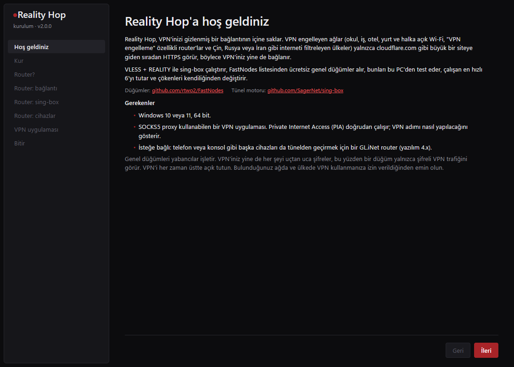
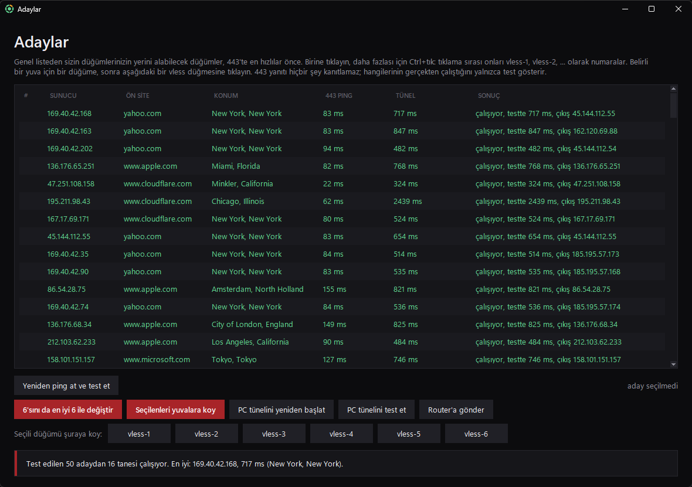
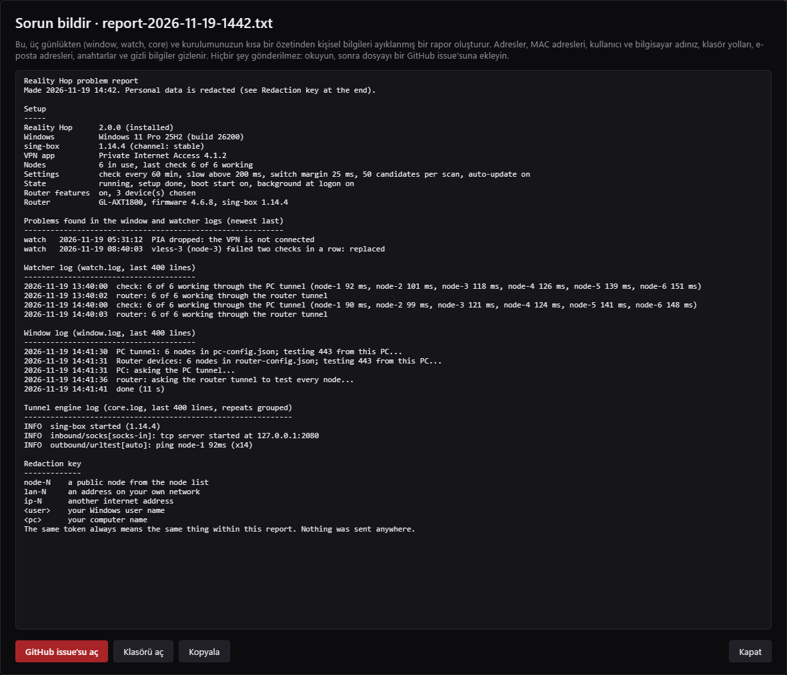

# Reality Hop (Türkçe)

  
  
  
  
   
  
  

  <a href="../../README.md">English</a> · <a href="README.es.md">Español</a> · <a href="README.zh.md">简体中文</a> ·
  <a href="README.ru.md">Русский</a> · <a href="README.uk.md">Українська</a> ·
  <a href="README.fa.md">فارسی</a> · <a href="README.ar.md">العربية</a> ·
  <b>Türkçe</b> · <a href="README.vi.md">Tiếng Việt</a>

> İngilizce README'nin makine çevirisidir. Bir şey açık değilse İngilizce sürüm esastır. Düzeltmeler GitHub issue'su olarak memnuniyetle karşılanır.

**VPN'inizi VPN engelleyen ağlardan geçirin.** Reality Hop, VPN bağlantınızı bir VLESS + REALITY tüneline ([sing-box](https://github.com/SagerNet/sing-box)) sarar. Ağa, cloudflare.com gibi büyük bir siteye giden sıradan HTTPS gibi görünür. Şunlar için yapıldı:

- okul, iş, otel ve yurt Wi-Fi'si
- havalimanı, kafe, tren ve kütüphanelerdeki halka açık Wi-Fi
- "VPN engelleme" özellikli router'lar ve VPN trafiğini yavaşlatan veya engelleyen sağlayıcılar
- interneti filtreleyen ülkeler: Çin'in Büyük Güvenlik Duvarı, Rusya, İran, Türkmenistan ve BAE

[rtwo2/FastNodes](https://github.com/rtwo2/FastNodes) listesinden ücretsiz genel düğümler alır, bunları kendisi test eder, çalışan en hızlıları kullanır ve çökenleri kendiliğinden değiştirir.

## Nasıl çalışır

VPN uygulaması → PC'nizdeki Reality Hop (SOCKS5 `127.0.0.1:2080`) → genel REALITY düğümü (cloudflare.com'a HTTPS gibi görünür) → VPN sunucusu → internet. VPN'inizin kendi şifrelemesi tüm yol boyunca içeride kalır.

## Ekran görüntüleri

<table>
<tr><td colspan="2"> <b>Ana pencere:</b> her düğüm canlı tünel üzerinden test edilir, son 24 saat, router tüneli.</td></tr>
<tr><td width="50%" valign="top"> <b>Adaylar:</b> genel listeden düğümler, PC'nizde ping atılıp test edilir; herhangi birini bir yuvaya koyun.</td><td width="50%" valign="top"> <b>Router cihazları:</b> hangi cihazların router tünelini kullanacağını ve adreslerinin nasıl sabit kalacağını seçin.</td></tr>
<tr><td width="50%" valign="top"> <b>Düğüm ayrıntıları:</b> düğümün nerede olduğu, testlerde nasıl olduğu, 24 saatlik ping'i.</td><td width="50%" valign="top"> <b>Sorun bildir:</b> kişisel her şeyi ayıklanmış günlükler, bir GitHub issue'suna hazır.</td></tr>
<tr><td colspan="2" align="center"> <b>Ayarlar:</b> kontroller, router özellikleri, güncellemeler, sing-box kanalı, kısayollar.</td></tr>
</table>

## Kurulum

1. `RealityHop.exe` dosyasını [son sürümden](https://github.com/KillerKingSolo/RealityHop/releases/latest) indirin. 64 bit Windows 10 veya 11 gerekir. Mac'te: `RealityHop-mac-apple-silicon.dmg` (M1 ve sonrası) veya `RealityHop-mac-intel.dmg`. macOS 15 veya üstü gerekir. Mac için PIA'yı Mac App Store'dan değil, [kendi web sitesinden](https://www.privateinternetaccess.com/download/mac-vpn) indirin: App Store sürümünde Multi-Hop ve Split Tunnel yoktur. macOS, Apple tarafından onaylanmadığı için Reality Hop'u ilk açılışta engeller: **Done** (Bitti) düğmesine tıklayın, **System Settings → Privacy & Security** (Sistem Ayarları → Gizlilik ve Güvenlik) bölümünü açın ve **Open Anyway** (Yine de Aç) düğmesine tıklayın. Yalnızca bir kez. [Adım adım](https://github.com/KillerKingSolo/RealityHop/blob/main/docs/troubleshooting.md#mac-reality-hop-cannot-be-opened).
2. Çalıştırın ve dilinizi seçin.
3. Sihirbaz Reality Hop'u kurar (bir UAC istemi), sing-box'ı resmi sürümlerinden indirir (SHA-256 doğrular), ilk düğümleri bulur ve tüneli başlatır. Yaklaşık bir dakika.

## Dil

Reality Hop ilk açılışta dili sorar. Daha sonra **Ayarlar → Dil** bölümünden değiştirin. Etkinlik günlüğü ve sorun raporları, destek okuyabilsin diye İngilizce kalır.

## VPN uygulamasını ayarlama

VPN uygulamanızı SOCKS5 proxy `127.0.0.1`, port `2080`, kullanıcı adı ve parola olmadan ayarlayın. **TCP 443 portunda OpenVPN** kullanın: SOCKS5 proxy yalnızca TCP taşır.

**Private Internet Access (PIA):**

1. PIA → **Settings → Protocols**: Protocol **OpenVPN**, Transport **TCP**, Remote Port **443**.
2. **Settings → Multi-Hop**: **Multi-hop and Obfuscation** işaretleyin ve **SOCKS5 Proxy** seçin.
3. **EDIT**'e tıklayın, host `127.0.0.1`, port `2080`, kullanıcı adı ve parola boş, kaydedin.
4. Reality Hop bu kuralı kendisi ekler; kurulum sihirbazı bu adımı yalnızca bu başarısız olursa gösterir. Yalnızca Split Tunnel'da **All Other Apps** **Use VPN** ise: **Settings → Split Tunnel**, **Add Application**, `C:\Program Files\RealityHop\PC\rh-core.exe` seçin ve **Bypass VPN** yapın. All Other Apps Bypass VPN ise bu kurala gerek yoktur.
5. Bağlanın.

**Diğer VPN uygulamaları:** SOCKS5 proxy ayarı olan her uygulama aynı şekilde çalışır. Bir OpenVPN dosyasında: `proto tcp`, 443 portundaki sunucu ve `socks-proxy 127.0.0.1 2080` satırı. İngilizce ayrıntılar: [VPN app setup](../vpn-setup.md).

## GL.iNet router (isteğe bağlı)

Bir GL.iNet router (yazılım 4.x) ile seçtiğiniz cihazlar (telefon, konsol, TV) da tünelden geçer; üzerlerine hiçbir şey kurulmaz. **Yalnızca router** modu PC'de hiçbir şey çalıştırmaz: router seçilen cihazları veya tüm ağı tünelden geçirir. İngilizce rehber: [router setup](../router-setup.md).

## Günlük kullanım

- **Tepsi simgesi:** ortası genel durumu gösterir; halkada her düğüm için bir parça vardır (yeşil çalışıyor, sarı yavaş, kırmızı çöktü).
- **Şimdi kontrol et**, **Tüneli yeniden başlat**, **Adayları göster** (düğümleri test edip yuvalara koymak için) ve tüm düğümler çöktüğünde **Kurtar**.
- Seyahatte **Durdur / Başlat**. Durdurulmuşken VPN uygulamasının proxy'sini kapatın.
- Reality Hop kendini GitHub sürümlerinden günceller (SHA-256 doğrulamasıyla).

## Gizlilik ve güvenlik

- **Genel düğümleri yabancılar işletir.** VPN'iniz yine de her şeyi uçtan uca şifreler, bu yüzden bir düğüm yalnızca şifreli VPN trafiğini görür. VPN'i her zaman açık tutun.
- Reality Hop GitHub'a (düğüm listesi, sing-box, Reality Hop sürümleri), tünel üzerinden de `api.ipify.org`, `www.gstatic.com/generate_204`, `ip-api.com` ve Quad9 DNS'e bağlanır. Sizinle ilgili hiçbir şey gönderilmez, telemetri yoktur.
- Ağınızda ve ülkenizde VPN kullanmanıza izin verildiğinden emin olun. Reality Hop bulunduğunuz yerdeki yasayı değiştirmez.

## Sorunlar

Pencerede **Sorun bildir**'i kullanın: bir GitHub issue'suna eklenecek, kişisel bilgileri ayıklanmış bir rapor oluşturur. `pc-config.json`, `router-config.json` veya `vault.json` dosyalarını asla eklemeyin. İngilizce rehber: [troubleshooting](../troubleshooting.md).

## Lisans

[CC BY-NC-ND 4.0](../../LICENSE): değiştirmeden ve kaynak göstererek paylaşın, değiştirilmiş sürüm yok, ticari kullanım yok.
