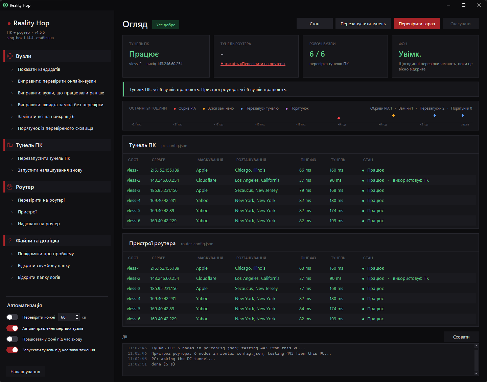
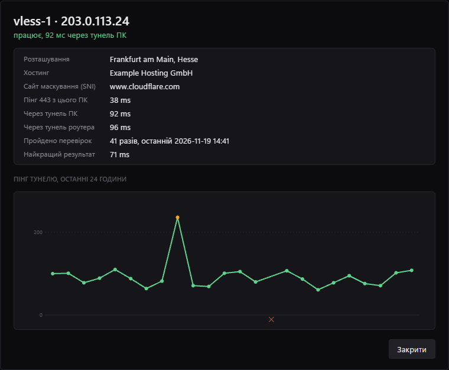
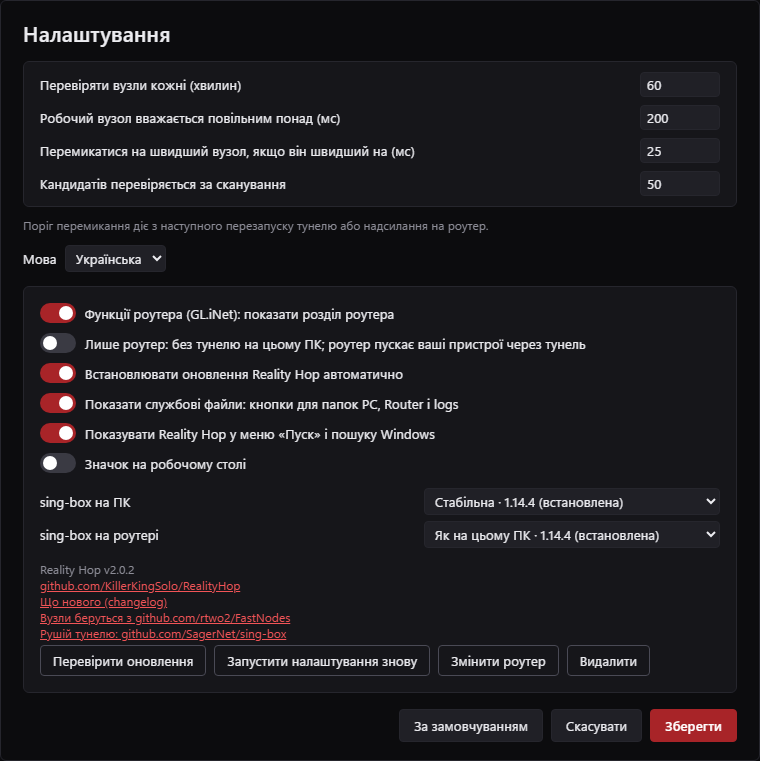

# Reality Hop (Українська)

<p align="center">
  <a href="https://github.com/KillerKingSolo/RealityHop/stargazers"></a>
  <a href="https://github.com/KillerKingSolo/RealityHop/releases"></a>
  <a href="https://github.com/KillerKingSolo/RealityHop/releases/latest"></a>
  <a href="../../LICENSE"></a>
  <br>
  <a href="https://github.com/KillerKingSolo/RealityHop/releases/latest"></a>
  <a href="#встановлення"></a>
</p>

<p align="center">
  <a href="../../README.md">English</a> · <a href="README.es.md">Español</a> · <a href="README.zh.md">简体中文</a> ·
  <a href="README.ru.md">Русский</a> · <b>Українська</b> ·
  <a href="README.fa.md">فارسی</a> · <a href="README.ar.md">العربية</a> ·
  <a href="README.tr.md">Türkçe</a> · <a href="README.vi.md">Tiếng Việt</a>
</p>

> Машинний переклад англійського README. Якщо щось незрозуміло, орієнтуйтеся на англійську версію. Виправлення вітаються в issue на GitHub.

**Пропустіть свій VPN крізь мережі, які блокують VPN.** Reality Hop загортає VPN-з'єднання в тунель VLESS + REALITY
([sing-box](https://github.com/SagerNet/sing-box)). Для мережі це виглядає як звичайний HTTPS до великого сайту,
наприклад cloudflare.com. Його зроблено для мереж, які блокують VPN:

- Wi-Fi у Школі, на Роботі, в Готелі та Гуртожитку
- Публічний Wi-Fi в Аеропортах, Кафе, Потягах і Бібліотеках
- Роутери з «блокуванням VPN» та провайдери, які сповільнюють або блокують VPN-трафік
- Країни, що фільтрують інтернет: Великий китайський файрвол, Росія, Іран, Туркменістан і ОАЕ

Він бере безкоштовні публічні вузли з [rtwo2/FastNodes](https://github.com/rtwo2/FastNodes), сам їх перевіряє,
використовує найшвидші робочі й сам замінює неробочі.

**Що нового:** [CHANGELOG.md](../../CHANGELOG.md) (спершу нові версії) · **Завантажити:** [останній реліз](https://github.com/KillerKingSolo/RealityHop/releases/latest)


<picture>
  <source media="(prefers-color-scheme: dark)" srcset="../images/flow-dark.png">
  
</picture>

Мережа між вами та вузлом бачить лише звичайне зашифроване з'єднання з великим сайтом. Власне шифрування вашого VPN
залишається всередині на всьому шляху.

## Знімки екрана

<table>
<tr><td colspan="2"><br><b>Головне вікно:</b> кожен вузол перевірено через робочий тунель, останні 24 години, тунель роутера.</td></tr>
<tr><td width="50%" valign="top"><br><b>Кандидати:</b> вузли з публічного списку, пінг і перевірка на вашому ПК; поставте будь-який у слот.</td><td width="50%" valign="top"><br><b>Пристрої роутера:</b> оберіть, які пристрої використовують тунель роутера, і як закріпити їхню адресу.</td></tr>
<tr><td width="50%" valign="top"><br><b>Відомості про вузол:</b> де розташований вузол, як він проходить перевірки, його пінг за 24 години.</td><td width="50%" valign="top"><br><b>Повідомити про проблему:</b> логи, з яких прибрано все особисте, готові для issue на GitHub.</td></tr>
<tr><td colspan="2" align="center"><br><b>Налаштування:</b> перевірки, функції роутера, оновлення, канал sing-box, ярлики.</td></tr>
</table>

## Можливості

- **Один exe, покрокове налаштування.** Завантажте `RealityHop.exe`, запустіть, і майстер зробить решту:
  встановлення, sing-box, перші вузли, ваш VPN-застосунок, запуск під час завантаження.
- **Сам знаходить і перевіряє вузли.** Завантажує публічний список вузлів, виконує справжній REALITY-хендшейк і
  HTTPS-запит через кожного кандидата та залишає 6 найшвидших робочих.
- **Сам себе лагодить.** Фоновий спостерігач з іконкою в треї перевіряє вузли щогодини. Він замінює неробочий вузол, а
  коли не працює жоден, рятує зі сховища перевірених вузлів. З PIA він реагує тієї миті, коли VPN падає.
- **Іконка в треї показує стан.** Центр показує загальний стан. Кільце поділено на сегменти, по одному на вузол:
  зелений працює, жовтий повільний, червоний не працює.
- **Меню «Пуск» і пошук Windows.** Натисніть клавішу Windows і введіть Reality Hop. Ярлик на робочому столі за
  бажанням.
- **Необов'язкова підтримка роутерів GL.iNet** з вікном **Пристрої**: оберіть, які пристрої використовують тунель, і
  як закріпити їхню адресу (без змінної MAC на телефоні, Reserved IP для нього у списку Clients панелі GL.iNet).
- **Роутер GL.iNet:** пустіть через тунель і телефон, консоль чи телевізор, нічого на них не встановлюючи. Вимкніть
  цю функцію, і розділ роутера зникне.
- **Лише роутер.** Без тунелю на ПК: роутер пропускає через тунель обрані вами пристрої або всі пристрої основної
  мережі, тож увесь ваш трафік іде через тунель.
- **Показує збірку sing-box** (стабільну чи тестову) під назвою у вікні.
- **Стоп / Старт для подорожей.** Одна кнопка вимикає все, включно із запуском під час завантаження, доки ви не
  натиснете Старт.
- **9 мов.** Англійська, іспанська, спрощена китайська, російська, українська, перська, арабська, турецька та
  в'єтнамська. Оберіть під час першого запуску; змініть у налаштуваннях. Журнал дій і звіти про проблеми лишаються
  англійською.
- **Автоматичні оновлення.** Reality Hop оновлюється сам з релізів цього репозиторію (з перевіркою SHA-256).
- **sing-box оновлюється сам**, щодня, на обраному каналі: **Стабільна** (за замовчуванням) або **Тестові збірки
  (бета, альфа)**. Він не чекає на реліз Reality Hop.
- **Видно, що працює за лаштунками.** Увімкніть *Показати службові файли*, щоб отримати кнопки для папок `PC`,
  `Router` і `logs`: чинні конфіги sing-box, скрипти роутера й три логи.
- **Анонімні звіти про проблеми.** *Повідомити про проблему* збирає три логи, замінюючи адреси, імена, ключі й
  секрети мітками. Спершу ви читаєте звіт, потім прикріплюєте його до issue на GitHub. Нічого не надсилається
  автоматично.
- **Одна папка для всього.** Встановлюється в `C:\Program Files\RealityHop` або в папку, обрану під час
  налаштування, з одним запитом UAC. Програма, рушій тунелю, конфіги та логи залишаються там, доступні для читання
  лише вашому користувачеві Windows. Оновлення встановлюються туди без повторних запитань. Програма ніколи не працює
  від імені адміністратора. Без телеметрії.

## Встановлення

1. Завантажте **`RealityHop.exe`** з [останнього релізу](https://github.com/KillerKingSolo/RealityHop/releases/latest).
2. Запустіть його. Windows SmartScreen може попередити, бо exe не підписаний: натисніть **More info → Run anyway**
   (Докладніше → Усе одно запустити). Деякі антивіруси помилково позначають непідписані застосунки; увесь вихідний
   код тут, і ви можете [зібрати його самі](../building.md) (англійською).
3. Пройдіть майстер налаштування:
   - **Встановити** копіює Reality Hop у `C:\Program Files\RealityHop` (один запит UAC), завантажує sing-box,
     знаходить перші вузли й запускає тунель. Це займає близько хвилини.
   - **Роутер?** питає, чи налаштувати також роутер GL.iNet. Якщо відповісти «так», майстер проведе вас крок за
     кроком ([докладніше](../router-setup.md), англійською). Якщо відповісти «ні», Reality Hop показує лише частину
     для ПК.
   - **VPN-застосунок** показує, як спрямувати VPN у тунель ([докладніше](../vpn-setup.md), англійською).
   - **Готово** вмикає фоновий запуск під час входу в систему, запуск під час завантаження та автоматичні оновлення.

Вимоги: Windows 10 або 11 (64-біт) з Microsoft Edge WebView2 (входить до Windows 11 і актуальної Windows 10) та
VPN-застосунок, який уміє працювати через SOCKS5-проксі.

### Mac

1. Завантажте **`RealityHop-mac-apple-silicon.dmg`** (M1 і новіші) або **`RealityHop-mac-intel.dmg`** з
   [останнього релізу](https://github.com/KillerKingSolo/RealityHop/releases/latest).
2. Відкрийте його й перетягніть **Reality Hop** до **Applications** (Програми). Запускайте з «Програм», а не з образу
   диска.
3. Відкрийте Reality Hop з «Програм». Першого разу macOS заблокує його, бо застосунок не нотаризовано Apple (для цього
   потрібен платний акаунт розробника Apple). Дозвольте один раз:
   1. macOS повідомить, що не може перевірити Reality Hop. Натисніть **Done** (Готово), а не **Move to Trash**
      (Перемістити в Смітник).
   2. Відкрийте **System Settings → Privacy & Security** (Системні параметри → Приватність і безпека) і прокрутіть
      донизу до **Security** (Безпека).
   3. Поруч із «Reality Hop» was blocked натисніть **Open Anyway** (Усе одно відкрити), потім ще раз **Open Anyway** і
      введіть пароль від Mac.

   Це потрібно зробити лише один раз. Оновлення відкриваються без запитань. Правий клік → **Відкрити** більше не
   працює в macOS 15 і новіших. Увесь вихідний код тут, і ви можете [зібрати його самі](../building.md).
   [Докладніше](../troubleshooting.md#mac-reality-hop-cannot-be-opened) (англійською).
4. Пройдіть той самий майстер. Пароль адміністратора не потрібен: усе зберігається в `~/Library/Application
   Support/RealityHop`, доступне для читання лише вашому користувачеві, а фоновий спостерігач видно в рядку меню.
5. PIA на Mac: у Split Tunnel нічого налаштовувати не треба. Reality Hop сам додає себе (Bypass VPN) і тримає там
   адреси своїх вузлів, тож kill switch у PIA може лишатися ввімкненим. Використовуйте один DNS-застосунок водночас
   ([докладніше](../vpn-setup.md)).

Вимоги: macOS 15 або новіша, Apple silicon або Intel, та VPN-застосунок, який уміє працювати через SOCKS5-проксі.
Завантажуйте PIA для Mac з [його сайту](https://www.privateinternetaccess.com/download/mac-vpn), а не з Mac App Store:
у версії з App Store немає Multi-Hop і Split Tunnel, тож вона не може під'єднатися через Reality Hop.

## Налаштування VPN-застосунку

Reality Hop слухає **SOCKS5 `127.0.0.1`, порт `2080`**, без імені користувача й пароля.

Ваш VPN має використовувати **OpenVPN через TCP, порт 443**. SOCKS5-проксі передає лише TCP, а 443 це звичайний
порт HTTPS.

**Private Internet Access (PIA):**
Settings → Protocols: Protocol **OpenVPN**, Transport **TCP**, Remote Port **443**. Потім Settings → Multi-Hop:
позначте **Multi-hop and Obfuscation**, оберіть **SOCKS5 Proxy**, натисніть **EDIT**, введіть хост `127.0.0.1` і порт
`2080` та збережіть. Split Tunnel нічого від вас не потребує: Reality Hop сам додає `rh-core.exe` і його тестову копію
`rh-test.exe` як **Bypass VPN**. Лише якщо командний рядок PIA відмовить, майстер покаже ручний крок: у Settings →
Split Tunnel додайте `C:\Program Files\RealityHop\PC\rh-core.exe` і оберіть **Bypass VPN**.


**Інші VPN-застосунки:** будь-який застосунок з налаштуванням SOCKS5-проксі працює так само, через OpenVPN по TCP на
порту 443. У конфігу OpenVPN вкажіть `proto tcp`, порт сервера `443` і додайте `socks-proxy 127.0.0.1 2080`. Див.
[docs/vpn-setup.md](../vpn-setup.md) (англійською).

## Керування

| Де | Що |
|---|---|
| Іконка в треї | Подвійний клік відкриває вікно. Правий клік: Перезапустити тунель, Перевірити зараз, Порятунок, Вихід. |
| **Перевірити зараз** | Перевіряє кожен вузол через робочий тунель. |
| **Перезапустити тунель** | Перезапускає тунель на поточних вузлах (близько 2 секунд). |
| **Стоп / Старт** | Вимикає все, включно із запуском під час завантаження, на час вашої відсутності. Поки зупинено, вимкніть проксі у VPN-застосунку. |
| Вузли → **Показати кандидатів** | Показує вузли з публічного списку; перевірте їх і поставте будь-який у слот, потім перезапустіть і перевірте тунель ПК у тому ж вікні. |
| Вузли → **Порятунок** | Використовуйте, коли не працює жоден вузол. Перевіряє сховище перевірених вузлів і ставить 6 найкращих. |
| Довідка → **Повідомити про проблему** | Робить знеособлений звіт із логів і відкриває issue на GitHub, щоб ви його прикріпили. |
| Файли (за бажанням) | **Відкрити службову папку** (`PC`, `Router`, `logs`, `anonymous-logs`) і **Відкрити папку логів**. |
| **Налаштування** | Інтервал перевірки, поріг повільного вузла, запас для перемикання, функції роутера ввімк/вимк, sing-box стабільна чи тестова збірка (ПК і роутер), показ службових файлів, оновлення, повторний запуск налаштування, видалення. |

**Видалення:** Панель керування → Програми → Видалення програми → Reality Hop. Параметри Windows → Програми →
Інстальовані програми → Reality Hop і Налаштування → Видалити в самому Reality Hop роблять те саме.

## Звідки беруться вузли

- **Список вузлів:** [rtwo2/FastNodes](https://github.com/rtwo2/FastNodes), файл
  [`sub/verified_tls.txt`](https://raw.githubusercontent.com/rtwo2/FastNodes/main/sub/verified_tls.txt). Reality Hop
  залишає лише вузли VLESS + REALITY + XTLS-Vision на порту 443 з відомим сайтом-прикриттям. Потім сам їх перевіряє;
  перевірці самого списку він не довіряє.
- **Рушій тунелю:** [SagerNet/sing-box](https://github.com/SagerNet/sing-box), завантажується з офіційних релізів на
  GitHub. Стабільна це найновіший повний реліз; тестові збірки це найновіші з усіх, включно з альфою та бетою.
  Перевіряється контрольна сума SHA-256, і нова збірка має прийняти конфіг, перш ніж замінить стару. На вашому ПК він
  працює як `rh-core.exe`.
- **Рушій роутера:** власна збірка sing-box від Reality Hop для роутерів arm64, зібрана з офіційного вихідного коду
  без усього, що роутер не використовує (18 МБ замість 27 МБ у пакета GL.iNet 1.9.7). Вона слідує каналу ПК, якщо в
  налаштуваннях роутеру не задано власний. Reality Hop питає перед оновленням роутера, тримає стару збірку в
  оперативній пам'яті роутера й повертає її, якщо нова не запуститься. Сторінка Plug-ins роутера й далі показує пакет
  GL.iNet 1.9.7; бічна панель показує версію, яка справді працює. Як вона збирається й перевіряється:
  [`router-core/`](../../router-core/README.md) (англійською).
- **Протокол:** VLESS з REALITY та XTLS-Vision від [XTLS](https://github.com/XTLS).

## Приватність і безпека

- **Публічні вузли тримають незнайомці.** Ваш VPN і далі шифрує все від початку до кінця, тож вузол бачить лише
  зашифрований VPN-трафік і його адресата, VPN-сервер. Завжди тримайте VPN поверх. Не надсилайте особистий трафік
  через Reality Hop без VPN.
- **З чим зв'язується Reality Hop:**
  - GitHub: список вузлів, релізи sing-box, збірки для роутера та релізи Reality Hop.
  - `api.ipify.org`, запитується через кожен вузол під час його перевірки.
  - `www.gstatic.com/generate_204`, перевірка затримки через тунель.
  - `ip-api.com`, для розташування вузлів, запитується через тунель.
  - DNS Quad9 (`9.9.9.9`), через тунель.

  Жодні дані про вас нікуди не надсилаються, телеметрії немає.
- **Що він зберігає:** конфіги, сховище вузлів, логи й налаштування у своїй папці встановлення (папки `PC`, `Router`,
  `logs`, `anonymous-logs`), яку може відкрити лише ваш користувач Windows. Ключ роутера це SSH-ключ, створений на
  вашому ПК. Пароль від роутера ви вводите у власний `ssh` Windows, і Reality Hop його ніколи не бачить і не зберігає.
- Переконайтеся, що вам дозволено користуватися VPN у вашій мережі й у вашій країні. Деякі країни обмежують або
  забороняють VPN; Reality Hop не змінює закон там, де ви перебуваєте.

Про проблеми безпеки див. [SECURITY.md](../../SECURITY.md). Для всього іншого використовуйте **Повідомити про
проблему** у вікні й прикріпіть анонімний звіт до issue. Ніколи не прикріплюйте `pc-config.json`,
`router-config.json` чи `vault.json`.

## Історія зірок

**Якщо Reality Hop вам допомагає, поставте йому зірку.** Це безкоштовно й займає один клік. Зірки показують мені, що
ним користуються, допомагають іншим його знайти й мотивують мене виправляти проблеми та додавати нові функції.

<a href="https://www.star-history.com/#KillerKingSolo/RealityHop&Date">
 <picture>
   <source media="(prefers-color-scheme: dark)" srcset="https://api.star-history.com/svg?repos=KillerKingSolo/RealityHop&type=Date&theme=dark" />
   <source media="(prefers-color-scheme: light)" srcset="https://api.star-history.com/svg?repos=KillerKingSolo/RealityHop&type=Date" />
   
 </picture>
</a>

## Документація

Посібники англійською:

- [Як це працює](../how-it-works.md)
- [Налаштування роутера GL.iNet](../router-setup.md)
- [Налаштування VPN-застосунку](../vpn-setup.md)
- [Розв'язання проблем](../troubleshooting.md)
- [Збирання з вихідного коду та випуск релізів](../building.md)

## Запуск із вихідного коду

Reality Hop написаний на Rust з [Tauri](https://github.com/tauri-apps/tauri). Якщо встановлено
[Rust](https://rustup.rs):

```
cd rust
cargo run -p realityhop-app
```

Подробиці, збирання для Mac і кроки випуску: [docs/building.md](../building.md).

## Ліцензія

[CC BY-NC-ND 4.0](../../LICENSE) (Creative Commons «Зазначення авторства — Некомерційна — Без похідних» 4.0).
Коротко:

- **Поширюйте без змін і із зазначенням авторів:** Reality Hop від KillerKingSolo, sing-box від SagerNet і FastNodes
  від rtwo2, з посиланнями на них (див. [LICENSE](../../LICENSE)).
- **Без змінених версій:** не можна поширювати відредаговану копію.
- **Без комерційного використання:** не можна продавати його чи використовувати задля прибутку.

Усе понад це потребує дозволу. sing-box (GPL-3.0-or-later) і FastNodes (MIT) це окремі проєкти з власними ліцензіями;
Reality Hop завантажує їх під час роботи й не поширює разом із собою.
