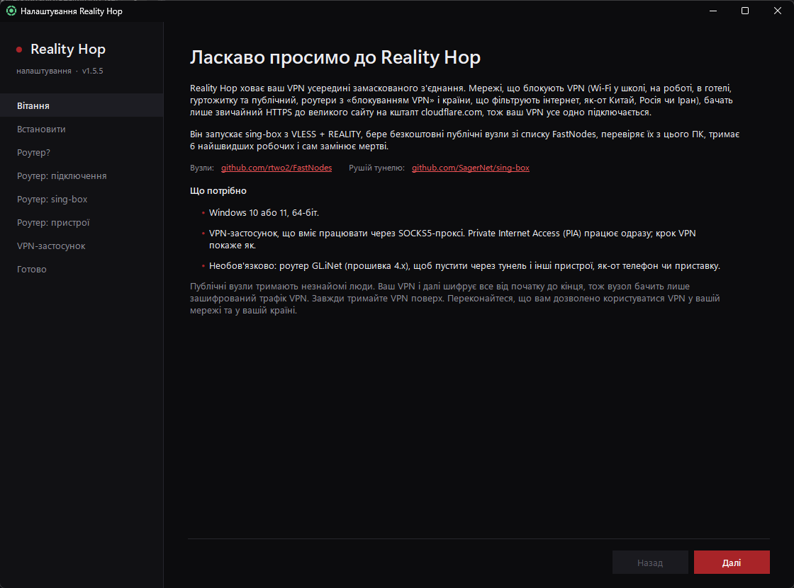
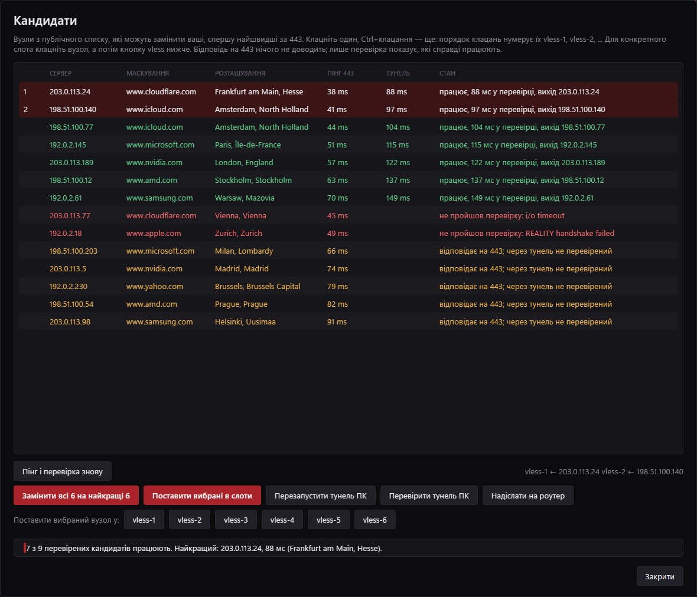
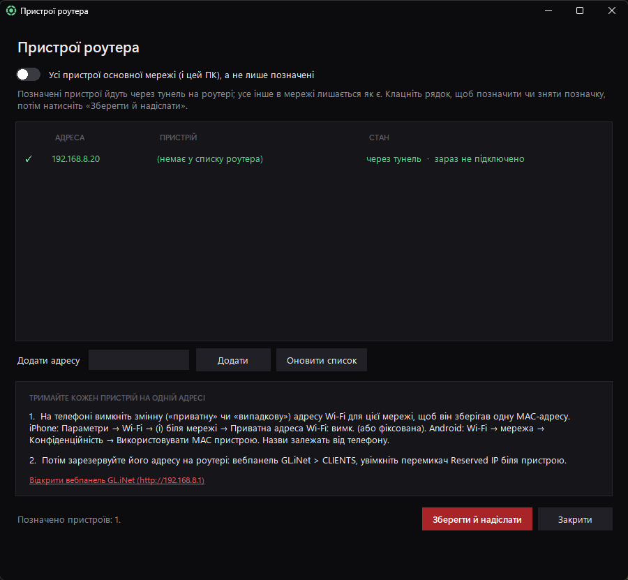
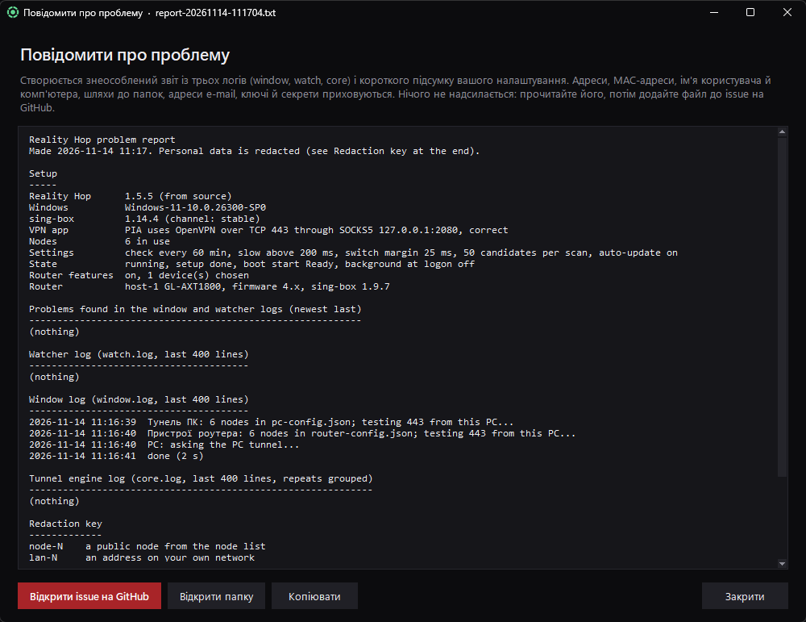
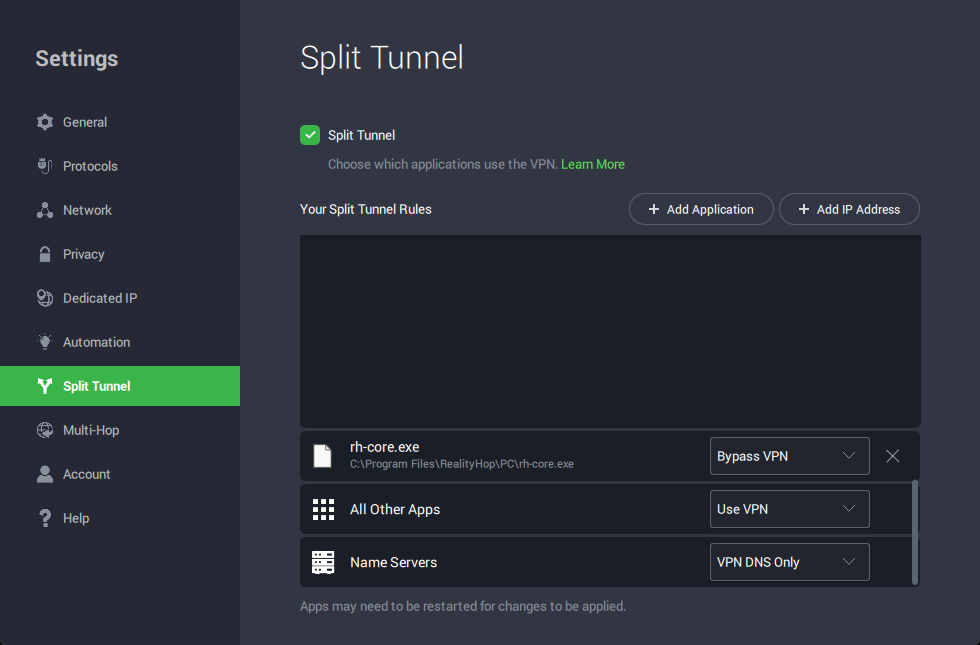

# Reality Hop (Українська)

  
  
  
  
   
  
  

  <a href="../../README.md">English</a> · <a href="README.es.md">Español</a> · <a href="README.zh.md">简体中文</a> ·
  <a href="README.ru.md">Русский</a> · <b>Українська</b> ·
  <a href="README.fa.md">فارسی</a> · <a href="README.ar.md">العربية</a> ·
  <a href="README.tr.md">Türkçe</a> · <a href="README.vi.md">Tiếng Việt</a>

> Машинний переклад англійського README. Якщо щось незрозуміло, орієнтуйтеся на англійську версію. Виправлення вітаються в issue на GitHub.

**Пропустіть VPN через мережі, що блокують VPN.** Reality Hop загортає з'єднання вашого VPN у тунель VLESS + REALITY ([sing-box](https://github.com/SagerNet/sing-box)). Для мережі це виглядає як звичайний HTTPS до великого сайту, як-от cloudflare.com. Він створений для:

- Wi-Fi у школі, на роботі, в готелі та гуртожитку
- публічного Wi-Fi в аеропортах, кафе, потягах і бібліотеках
- роутерів із «блокуванням VPN» і провайдерів, що сповільнюють або блокують VPN
- країн, що фільтрують інтернет: Великий китайський файрвол, Росія, Іран, Туркменістан і ОАЕ

Він бере безкоштовні публічні вузли з [rtwo2/FastNodes](https://github.com/rtwo2/FastNodes), сам їх перевіряє, використовує найшвидші робочі й сам замінює мертві.

## Як це працює

VPN-застосунок → Reality Hop на вашому ПК (SOCKS5 `127.0.0.1:2080`) → публічний вузол REALITY (виглядає як HTTPS до cloudflare.com) → VPN-сервер → інтернет. Власне шифрування VPN зберігається всередині на всьому шляху.

## Знімки екрана

<table>
<tr><td colspan="2"> <b>Головне вікно:</b> кожен вузол перевірено через робочий тунель, останні 24 години, тунель роутера.</td></tr>
<tr><td width="50%" valign="top"> <b>Кандидати:</b> вузли з публічного списку, пропінговані й перевірені на вашому ПК; будь-який можна поставити в слот.</td><td width="50%" valign="top"> <b>Пристрої роутера:</b> оберіть, які пристрої йдуть через тунель роутера, і як закріпити їхню адресу.</td></tr>
<tr><td width="50%" valign="top"> <b>Відомості про вузол:</b> де розташований вузол, як він проходить перевірки, його пінг за 24 години.</td><td width="50%" valign="top"> <b>Повідомити про проблему:</b> журнали без особистих даних, готові для issue на GitHub.</td></tr>
<tr><td colspan="2" align="center"> <b>Налаштування:</b> перевірки, функції роутера, оновлення, канал sing-box, ярлики.</td></tr>
</table>

## Встановлення

1. Завантажте `RealityHop.exe` з [останнього релізу](https://github.com/KillerKingSolo/RealityHop/releases/latest). Потрібна 64-бітна Windows 10 або 11. На Mac: `RealityHop-mac-apple-silicon.dmg` (M1 і новіші) або `RealityHop-mac-intel.dmg`. Потрібна macOS 15 або новіша. PIA для Mac завантажте з [його сайту](https://www.privateinternetaccess.com/download/mac-vpn), а не з Mac App Store: у версії з App Store немає Multi-Hop і Split Tunnel. Під час першого запуску macOS блокує Reality Hop, бо Apple не нотаріально засвідчила застосунок: натисніть **Done** (Готово), відкрийте **System Settings → Privacy & Security** (Системні параметри → Приватність і безпека) і натисніть **Open Anyway** (Усе одно відкрити). Лише один раз. [Покроково](https://github.com/KillerKingSolo/RealityHop/blob/main/docs/troubleshooting.md#mac-reality-hop-cannot-be-opened).
2. Запустіть його й виберіть мову.
3. Майстер встановлює Reality Hop (один запит UAC), завантажує sing-box з офіційних релізів (перевіряє SHA-256), знаходить перші вузли й запускає тунель. Близько хвилини.

## Мова

Reality Hop питає мову під час першого запуску. Пізніше її можна змінити в **Налаштування → Мова**. Журнал дій і звіти про проблеми лишаються англійською, щоб їх могла прочитати підтримка.

## Налаштування VPN-застосунку

Спрямуйте VPN-застосунок на SOCKS5-проксі `127.0.0.1`, порт `2080`, без імені користувача й пароля. Використовуйте **OpenVPN через TCP, порт 443**: SOCKS5-проксі передає лише TCP.

**Private Internet Access (PIA):**

1. PIA → **Settings → Protocols**: Protocol **OpenVPN**, Transport **TCP**, Remote Port **443**.
2. **Settings → Multi-Hop**: позначте **Multi-hop and Obfuscation** і виберіть **SOCKS5 Proxy**.
3. Натисніть **EDIT**, хост `127.0.0.1`, порт `2080`, ім'я користувача й пароль порожні, збережіть.
4. Reality Hop додає це правило сам; майстер налаштування показує цей крок, лише якщо це не вдалося. Лише якщо в Split Tunnel для **All Other Apps** вибрано **Use VPN**: **Settings → Split Tunnel**, **Add Application**, виберіть `C:\Program Files\RealityHop\PC\rh-core.exe` і встановіть **Bypass VPN**. Якщо для All Other Apps вибрано Bypass VPN, це правило не потрібне.
5. Підключіться.

**Інші VPN-застосунки:** будь-який застосунок із налаштуванням SOCKS5-проксі працює так само. У файлі OpenVPN: `proto tcp`, сервер на порту 443 і рядок `socks-proxy 127.0.0.1 2080`. Подробиці англійською: [VPN app setup](../vpn-setup.md).

## Роутер GL.iNet (необов'язково)

З роутером GL.iNet (прошивка 4.x) вибрані пристрої (телефон, приставка, телевізор) теж ідуть через тунель, без встановлення будь-чого на них. Режим **Лише роутер** нічого не запускає на ПК: роутер пускає через тунель вибрані пристрої або всю мережу. Посібник англійською: [router setup](../router-setup.md).

## Щоденне використання

- **Значок у треї:** центр показує загальний стан; кільце — по сегменту на вузол (зелений працює, жовтий повільний, червоний мертвий).
- **Перевірити зараз**, **Перезапустити тунель**, **Показати кандидатів** (перевірити вузли й поставити в слоти), **Порятунок**, коли всі вузли мертві.
- **Стоп / Старт** для подорожей. Поки зупинено, вимкніть проксі у VPN-застосунку.
- Reality Hop сам оновлюється з релізів на GitHub (з перевіркою SHA-256).

## Приватність і безпека

- **Публічні вузли тримають незнайомі люди.** VPN і далі шифрує все від початку до кінця, тож вузол бачить лише зашифрований трафік VPN. Завжди тримайте VPN увімкненим.
- Reality Hop звертається до GitHub (список вузлів, sing-box, релізи Reality Hop), а через тунель — до `api.ipify.org`, `www.gstatic.com/generate_204`, `ip-api.com` і DNS Quad9. Нічого про вас не надсилається, телеметрії немає.
- Переконайтеся, що вам дозволено користуватися VPN у вашій мережі та у вашій країні. Reality Hop не змінює закон там, де ви перебуваєте.

## Проблеми

Скористайтеся **Повідомити про проблему** у вікні: створюється знеособлений звіт для issue на GitHub. Ніколи не додавайте `pc-config.json`, `router-config.json` чи `vault.json`. Посібник англійською: [troubleshooting](../troubleshooting.md).

## Ліцензія

[CC BY-NC-ND 4.0](../../LICENSE): ділитися без змін і з зазначенням автора, без змінених версій і без комерційного використання.
