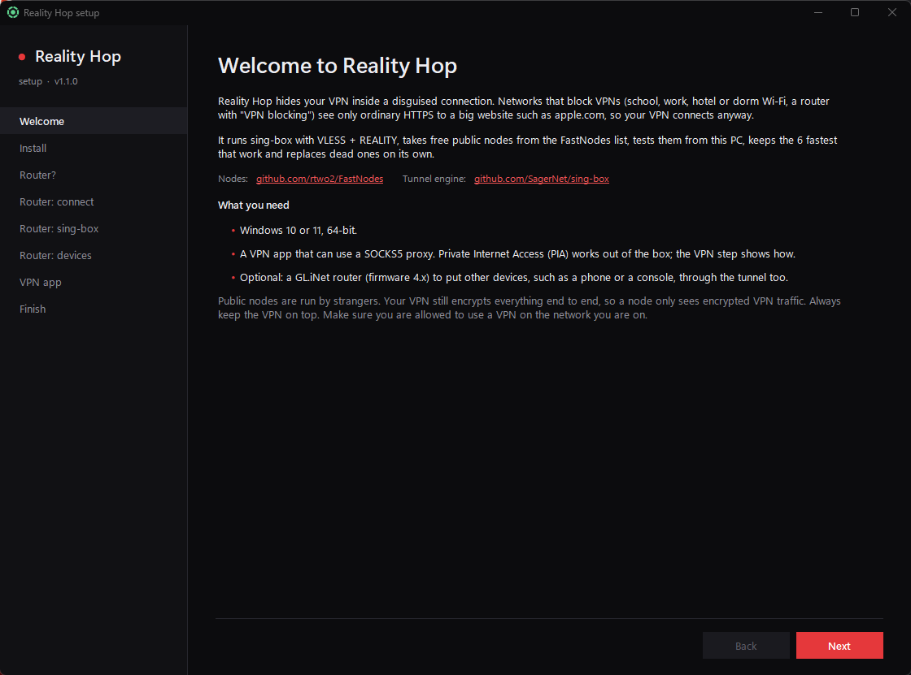
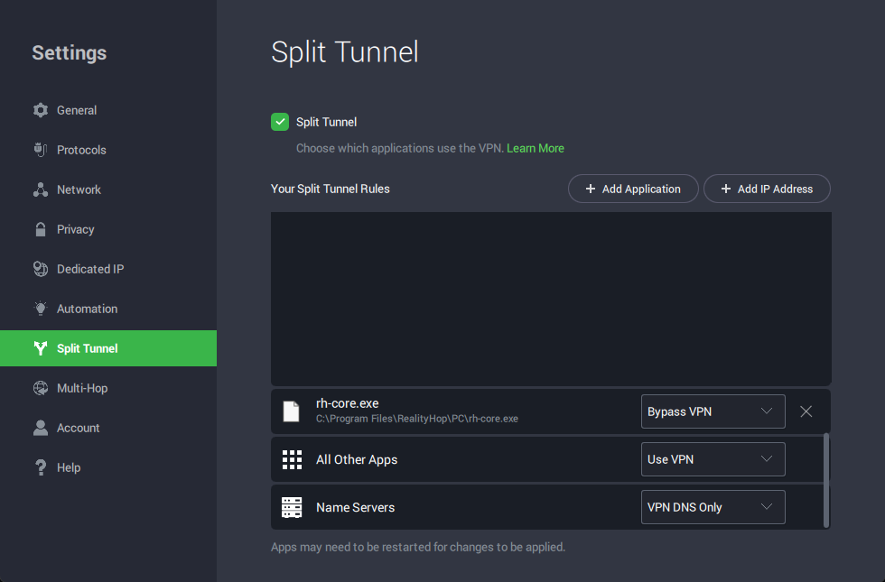

# Reality Hop (Tiếng Việt)

[English](../../README.md) · [Español](README.es.md) · [简体中文](README.zh.md) · [Русский](README.ru.md) · [Українська](README.uk.md) · [فارسی](README.fa.md) · [العربية](README.ar.md) · [Türkçe](README.tr.md) · **Tiếng Việt**

> Đây là bản dịch máy của README tiếng Anh. Nếu có gì chưa rõ, bản tiếng Anh là bản chuẩn. Mọi góp ý sửa lỗi xin gửi qua issue trên GitHub.

**Đưa VPN của bạn vượt qua các mạng chặn VPN.** Reality Hop bọc kết nối VPN của bạn trong một đường hầm VLESS + REALITY ([sing-box](https://github.com/SagerNet/sing-box)). Với mạng, nó trông như HTTPS bình thường tới một trang web lớn như cloudflare.com. Nó được làm cho:

- Wi-Fi ở trường, nơi làm việc, khách sạn và ký túc xá
- Wi-Fi công cộng ở sân bay, quán cà phê, tàu hỏa và thư viện
- router có "chặn VPN" và nhà mạng làm chậm hoặc chặn lưu lượng VPN
- các quốc gia lọc internet, như Vạn lý tường lửa của Trung Quốc, Nga, Iran, Turkmenistan và UAE

Nó lấy các nút công khai miễn phí từ [rtwo2/FastNodes](https://github.com/rtwo2/FastNodes), tự kiểm tra, dùng các nút nhanh nhất đang hoạt động và tự thay các nút chết.

## Cách hoạt động

Ứng dụng VPN → Reality Hop trên PC của bạn (SOCKS5 `127.0.0.1:2080`) → nút REALITY công khai (trông như HTTPS tới cloudflare.com) → máy chủ VPN → internet. Lớp mã hóa riêng của VPN vẫn nằm bên trong suốt đường đi.

## Cài đặt

1. Tải `RealityHop.exe` từ [bản phát hành mới nhất](https://github.com/KillerKingSolo/RealityHop/releases/latest). Cần Windows 10 hoặc 11 bản 64-bit.
2. Chạy nó và chọn ngôn ngữ.
3. Trình hướng dẫn cài Reality Hop (một lời nhắc UAC), tải sing-box từ bản phát hành chính thức (kiểm tra SHA-256), tìm các nút đầu tiên và khởi động đường hầm. Khoảng một phút.

## Ngôn ngữ

Reality Hop hỏi ngôn ngữ ở lần chạy đầu. Sau đó có thể đổi trong **Cài đặt → Ngôn ngữ**. Nhật ký hoạt động và báo cáo sự cố vẫn bằng tiếng Anh để bộ phận hỗ trợ đọc được.

## Thiết lập ứng dụng VPN

Trỏ ứng dụng VPN vào proxy SOCKS5 `127.0.0.1`, cổng `2080`, không có tên người dùng hay mật khẩu. Dùng **OpenVPN qua TCP, cổng 443**: proxy SOCKS5 chỉ mang TCP.

**Private Internet Access (PIA):**

1. PIA → **Settings → Protocols**: Protocol **OpenVPN**, Transport **TCP**, Remote Port **443**.
2. **Settings → Multi-Hop**: đánh dấu **Multi-hop and Obfuscation** và chọn **SOCKS5 Proxy**.
3. Bấm **EDIT**, host `127.0.0.1`, cổng `2080`, để trống tên người dùng và mật khẩu, rồi lưu.
4. Chỉ khi Split Tunnel đặt **All Other Apps** là **Use VPN**: **Settings → Split Tunnel**, **Add Application**, chọn `C:\Program Files\RealityHop\PC\rh-core.exe` và đặt là **Bypass VPN**. Nếu All Other Apps là Bypass VPN thì không cần quy tắc này.
5. Kết nối.

**Ứng dụng VPN khác:** mọi ứng dụng có cài đặt proxy SOCKS5 đều hoạt động như vậy. Trong tệp OpenVPN: `proto tcp`, máy chủ ở cổng 443 và dòng `socks-proxy 127.0.0.1 2080`. Chi tiết bằng tiếng Anh: [VPN app setup](../vpn-setup.md).

## Router GL.iNet (tùy chọn)

Với router GL.iNet (firmware 4.x), các thiết bị bạn chọn (điện thoại, máy chơi game, TV) cũng đi qua đường hầm, không cần cài gì lên chúng. Chế độ **Chỉ router** không chạy gì trên PC: router cho các thiết bị đã chọn hoặc cả mạng đi qua đường hầm. Hướng dẫn tiếng Anh: [router setup](../router-setup.md).

## Sử dụng hằng ngày

- **Biểu tượng khay:** phần giữa là trạng thái chung; vòng ngoài có một đoạn cho mỗi nút (xanh hoạt động, vàng chậm, đỏ chết).
- **Kiểm tra ngay**, **Khởi động lại đường hầm**, **Hiện ứng viên** (kiểm tra nút và đặt vào ô), và **Cứu** khi mọi nút đều chết.
- **Dừng / Bắt đầu** khi đi xa. Trong lúc dừng, hãy tắt proxy của ứng dụng VPN.
- Reality Hop tự cập nhật từ các bản phát hành trên GitHub (có kiểm tra SHA-256).

## Quyền riêng tư và bảo mật

- **Các nút công khai do người lạ vận hành.** VPN của bạn vẫn mã hóa mọi thứ đầu cuối, nên một nút chỉ thấy lưu lượng VPN đã mã hóa. Luôn bật VPN.
- Reality Hop kết nối tới GitHub (danh sách nút, sing-box, bản phát hành Reality Hop), và qua đường hầm tới `api.ipify.org`, `www.gstatic.com/generate_204`, `ip-api.com` và DNS của Quad9. Không gửi gì về bạn, không có đo đạc từ xa.
- Hãy chắc chắn rằng bạn được phép dùng VPN trên mạng và ở quốc gia của bạn. Reality Hop không thay đổi luật pháp nơi bạn ở.

## Sự cố

Dùng **Báo cáo sự cố** trong cửa sổ: nó tạo một báo cáo đã ẩn thông tin cá nhân để đính kèm vào issue GitHub. Đừng bao giờ đính kèm `pc-config.json`, `router-config.json` hay `vault.json`. Hướng dẫn tiếng Anh: [troubleshooting](../troubleshooting.md).

## Giấy phép

[CC BY-NC-ND 4.0](../../LICENSE): chia sẻ nguyên vẹn và ghi nguồn, không chia sẻ bản đã sửa, không dùng cho mục đích thương mại.
