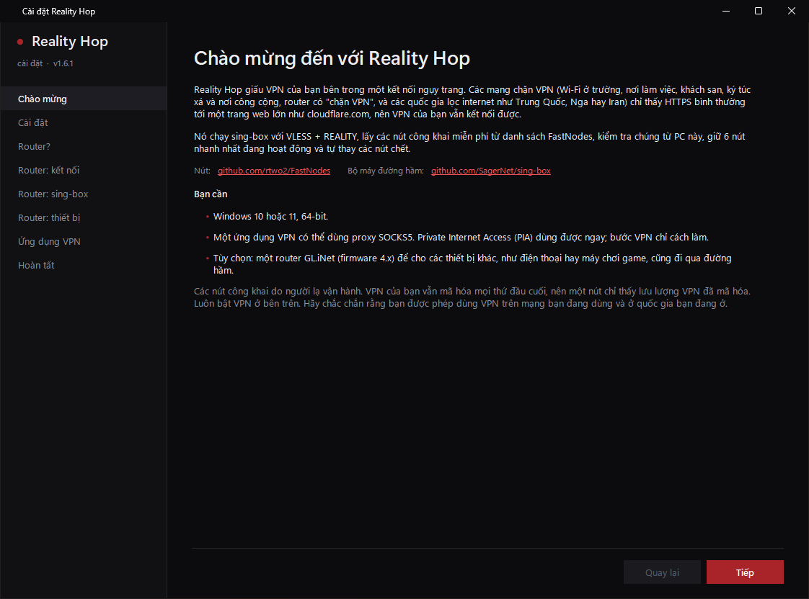
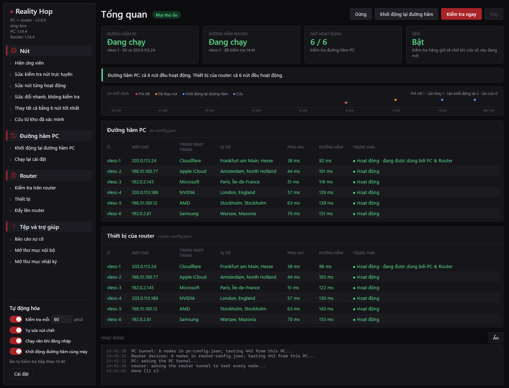
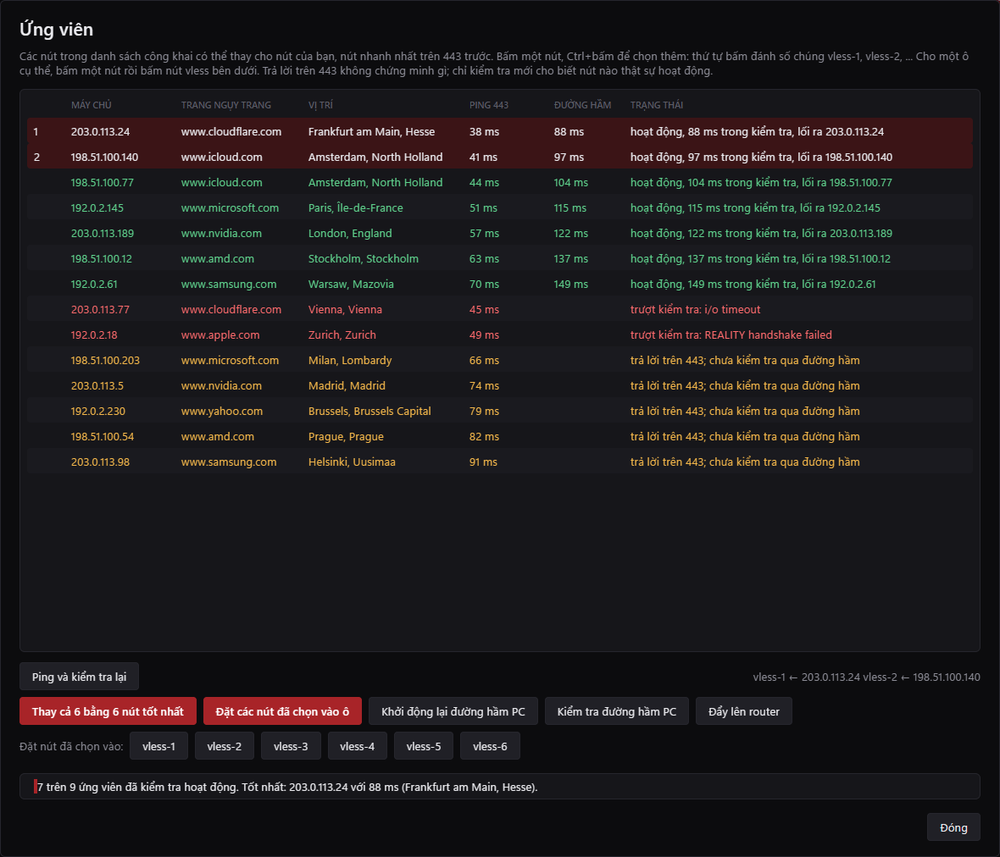
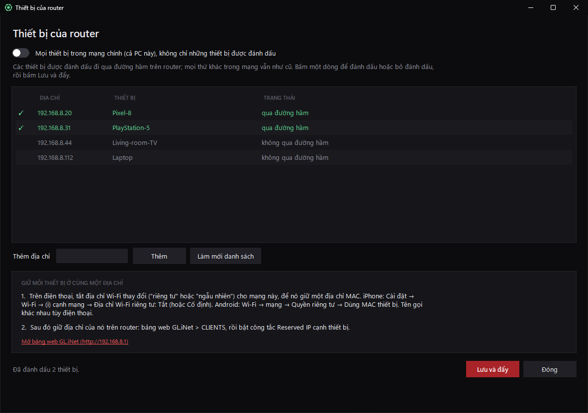
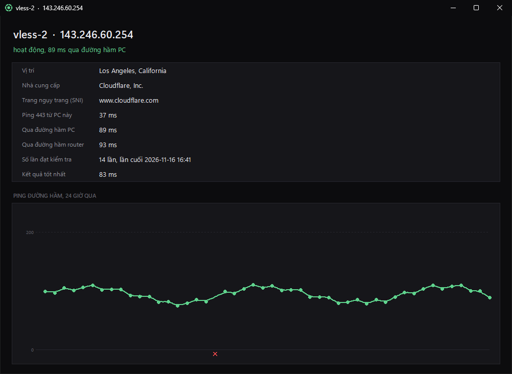
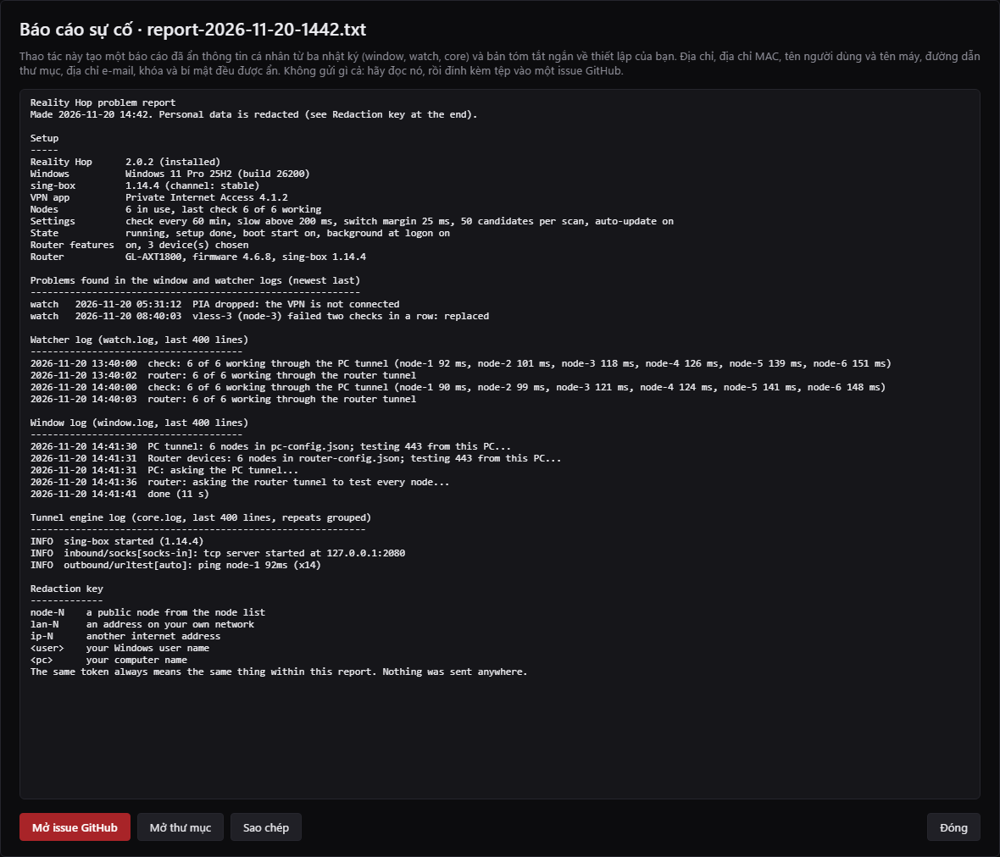
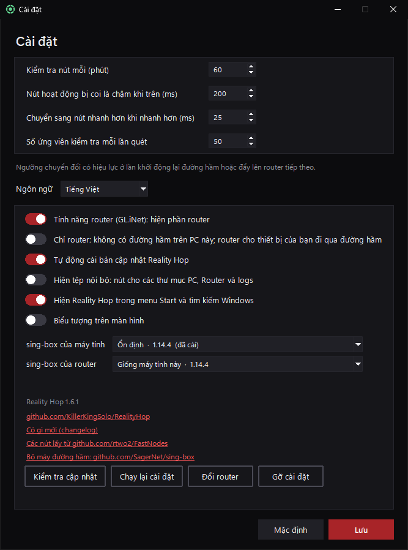

# Reality Hop (Tiếng Việt)

<p align="center">
  <a href="https://github.com/KillerKingSolo/RealityHop/stargazers"></a>
  <a href="https://github.com/KillerKingSolo/RealityHop/releases"></a>
  <a href="https://github.com/KillerKingSolo/RealityHop/releases/latest"></a>
  <a href="../../LICENSE"></a>
  <br>
  <a href="https://github.com/KillerKingSolo/RealityHop/releases/latest"></a>
  <a href="#cài-đặt"></a>
</p>

<p align="center">
  <a href="../../README.md">English</a> · <a href="README.es.md">Español</a> · <a href="README.zh.md">简体中文</a> ·
  <a href="README.ru.md">Русский</a> · <a href="README.uk.md">Українська</a> ·
  <a href="README.fa.md">فارسی</a> · <a href="README.ar.md">العربية</a> ·
  <a href="README.tr.md">Türkçe</a> · <b>Tiếng Việt</b>
</p>

> Đây là bản dịch máy của README tiếng Anh. Nếu có gì chưa rõ, bản tiếng Anh là bản chuẩn. Mọi góp ý sửa lỗi xin gửi qua issue trên GitHub.

**Đưa VPN của bạn đi qua các mạng chặn VPN.** Reality Hop bọc kết nối VPN của bạn trong một đường hầm VLESS + REALITY
([sing-box](https://github.com/SagerNet/sing-box)). Với mạng, nó trông như HTTPS bình thường tới một trang web lớn,
chẳng hạn cloudflare.com. Nó được làm cho các mạng chặn VPN:

- Wi-Fi ở Trường học, Nơi làm việc, Khách sạn và Ký túc xá
- Wi-Fi Công cộng ở Sân bay, Quán cà phê, Tàu hỏa và Thư viện
- Router có tính năng "chặn VPN", và nhà mạng làm chậm hoặc chặn lưu lượng VPN
- Các quốc gia lọc internet, như Vạn lý tường lửa của Trung Quốc, Nga, Iran, Turkmenistan và UAE

Nó lấy các nút công cộng miễn phí từ [rtwo2/FastNodes](https://github.com/rtwo2/FastNodes), tự kiểm tra chúng, dùng các
nút hoạt động nhanh nhất và tự thay các nút hỏng.

**Có gì mới:** [CHANGELOG.md](../../CHANGELOG.md) (phiên bản mới nhất trước) · **Tải về:** [bản phát hành mới nhất](https://github.com/KillerKingSolo/RealityHop/releases/latest)



<picture>
  <source media="(prefers-color-scheme: dark)" srcset="../images/flow-dark.png">
  
</picture>

Mạng ở giữa chỉ thấy một kết nối mã hóa bình thường tới một trang web lớn. Mã hóa riêng của VPN vẫn nằm bên trong
suốt đường đi.

## Ảnh chụp màn hình

<table>
<tr><td colspan="2"><br><b>Cửa sổ chính:</b> mọi nút được kiểm tra qua đường hầm đang chạy, 24 giờ qua, đường hầm router.</td></tr>
<tr><td width="50%" valign="top"><br><b>Ứng viên:</b> các nút từ danh sách công cộng, được ping và kiểm tra trên PC của bạn; đặt bất kỳ nút nào vào một ô.</td><td width="50%" valign="top"><br><b>Thiết bị của router:</b> chọn thiết bị nào dùng đường hầm router, và cách giữ cố định địa chỉ của chúng.</td></tr>
<tr><td width="50%" valign="top"><br><b>Chi tiết nút:</b> nút ở đâu, kết quả kiểm tra ra sao, ping trong 24 giờ.</td><td width="50%" valign="top"><br><b>Báo cáo sự cố:</b> nhật ký đã che mọi thông tin cá nhân, sẵn sàng cho một issue trên GitHub.</td></tr>
<tr><td colspan="2" align="center"><br><b>Cài đặt:</b> kiểm tra, tính năng router, cập nhật, kênh sing-box, lối tắt.</td></tr>
</table>

## Tính năng

- **Một file exe, cài đặt có hướng dẫn.** Tải `RealityHop.exe`, chạy nó, trình hướng dẫn làm phần còn lại: cài đặt,
  sing-box, các nút đầu tiên, ứng dụng VPN của bạn, khởi động cùng máy.
- **Tự tìm và kiểm tra nút cho bạn.** Nó tải danh sách nút công cộng, thực hiện một bắt tay REALITY thật và một lần
  tải HTTPS qua từng ứng viên, rồi giữ 6 nút hoạt động nhanh nhất.
- **Tự sửa chữa.** Một trình theo dõi nền có biểu tượng ở khay hệ thống kiểm tra các nút mỗi giờ. Nó thay một nút
  hỏng, và cứu từ kho các nút tốt đã biết khi tất cả đều hỏng. Với PIA, nó phản ứng ngay khi VPN bị ngắt.
- **Biểu tượng khay cho thấy trạng thái.** Ở giữa là trạng thái chung. Vòng ngoài có một đoạn cho mỗi nút: xanh lá
  hoạt động, vàng chậm, đỏ hỏng.
- **Menu Start và tìm kiếm Windows.** Nhấn phím Windows và gõ Reality Hop. Biểu tượng trên màn hình là tùy chọn.
- **Hỗ trợ router GL.iNet tùy chọn,** với cửa sổ **Thiết bị**: chọn thiết bị nào dùng đường hầm, và cách giữ cố định
  địa chỉ của chúng (không đổi MAC trên điện thoại, Reserved IP cho nó trong danh sách Clients của bảng điều khiển
  GL.iNet).
- **Router GL.iNet:** Cho cả điện thoại, máy chơi game hoặc TV đi qua đường hầm, không cần cài gì trên chúng. Tắt nó
  đi thì phần router biến mất.
- **Chỉ router.** Không có đường hầm trên PC: router đưa các thiết bị bạn chọn, hoặc mọi thiết bị trên mạng chính,
  qua đường hầm, để toàn bộ lưu lượng của bạn đi qua đường hầm.
- **Hiển thị bản sing-box** đang dùng (ổn định hoặc thử nghiệm) bên dưới tên trong cửa sổ.
- **Dừng / Bắt đầu khi bạn đi xa.** Một nút tắt mọi thứ, kể cả khởi động cùng máy, cho tới khi bạn nhấn Bắt đầu.
- **9 ngôn ngữ.** Tiếng Anh, Tây Ban Nha, Trung giản thể, Nga, Ukraina, Ba Tư, Ả Rập, Thổ Nhĩ Kỳ và Việt. Chọn một
  ngôn ngữ ở lần chạy đầu; đổi trong Cài đặt. Nhật ký hoạt động và báo cáo sự cố vẫn bằng tiếng Anh.
- **Tự động cập nhật.** Reality Hop tự cập nhật từ mục Releases của kho này (có kiểm tra SHA-256).
- **sing-box tự cập nhật**, hằng ngày, theo kênh bạn chọn: **Ổn định** (mặc định) hoặc **Bản thử nghiệm (beta,
  alpha)**. Không cần chờ bản phát hành Reality Hop.
- **Xem những gì chạy phía sau.** Bật *Hiện tệp nội bộ* để có các nút cho thư mục `PC`, `Router` và `logs`: các cấu
  hình sing-box đang dùng, các script của router và ba file nhật ký.
- **Báo cáo sự cố ẩn danh.** *Báo cáo sự cố* gom ba file nhật ký, thay địa chỉ, tên, khóa và bí mật bằng các ký hiệu.
  Bạn đọc trước, rồi đính kèm vào một issue trên GitHub. Không có gì được gửi tự động.
- **Một thư mục cho mọi thứ.** Cài vào `C:\Program Files\RealityHop`, hoặc thư mục bạn chọn khi cài đặt, với một lần
  hỏi UAC. Chương trình, công cụ đường hầm, cấu hình và nhật ký đều ở đó, chỉ người dùng Windows của bạn đọc được.
  Bản cập nhật cài vào đó mà không hỏi lại. Chương trình không bao giờ chạy với quyền quản trị. Không có telemetry.

## Cài đặt

1. Tải **`RealityHop.exe`** từ [bản phát hành mới nhất](https://github.com/KillerKingSolo/RealityHop/releases/latest).
2. Chạy nó. Windows SmartScreen có thể cảnh báo vì file exe chưa được ký mã: nhấn **More info → Run anyway** (Thông
   tin thêm → Vẫn chạy). Một số phần mềm diệt virus đánh dấu nhầm các ứng dụng chưa ký; toàn bộ mã nguồn ở đây, và bạn
   có thể [tự build](../building.md) (tiếng Anh).
3. Làm theo trình hướng dẫn cài đặt:
   - **Cài đặt** sao chép Reality Hop vào `C:\Program Files\RealityHop` (một lần hỏi UAC), tải sing-box, tìm các nút
     đầu tiên và khởi động đường hầm. Mất khoảng một phút.
   - **Router?** hỏi bạn có muốn cài đặt cả router GL.iNet không. Nếu trả lời có, trình hướng dẫn dẫn bạn từng bước
     ([chi tiết](../router-setup.md), tiếng Anh). Nếu trả lời không, Reality Hop chỉ hiện phần PC.
   - **Ứng dụng VPN** chỉ cách trỏ VPN của bạn vào đường hầm ([chi tiết](../vpn-setup.md), tiếng Anh).
   - **Hoàn tất** bật khởi động nền khi đăng nhập, khởi động cùng máy và tự động cập nhật.

Yêu cầu: Windows 10 hoặc 11 (64-bit) có Microsoft Edge WebView2 (có sẵn trong Windows 11 và Windows 10 hiện tại), và
một ứng dụng VPN dùng được proxy SOCKS5.

### Mac

1. Tải **`RealityHop-mac-apple-silicon.dmg`** (M1 trở lên) hoặc **`RealityHop-mac-intel.dmg`** từ
   [bản phát hành mới nhất](https://github.com/KillerKingSolo/RealityHop/releases/latest).
2. Mở nó và kéo **Reality Hop** vào **Applications** (Ứng dụng). Chạy từ Ứng dụng, không chạy từ ảnh đĩa.
3. Mở Reality Hop từ Ứng dụng. Lần đầu, macOS chặn nó vì ứng dụng chưa được Apple công chứng (việc đó cần tài khoản
   nhà phát triển Apple trả phí). Cho phép một lần:
   1. macOS báo không thể xác minh Reality Hop. Nhấn **Done** (Xong), không nhấn **Move to Trash** (Chuyển vào
      Thùng rác).
   2. Mở **System Settings → Privacy & Security** (Cài đặt hệ thống → Quyền riêng tư & Bảo mật) và cuộn xuống
      **Security** (Bảo mật).
   3. Bên cạnh "Reality Hop" was blocked, nhấn **Open Anyway** (Vẫn mở), rồi **Open Anyway** lần nữa và nhập mật
      khẩu Mac của bạn.

   Bạn chỉ làm việc này một lần. Các bản cập nhật mở mà không hỏi lại. Nhấp chuột phải → **Mở** không còn tác dụng
   trên macOS 15 trở lên. Toàn bộ mã nguồn ở đây, và bạn có thể [tự build](../building.md).
   [Thêm trợ giúp](../troubleshooting.md#mac-reality-hop-cannot-be-opened) (tiếng Anh).
4. Làm theo cùng trình hướng dẫn cài đặt. Không cần mật khẩu quản trị: mọi thứ nằm trong `~/Library/Application
   Support/RealityHop`, chỉ người dùng của bạn đọc được, và trình theo dõi nền hiện trên thanh menu.
5. PIA trên Mac: không cần đặt gì trong Split Tunnel. Reality Hop tự thêm chính nó (Bypass VPN) và giữ địa chỉ các nút
   ở đó, nên kill switch của PIA có thể vẫn bật. Mỗi lúc chỉ chạy một ứng dụng DNS ([chi tiết](../vpn-setup.md)).

Yêu cầu: macOS 15 trở lên, Apple silicon hoặc Intel, và một ứng dụng VPN dùng được proxy SOCKS5. Tải PIA cho Mac từ
[trang web của nó](https://www.privateinternetaccess.com/download/mac-vpn), không phải Mac App Store: bản App Store
không có Multi-Hop hay Split Tunnel, nên không thể kết nối qua Reality Hop.

## Thiết lập ứng dụng VPN

Reality Hop lắng nghe trên **SOCKS5 `127.0.0.1`, cổng `2080`**, không có tên người dùng hay mật khẩu.

VPN của bạn phải dùng **OpenVPN qua TCP, cổng 443**. Proxy SOCKS5 chỉ mang TCP, và 443 là cổng HTTPS thông thường.

**Private Internet Access (PIA):**
Settings → Protocols: Protocol **OpenVPN**, Transport **TCP**, Remote Port **443**. Sau đó Settings → Multi-Hop: đánh
dấu **Multi-hop and Obfuscation**, chọn **SOCKS5 Proxy**, nhấn **EDIT**, nhập host `127.0.0.1` và cổng `2080`, rồi
lưu. Split Tunnel không cần bạn làm gì: Reality Hop tự thêm `rh-core.exe` và bản thử của nó `rh-test.exe` dưới dạng
**Bypass VPN**. Chỉ khi dòng lệnh của PIA từ chối, trình hướng dẫn mới hiện bước làm thủ công: trong Settings → Split
Tunnel, thêm `C:\Program Files\RealityHop\PC\rh-core.exe` và đặt thành **Bypass VPN**.


**Ứng dụng VPN khác:** mọi ứng dụng có cài đặt proxy SOCKS5 đều dùng được theo cách tương tự, với OpenVPN qua TCP
cổng 443. Trong file cấu hình OpenVPN, dùng `proto tcp`, cổng `443` của máy chủ và thêm `socks-proxy 127.0.0.1 2080`.
Xem [docs/vpn-setup.md](../vpn-setup.md) (tiếng Anh).

## Điều khiển

| Ở đâu | Làm gì |
|---|---|
| Biểu tượng khay | Nhấp đúp mở cửa sổ. Nhấp chuột phải: Khởi động lại đường hầm, Kiểm tra ngay, Cứu, Thoát. |
| **Kiểm tra ngay** | Kiểm tra mọi nút qua đường hầm đang chạy. |
| **Khởi động lại đường hầm** | Khởi động lại đường hầm với các nút hiện tại (khoảng 2 giây). |
| **Dừng / Bắt đầu** | Tắt mọi thứ, kể cả khởi động cùng máy, khi bạn đi vắng. Tắt proxy của ứng dụng VPN trong lúc dừng. |
| Nút → **Hiện ứng viên** | Liệt kê các nút từ danh sách công cộng; kiểm tra và đặt bất kỳ nút nào vào một ô, rồi khởi động lại và kiểm tra đường hầm PC ngay trong cửa sổ đó. |
| Nút → **Cứu** | Dùng khi mọi nút đều hỏng. Kiểm tra kho các nút tốt đã biết và đặt 6 nút tốt nhất vào. |
| Trợ giúp → **Báo cáo sự cố** | Tạo một báo cáo nhật ký đã che thông tin và mở một issue trên GitHub để bạn đính kèm. |
| Tệp (tùy chọn) | **Mở thư mục nội bộ** (`PC`, `Router`, `logs`, `anonymous-logs`) và **Mở thư mục nhật ký**. |
| **Cài đặt** | Khoảng thời gian kiểm tra, ngưỡng chậm, biên chuyển đổi, bật/tắt tính năng router, sing-box ổn định hoặc thử nghiệm (PC và router), hiện tệp nội bộ, cập nhật, chạy lại cài đặt, gỡ cài đặt. |

**Gỡ cài đặt:** Control Panel → Programs → Uninstall a program → Reality Hop. Cài đặt Windows → Ứng dụng → Ứng dụng đã
cài → Reality Hop, và Cài đặt → Gỡ cài đặt ngay trong Reality Hop, đều làm điều tương tự.

## Các nút đến từ đâu

- **Danh sách nút:** [rtwo2/FastNodes](https://github.com/rtwo2/FastNodes), file
  [`sub/verified_tls.txt`](https://raw.githubusercontent.com/rtwo2/FastNodes/outputs/sub/verified_tls.txt). Reality Hop
  chỉ giữ các nút VLESS + REALITY + XTLS-Vision trên cổng 443 dùng một trang ngụy trang nổi tiếng. Sau đó nó tự kiểm
  tra; nó không tin vào việc xác minh của chính danh sách.
- **Công cụ đường hầm:** [SagerNet/sing-box](https://github.com/SagerNet/sing-box), tải từ bản phát hành chính thức
  trên GitHub. Ổn định là bản phát hành đầy đủ mới nhất; bản thử nghiệm là bản mới nhất trong tất cả, gồm cả alpha và
  beta. Tổng kiểm SHA-256 được kiểm tra, và bản mới phải chấp nhận cấu hình trước khi thay bản cũ. Trên PC của bạn,
  nó chạy dưới tên `rh-core.exe`.
- **Công cụ của router:** bản sing-box riêng của Reality Hop cho router arm64, build từ mã nguồn chính thức và bỏ mọi
  thứ router không dùng (18 MB thay vì 27 MB của gói 1.9.7 của GL.iNet). Nó theo kênh của PC, trừ khi Cài đặt cho
  router một kênh riêng. Reality Hop hỏi trước khi cập nhật router, giữ bản cũ trong RAM của router và đặt lại nếu bản
  mới không khởi động. Trang Plug-ins của router vẫn hiện gói 1.9.7 của GL.iNet; thanh bên hiện phiên bản thực sự đang
  chạy. Cách build và kiểm tra: [`router-core/`](../../router-core/README.md) (tiếng Anh).
- **Giao thức:** VLESS với REALITY và XTLS-Vision, từ [XTLS](https://github.com/XTLS).

## Quyền riêng tư và bảo mật

- **Các nút công cộng do người lạ vận hành.** VPN của bạn vẫn mã hóa mọi thứ đầu cuối, nên một nút chỉ thấy lưu lượng
  VPN đã mã hóa và đích đến của nó, tức máy chủ VPN. Luôn giữ VPN ở trên. Không gửi lưu lượng riêng tư qua Reality Hop
  khi không có VPN.
- **Những nơi Reality Hop liên hệ:**
  - GitHub, cho danh sách nút, bản phát hành sing-box, bản build cho router và bản phát hành Reality Hop.
  - `api.ipify.org`, được truy vấn qua từng nút khi kiểm tra nút đó.
  - `www.gstatic.com/generate_204`, kiểm tra độ trễ qua đường hầm.
  - `ip-api.com`, cho vị trí các nút, được hỏi qua đường hầm.
  - DNS Quad9 (`9.9.9.9`), qua đường hầm.

  Không có thông tin nào về bạn được gửi đi đâu cả, và không có telemetry.
- **Những gì nó lưu:** cấu hình, kho nút, nhật ký và cài đặt trong thư mục cài đặt của nó (các thư mục `PC`, `Router`,
  `logs`, `anonymous-logs`), chỉ người dùng Windows của bạn mở được. Khóa router là một khóa SSH tạo trên PC của bạn.
  Mật khẩu router của bạn được gõ vào `ssh` có sẵn của Windows, và Reality Hop không bao giờ thấy hay lưu nó.
- Hãy chắc rằng bạn được phép dùng VPN trên mạng bạn đang dùng và ở quốc gia bạn đang ở. Một số quốc gia hạn chế hoặc
  cấm VPN; Reality Hop không thay đổi luật nơi bạn ở.

Với vấn đề bảo mật, xem [SECURITY.md](../../SECURITY.md). Với mọi việc khác, dùng **Báo cáo sự cố** trong cửa sổ và
đính kèm báo cáo ẩn danh vào một issue. Không bao giờ đính kèm `pc-config.json`, `router-config.json` hay
`vault.json`.

## Lịch sử sao

**Nếu Reality Hop giúp ích cho bạn, hãy cho nó một ngôi sao.** Miễn phí và chỉ mất một cú nhấp. Các ngôi sao cho tôi
thấy mọi người đang dùng nó, giúp người khác tìm thấy nó, và tiếp động lực cho tôi sửa lỗi và thêm tính năng mới.

<a href="https://www.star-history.com/#KillerKingSolo/RealityHop&Date">
 <picture>
   <source media="(prefers-color-scheme: dark)" srcset="https://api.star-history.com/svg?repos=KillerKingSolo/RealityHop&type=Date&theme=dark" />
   <source media="(prefers-color-scheme: light)" srcset="https://api.star-history.com/svg?repos=KillerKingSolo/RealityHop&type=Date" />
   
 </picture>
</a>

## Tài liệu

Các hướng dẫn bằng tiếng Anh:

- [Cách hoạt động](../how-it-works.md)
- [Cài đặt router GL.iNet](../router-setup.md)
- [Thiết lập ứng dụng VPN](../vpn-setup.md)
- [Khắc phục sự cố](../troubleshooting.md)
- [Build từ mã nguồn và phát hành](../building.md)

## Chạy từ mã nguồn

Reality Hop được viết bằng Rust với [Tauri](https://github.com/tauri-apps/tauri). Khi đã cài
[Rust](https://rustup.rs):

```
cd rust
cargo run -p realityhop-app
```

Chi tiết, bản build cho Mac và các bước phát hành: [docs/building.md](../building.md).

## Giấy phép

[CC BY-NC-ND 4.0](../../LICENSE) (Creative Commons Ghi công-Phi thương mại-Không phái sinh 4.0). Tóm lại:

- **Chia sẻ nguyên vẹn, có ghi công:** Reality Hop của KillerKingSolo, sing-box của SagerNet và FastNodes của rtwo2,
  kèm liên kết của chúng (xem [LICENSE](../../LICENSE)).
- **Không có bản sửa đổi:** bạn không được chia sẻ một bản đã chỉnh sửa.
- **Không dùng cho mục đích thương mại:** bạn không được bán hay dùng nó để kiếm lợi nhuận.

Mọi điều ngoài phạm vi đó cần xin phép. sing-box (GPL-3.0-or-later) và FastNodes (MIT) là các dự án riêng với giấy phép
riêng; Reality Hop tải chúng khi chạy và không đóng gói kèm theo.
