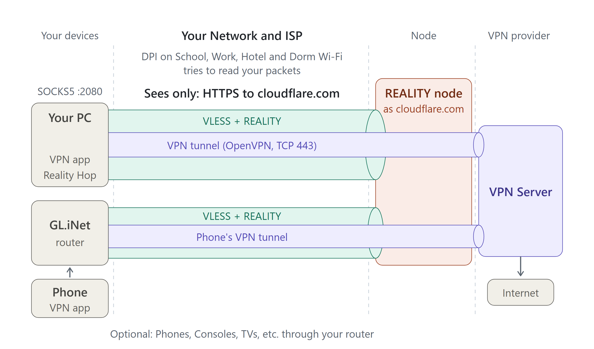
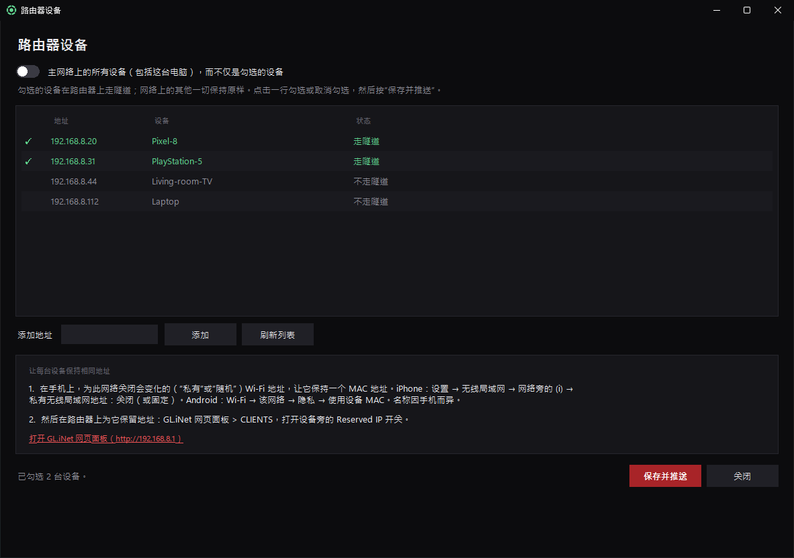
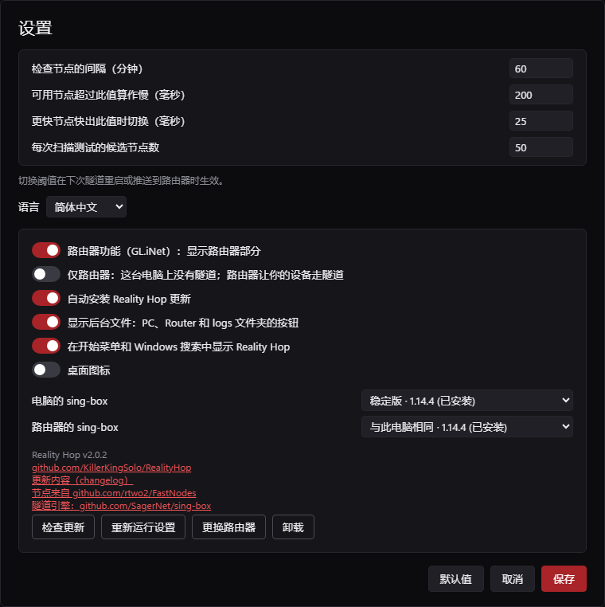
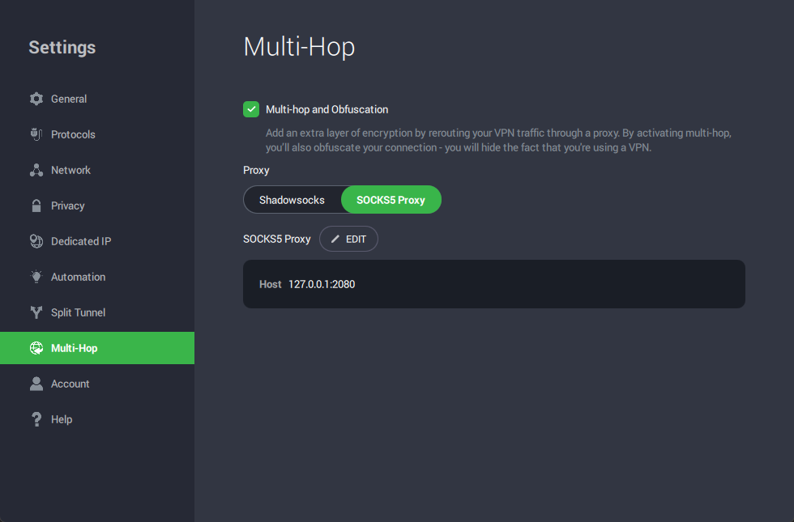

# Reality Hop（简体中文）

<p align="center">
  <a href="https://github.com/KillerKingSolo/RealityHop/stargazers"></a>
  <a href="https://github.com/KillerKingSolo/RealityHop/releases"></a>
  <a href="https://github.com/KillerKingSolo/RealityHop/releases/latest"></a>
  <a href="../../LICENSE"></a>
  <br>
  <a href="https://github.com/KillerKingSolo/RealityHop/releases/latest"></a>
  <a href="#安装"></a>
</p>

<p align="center">
  <a href="../../README.md">English</a> · <a href="README.es.md">Español</a> · <b>简体中文</b> ·
  <a href="README.ru.md">Русский</a> · <a href="README.uk.md">Українська</a> ·
  <a href="README.fa.md">فارسی</a> · <a href="README.ar.md">العربية</a> ·
  <a href="README.tr.md">Türkçe</a> · <a href="README.vi.md">Tiếng Việt</a>
</p>

> 本文由英文 README 机器翻译而来。如有不清楚之处，以英文版为准。欢迎在 GitHub issue 中提出更正。

**让你的 VPN 穿过封锁 VPN 的网络。** Reality Hop 把你的 VPN 连接包进一条 VLESS + REALITY 隧道
（[sing-box](https://github.com/SagerNet/sing-box)）。在网络看来，它就像访问 cloudflare.com 这类大型网站的普通 HTTPS。
它专为封锁 VPN 的网络而做：

- 学校、公司、酒店和宿舍的 Wi-Fi
- 机场、咖啡馆、火车和图书馆的公共 Wi-Fi
- 带有“VPN 封锁”的路由器，以及限速或封锁 VPN 流量的网络运营商
- 过滤互联网的国家和地区，例如中国的防火长城、俄罗斯、伊朗、土库曼斯坦和阿联酋

它从 [rtwo2/FastNodes](https://github.com/rtwo2/FastNodes) 获取免费的公共节点，自己测试，使用最快的可用节点，并自动替换失效的节点。

**更新内容：**[CHANGELOG.md](../../CHANGELOG.md)（最新版本在前）· **下载：**[最新版本](https://github.com/KillerKingSolo/RealityHop/releases/latest)


<picture>
  <source media="(prefers-color-scheme: dark)" srcset="../images/flow-dark.png">
  
</picture>

中间的网络只能看到一条访问大型网站的普通加密连接。你的 VPN 自身的加密全程都在里面。

## 截图

<table>
<tr><td colspan="2"><br><b>主窗口：</b>每个节点都通过运行中的隧道测试，最近 24 小时，路由器隧道。</td></tr>
<tr><td width="50%" valign="top"><br><b>候选节点：</b>公共列表中的节点，在你的电脑上 ping 并测试；可放入任意槽位。</td><td width="50%" valign="top"><br><b>路由器设备：</b>选择哪些设备使用路由器隧道，以及如何固定它们的地址。</td></tr>
<tr><td width="50%" valign="top"><br><b>节点详情：</b>节点在哪里、测试结果如何、24 小时内的 ping。</td><td width="50%" valign="top"><br><b>报告问题：</b>已隐去所有个人信息的日志，可直接用于 GitHub issue。</td></tr>
<tr><td colspan="2" align="center"><br><b>设置：</b>检查、路由器功能、更新、sing-box 渠道、快捷方式。</td></tr>
</table>

## 功能

- **一个 exe，引导式设置。** 下载 `RealityHop.exe` 并运行，其余由向导完成：安装、sing-box、首批节点、你的 VPN 应用、开机启动。
- **替你寻找并测试节点。** 它下载公共节点列表，对每个候选节点做一次真实的 REALITY 握手和一次 HTTPS 获取，并保留最快的 6 个可用节点。
- **自我修复。** 带托盘图标的后台守护程序每小时检查一次节点。它会替换失效节点；当全部失效时，从已知可用节点的保险库中救援。使用 PIA 时，VPN 一断开它就立即响应。
- **托盘图标显示状态。** 中心是总体状态。外环每个节点一段：绿色可用，琥珀色慢，红色失效。
- **开始菜单和 Windows 搜索。** 按 Windows 键并输入 Reality Hop。桌面图标可选。
- **可选的 GL.iNet 路由器支持，** 带 **设备** 窗口：选择哪些设备使用隧道，以及如何固定它们的地址（手机上不使用随机 MAC，在 GL.iNet 面板的 Clients 列表中为它保留 IP）。
- **GL.iNet 路由器：** 让手机、游戏机或电视也走隧道，无需在它们上面安装任何东西。关闭后，路由器部分就会消失。
- **仅路由器。** 电脑上不运行隧道：路由器为你选择的设备，或其主网络上的所有设备建立隧道，让你的全部流量都经过隧道。
- **显示正在使用的 sing-box 版本**（稳定版或测试版），位于窗口中名称下方。
- **出行时的停止 / 启动。** 一个按钮关闭一切，包括开机启动，直到你按下启动。
- **9 种语言。** 英语、西班牙语、简体中文、俄语、乌克兰语、波斯语、阿拉伯语、土耳其语和越南语。首次启动时选择；可在设置中更改。活动日志和问题报告保持英文。
- **自动更新。** Reality Hop 从本仓库的 Releases 自动更新（校验 SHA-256）。
- **sing-box 自行保持最新**，每天一次，使用你选择的渠道：**稳定版**（默认）或 **测试版（beta、alpha）**。不必等待 Reality Hop 发布新版本。
- **查看后台运行的内容。** 打开 *显示后台文件*，即可获得 `PC`、`Router` 和 `logs` 文件夹的按钮：正在使用的 sing-box 配置、路由器脚本和三个日志。
- **匿名问题报告。** *报告问题* 把三个日志打包，地址、名称、密钥和机密都替换为标记。你先阅读，再把它附加到 GitHub issue。不会自动发送任何内容。
- **一个文件夹装下一切。** 安装到 `C:\Program Files\RealityHop`，或你在设置中选择的文件夹，只需一次 UAC 提示。程序、隧道引擎、配置和日志都在那里，只有你的 Windows 用户可以读取。更新会安装到那里，不再询问。程序从不以管理员身份运行。没有遥测。

## 安装

1. 从 [最新版本](https://github.com/KillerKingSolo/RealityHop/releases/latest) 下载 **`RealityHop.exe`**。
2. 运行它。由于 exe 没有代码签名，Windows SmartScreen 可能会警告：点击 **More info → Run anyway**（更多信息 → 仍要运行）。部分杀毒软件会误报未签名的应用；源代码全部在这里，你可以 [自行构建](../building.md)（英文）。
3. 按照设置向导操作：
   - **安装** 把 Reality Hop 复制到 `C:\Program Files\RealityHop`（一次 UAC 提示），下载 sing-box，找到首批节点并启动隧道。大约需要一分钟。
   - **路由器？** 询问你是否还要设置 GL.iNet 路由器。如果回答是，向导会一步步引导你（[详情](../router-setup.md)，英文）。如果回答否，Reality Hop 只显示电脑部分。
   - **VPN 应用** 说明如何把你的 VPN 指向隧道（[详情](../vpn-setup.md)，英文）。
   - **完成** 设置登录时后台启动、开机启动和自动更新。

要求：Windows 10 或 11（64 位），带 Microsoft Edge WebView2（Windows 11 和当前 Windows 10 自带），以及一个可以使用 SOCKS5 代理的 VPN 应用。

### Mac

1. 从 [最新版本](https://github.com/KillerKingSolo/RealityHop/releases/latest) 下载 **`RealityHop-mac-apple-silicon.dmg`**（M1 及更新）或 **`RealityHop-mac-intel.dmg`**。
2. 打开它，把 **Reality Hop** 拖到 **Applications**（应用程序）。从“应用程序”运行，而不是从磁盘映像运行。
3. 从“应用程序”打开 Reality Hop。第一次时 macOS 会阻止它，因为该应用没有经过 Apple 公证（公证需要付费的 Apple 开发者账户）。允许一次即可：
   1. macOS 提示无法验证 Reality Hop。点击 **Done**（完成），不要点 **Move to Trash**（移到废纸篓）。
   2. 打开 **System Settings → Privacy & Security**（系统设置 → 隐私与安全性），向下滚动到 **Security**（安全性）。
   3. 在“Reality Hop”was blocked 旁边点击 **Open Anyway**（仍要打开），再次点击 **Open Anyway**，并输入你的 Mac 密码。

   只需做一次。更新后会直接打开，不再询问。在 macOS 15 及更新版本上，右键 → **打开** 已不再有效。源代码全部在这里，你可以 [自行构建](../building.md)。[更多帮助](../troubleshooting.md#mac-reality-hop-cannot-be-opened)（英文）。
4. 按照同样的设置向导操作。不需要管理员密码：所有内容都在 `~/Library/Application Support/RealityHop`，只有你的用户可以读取，后台守护程序显示在菜单栏中。
5. Mac 上的 PIA：Split Tunnel 中无需任何设置。Reality Hop 会自动添加自己（Bypass VPN），并在其中保存节点地址，因此 PIA 的 kill switch 可以保持开启。同一时间只运行一个 DNS 应用（[详情](../vpn-setup.md)）。

要求：macOS 15 或更新版本，Apple 芯片或 Intel，以及一个可以使用 SOCKS5 代理的 VPN 应用。请从 [PIA 官网](https://www.privateinternetaccess.com/download/mac-vpn) 获取 Mac 版 PIA，而不是 Mac App Store：App Store 版本没有 Multi-Hop 和 Split Tunnel，因此无法通过 Reality Hop 连接。

## 设置 VPN 应用

Reality Hop 监听 **SOCKS5 `127.0.0.1` 端口 `2080`**，没有用户名和密码。

你的 VPN 必须使用 **OpenVPN over TCP，端口 443**。SOCKS5 代理只承载 TCP，而 443 是普通的 HTTPS 端口。

**Private Internet Access (PIA)：**
Settings → Protocols：Protocol **OpenVPN**，Transport **TCP**，Remote Port **443**。然后 Settings → Multi-Hop：勾选 **Multi-hop and Obfuscation**，选择 **SOCKS5 Proxy**，点击 **EDIT**，输入主机 `127.0.0.1` 和端口 `2080`，然后保存。Split Tunnel 不需要你做任何事：Reality Hop 会自动把 `rh-core.exe` 及其测试副本 `rh-test.exe` 添加为 **Bypass VPN**。只有当 PIA 的命令行拒绝时，设置向导才会显示手动步骤：在 Settings → Split Tunnel 中添加 `C:\Program Files\RealityHop\PC\rh-core.exe` 并设为 **Bypass VPN**。




**其他 VPN 应用：** 任何带有 SOCKS5 代理设置的应用都可以同样使用，搭配 OpenVPN over TCP 端口 443。在 OpenVPN 配置文件中，使用 `proto tcp`、服务器端口 `443`，并添加 `socks-proxy 127.0.0.1 2080`。参见 [docs/vpn-setup.md](../vpn-setup.md)（英文）。

## 控制

| 位置 | 作用 |
|---|---|
| 托盘图标 | 双击打开窗口。右键：重启隧道、立即检查、救援、退出。 |
| **立即检查** | 通过运行中的隧道测试每个节点。 |
| **重启隧道** | 用当前节点重启隧道（约 2 秒）。 |
| **停止 / 启动** | 关闭一切，包括开机启动，适合你不在时使用。停止期间请关闭 VPN 应用的代理。 |
| 节点 → **显示候选节点** | 列出公共列表中的节点；测试它们并放入任意槽位，然后在同一窗口中重启并测试电脑隧道。 |
| 节点 → **救援** | 当所有节点都失效时使用。测试已知可用节点的保险库，放入最好的 6 个。 |
| 帮助 → **报告问题** | 生成日志的脱敏报告，并打开一个 GitHub issue 供你附加。 |
| 文件（可选） | **打开后台文件夹**（`PC`、`Router`、`logs`、`anonymous-logs`）和 **打开日志文件夹**。 |
| **设置** | 检查间隔、慢速阈值、切换余量、路由器功能开关、sing-box 稳定版或测试版（电脑和路由器）、显示后台文件、更新、重新运行设置、卸载。 |

**卸载：** 控制面板 → 程序 → 卸载程序 → Reality Hop。Windows 设置 → 应用 → 已安装的应用 → Reality Hop，以及 Reality Hop 自己的设置 → 卸载，效果相同。

## 节点从哪里来

- **节点列表：** [rtwo2/FastNodes](https://github.com/rtwo2/FastNodes) 的文件 [`sub/verified_tls.txt`](https://raw.githubusercontent.com/rtwo2/FastNodes/main/sub/verified_tls.txt)。Reality Hop 只保留端口 443 上、使用知名伪装站点的 VLESS + REALITY + XTLS-Vision 节点。然后自己测试；不信任列表自带的验证。
- **隧道引擎：** [SagerNet/sing-box](https://github.com/SagerNet/sing-box)，从其官方 GitHub 发布下载。稳定版是最新的正式版；测试版是所有版本中最新的，包括 alpha 和 beta。会校验 SHA-256，新版本必须接受配置后才会替换旧版本。在你的电脑上，它以 `rh-core.exe` 运行。
- **路由器引擎：** Reality Hop 为 arm64 路由器自建的 sing-box，从官方源代码构建，去掉了路由器用不到的部分（18 MB，GL.iNet 的 1.9.7 软件包为 27 MB）。除非在设置中为路由器指定单独的渠道，否则它跟随电脑的渠道。Reality Hop 在更新路由器前会先询问，把旧版本保留在路由器的内存中，如果新版本无法启动就恢复旧版本。路由器的 Plug-ins 页面仍显示 GL.iNet 的 1.9.7 软件包；侧边栏显示实际运行的版本。构建和检查方式：[`router-core/`](../../router-core/README.md)（英文）。
- **协议：** 带 REALITY 和 XTLS-Vision 的 VLESS，来自 [XTLS](https://github.com/XTLS)。

## 隐私与安全

- **公共节点由陌生人运行。** 你的 VPN 仍然端到端加密一切，所以节点只能看到加密的 VPN 流量及其目的地，也就是 VPN 服务器。始终在上层保持 VPN。不要在没有 VPN 的情况下通过 Reality Hop 发送私密流量。
- **Reality Hop 会联系：**
  - GitHub，用于节点列表、sing-box 发布、路由器版本和 Reality Hop 发布。
  - `api.ipify.org`，测试每个节点时通过该节点获取。
  - `www.gstatic.com/generate_204`，通过隧道的延迟测试。
  - `ip-api.com`，用于节点位置，通过隧道查询。
  - Quad9 DNS（`9.9.9.9`），通过隧道。

  不会把任何关于你的信息发送到任何地方，也没有遥测。
- **它保存的内容：** 配置、节点保险库、日志和设置都在其安装文件夹中（`PC`、`Router`、`logs`、`anonymous-logs` 文件夹），只有你的 Windows 用户可以打开。路由器密钥是在你的电脑上生成的 SSH 密钥。你的路由器密码输入在 Windows 自带的 `ssh` 中，Reality Hop 从不查看或保存。
- 请确认你可以在所在的网络和所在的国家使用 VPN。有些国家限制或禁止 VPN；Reality Hop 不会改变你所在地的法律。

安全问题请参见 [SECURITY.md](../../SECURITY.md)。其他问题请在窗口中使用 **报告问题**，并把匿名报告附加到 issue。切勿附加 `pc-config.json`、`router-config.json` 或 `vault.json`。

## Star 历史

**如果 Reality Hop 对你有帮助，请给它一个 star。** 它是免费的，只需点一下。Star 让我知道有人在用它，帮助其他人找到它，也激励我修复问题、添加新功能。

<a href="https://www.star-history.com/#KillerKingSolo/RealityHop&Date">
 <picture>
   <source media="(prefers-color-scheme: dark)" srcset="https://api.star-history.com/svg?repos=KillerKingSolo/RealityHop&type=Date&theme=dark" />
   <source media="(prefers-color-scheme: light)" srcset="https://api.star-history.com/svg?repos=KillerKingSolo/RealityHop&type=Date" />
   
 </picture>
</a>

## 文档

这些指南为英文：

- [工作原理](../how-it-works.md)
- [GL.iNet 路由器设置](../router-setup.md)
- [VPN 应用设置](../vpn-setup.md)
- [故障排除](../troubleshooting.md)
- [从源代码构建和发布](../building.md)

## 从源代码运行

Reality Hop 使用 Rust 和 [Tauri](https://github.com/tauri-apps/tauri) 编写。安装 [Rust](https://rustup.rs) 后：

```
cd rust
cargo run -p realityhop-app
```

详细信息、Mac 构建和发布步骤：[docs/building.md](../building.md)。

## 许可证

[CC BY-NC-ND 4.0](../../LICENSE)（知识共享 署名-非商业性使用-禁止演绎 4.0）。简而言之：

- **原样分享并注明出处：** KillerKingSolo 的 Reality Hop、SagerNet 的 sing-box 和 rtwo2 的 FastNodes，并附上它们的链接（见 [LICENSE](../../LICENSE)）。
- **不得修改：** 你不能分享修改过的副本。
- **不得商用：** 你不能出售它或将其用于盈利。

超出这些范围需要获得许可。sing-box（GPL-3.0-or-later）和 FastNodes（MIT）是独立的项目，使用各自的许可证；Reality Hop 在运行时下载它们，不随附分发。
