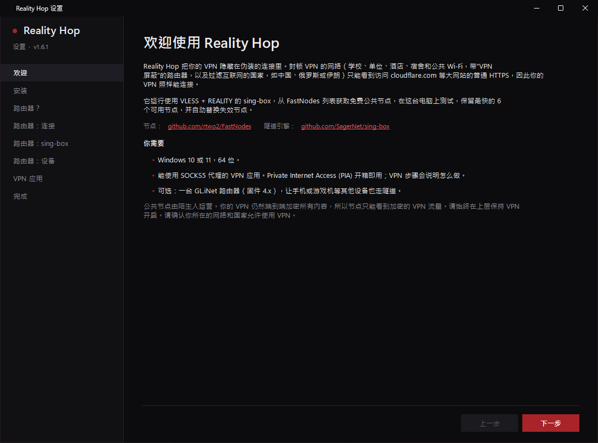
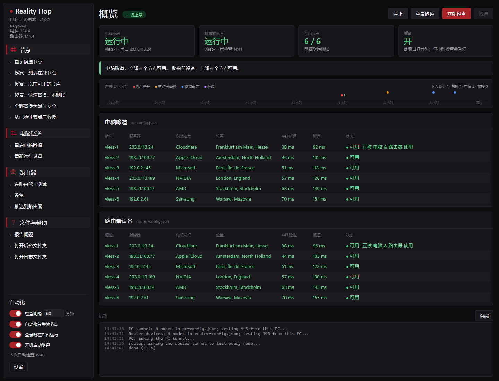
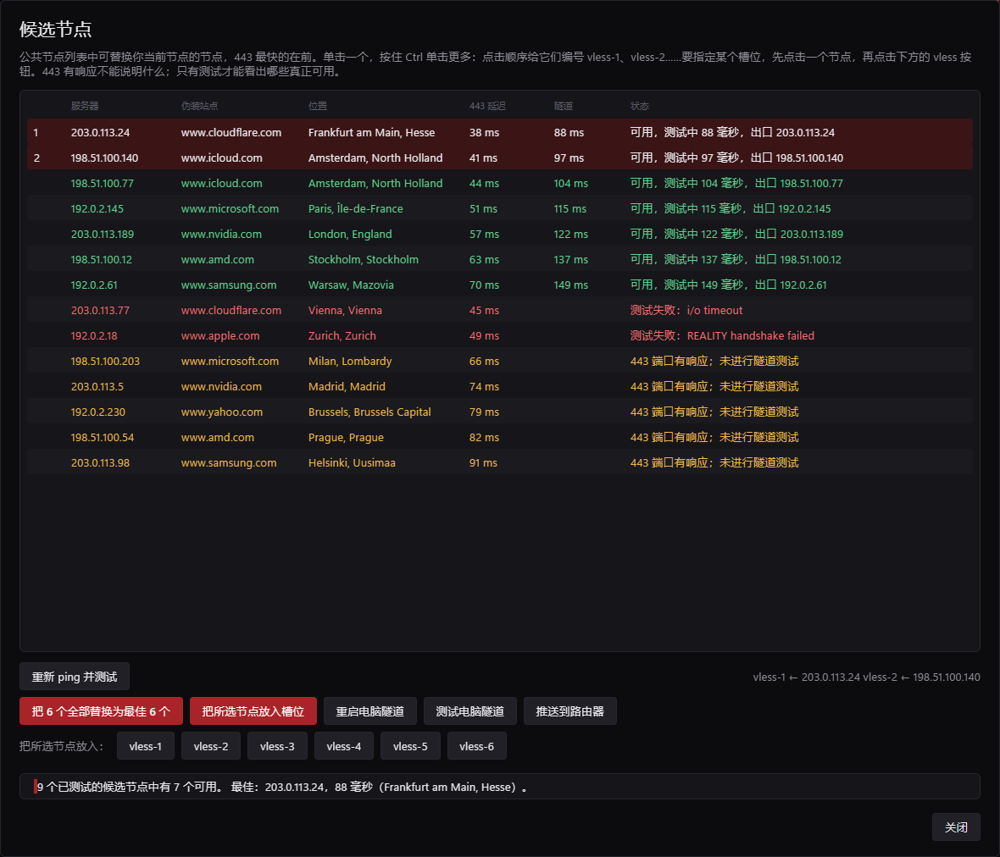
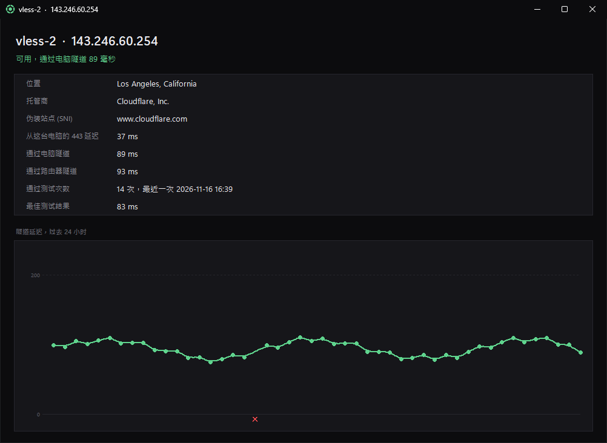
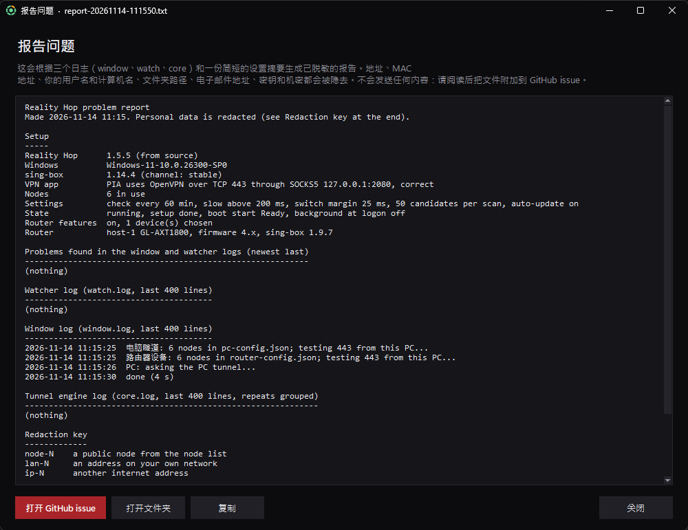

# Reality Hop（简体中文）

  
  
  
  
   
  
  

  <a href="../../README.md">English</a> · <a href="README.es.md">Español</a> · <b>简体中文</b> ·
  <a href="README.ru.md">Русский</a> · <a href="README.uk.md">Українська</a> ·
  <a href="README.fa.md">فارسی</a> · <a href="README.ar.md">العربية</a> ·
  <a href="README.tr.md">Türkçe</a> · <a href="README.vi.md">Tiếng Việt</a>

> 本文由英文 README 机器翻译而来。如有不清楚之处，以英文版为准。欢迎在 GitHub issue 中提出更正。

**让你的 VPN 穿过封锁 VPN 的网络。** Reality Hop 把你的 VPN 连接包裹在 VLESS + REALITY 隧道（[sing-box](https://github.com/SagerNet/sing-box)）中。在网络看来，它就像访问 cloudflare.com 等大网站的普通 HTTPS。适用于：

- 学校、单位、酒店和宿舍 Wi-Fi
- 机场、咖啡馆、火车和图书馆的公共 Wi-Fi
- 带“VPN 屏蔽”的路由器，以及限速或封锁 VPN 流量的运营商
- 过滤互联网的国家，如中国的防火长城、俄罗斯、伊朗、土库曼斯坦和阿联酋

它从 [rtwo2/FastNodes](https://github.com/rtwo2/FastNodes) 获取免费公共节点，自己测试，使用最快的可用节点，并自动替换失效节点。

## 工作原理

VPN 应用 → 你电脑上的 Reality Hop（SOCKS5 `127.0.0.1:2080`）→ 公共 REALITY 节点（看起来像访问 cloudflare.com 的 HTTPS）→ VPN 服务器 → 互联网。你的 VPN 自身的加密全程保留在里面。

## 截图

<table>
<tr><td colspan="2"> <b>主窗口:</b> 每个节点都通过运行中的隧道测试，显示最近 24 小时和路由器隧道。</td></tr>
<tr><td width="50%" valign="top"> <b>候选节点:</b> 来自公共列表的节点，在你的电脑上测 ping 和测试；可以把任意一个放进槽位。</td><td width="50%" valign="top"> <b>路由器设备:</b> 选择哪些设备走路由器隧道，以及如何固定它们的地址。</td></tr>
<tr><td width="50%" valign="top"> <b>节点详情:</b> 节点所在位置、测试结果、24 小时内的 ping。</td><td width="50%" valign="top"> <b>报告问题:</b> 去除了所有个人信息的日志，可直接附到 GitHub issue。</td></tr>
<tr><td colspan="2" align="center"> <b>设置:</b> 检查、路由器功能、更新、sing-box 通道、快捷方式。</td></tr>
</table>

## 安装

1. 从[最新版本](https://github.com/KillerKingSolo/RealityHop/releases/latest)下载 `RealityHop.exe`。需要 64 位 Windows 10 或 11。 Mac：下载 `RealityHop-mac-apple-silicon.dmg`（M1 及更新）或 `RealityHop-mac-intel.dmg`。需要 macOS 15 或更新。 Mac 版 PIA 请从[其官网](https://www.privateinternetaccess.com/download/mac-vpn)下载，不要从 Mac App Store 下载：App Store 版本没有 Multi-Hop 和 Split Tunnel。
2. 运行它并选择语言。
3. 向导会安装 Reality Hop（一次 UAC 提示），从官方版本下载 sing-box（校验 SHA-256），找到第一批节点并启动隧道。约一分钟。

## 语言

Reality Hop 首次启动时会询问语言。之后可在 **设置 → 语言** 中更改。活动日志和问题报告保持英文，方便支持人员阅读。

## 设置 VPN 应用

把你的 VPN 应用指向 SOCKS5 代理 `127.0.0.1`，端口 `2080`，无用户名和密码。使用 **基于 TCP 443 端口的 OpenVPN**：SOCKS5 代理只承载 TCP。

**Private Internet Access (PIA)：**

1. PIA → **Settings → Protocols**：Protocol **OpenVPN**，Transport **TCP**，Remote Port **443**。
2. **Settings → Multi-Hop**：勾选 **Multi-hop and Obfuscation** 并选择 **SOCKS5 Proxy**。
3. 点击 **EDIT**，主机 `127.0.0.1`，端口 `2080`，用户名和密码留空，然后保存。
4. Reality Hop 会自动添加这条规则；只有失败时安装向导才会显示此步骤。 仅当 Split Tunnel 中 **All Other Apps** 设为 **Use VPN** 时：**Settings → Split Tunnel**，**Add Application**，选择 `C:\Program Files\RealityHop\PC\rh-core.exe` 并设为 **Bypass VPN**。如果 All Other Apps 设为 Bypass VPN，则不需要这条规则。
5. 连接。

**其他 VPN 应用：** 任何有 SOCKS5 代理设置的应用都一样。在 OpenVPN 配置文件中：`proto tcp`、服务器端口 443，以及一行 `socks-proxy 127.0.0.1 2080`。英文详细说明：[VPN app setup](../vpn-setup.md)。

## GL.iNet 路由器（可选）

使用 GL.iNet 路由器（固件 4.x）时，你选择的设备（手机、游戏机、电视）也会走隧道，无需在上面安装任何东西。**仅路由器** 模式下电脑上不运行任何东西：路由器让所选设备或整个网络走隧道。英文指南：[router setup](../router-setup.md)。

## 日常使用

- **托盘图标：** 中心表示总体状态；外圈每个节点一段（绿色可用，琥珀色慢，红色失效）。
- **立即检查**、**重启隧道**、**显示候选节点**（测试节点并放入槽位），所有节点失效时用 **救援**。
- 出行时用 **停止 / 启动**。停止期间请关闭 VPN 应用的代理。
- Reality Hop 会从 GitHub 版本自动更新（校验 SHA-256）。

## 隐私与安全

- **公共节点由陌生人运营。** 你的 VPN 仍然端到端加密所有内容，节点只能看到加密的 VPN 流量。请始终保持 VPN 开启。
- Reality Hop 会连接 GitHub（节点列表、sing-box、Reality Hop 版本），并通过隧道连接 `api.ipify.org`、`www.gstatic.com/generate_204`、`ip-api.com` 和 Quad9 DNS。不会发送任何关于你的信息，没有遥测。
- 请确认你所在的网络和国家允许使用 VPN。Reality Hop 不会改变你所在地的法律。

## 遇到问题

在窗口中使用 **报告问题**：它会生成已脱敏的报告，可附加到 GitHub issue。切勿附加 `pc-config.json`、`router-config.json` 或 `vault.json`。英文指南：[troubleshooting](../troubleshooting.md)。

## 许可证

[CC BY-NC-ND 4.0](../../LICENSE)：可原样分享并注明出处，不得分享修改版，不得商用。
