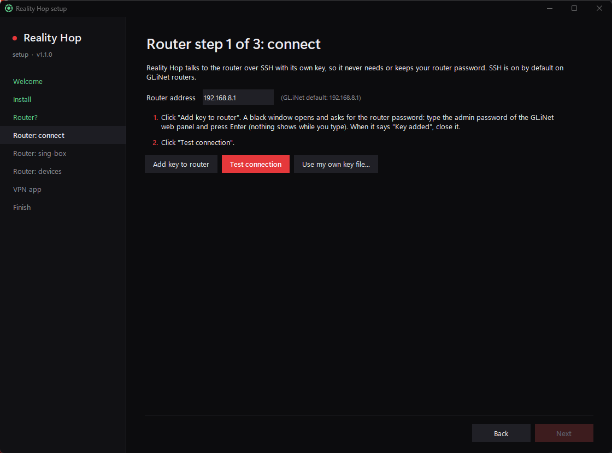
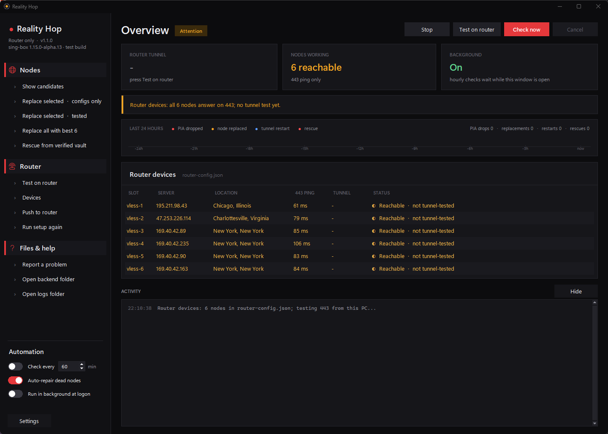

# GL.iNet router setup

With the router set up, the devices you choose (a phone, a games console, a TV) go through the same kind of tunnel,
with nothing installed on them. Only their traffic is diverted. Everything else on the network, including the router
itself, stays as it is.

**Tested on:** GL-AXT1800, firmware 4.x, router sing-box 1.9.7. Other GL.iNet routers on firmware 4.x use the same
OpenWrt base and should work the same way, but they are untested. Reports are welcome in Issues.

The setup wizard does every step below. Answer **Yes** to "Do you have a GL.iNet router?", or later use
Settings > Router features, then Run setup again. This page explains what each step does, and how to do it by hand.



## Step 1: connect (SSH key)

Reality Hop talks to the router over SSH with a key of its own. It never needs or stores the router password.

1. The router address is `192.168.8.1` by default on GL.iNet routers.
2. Click **Add key to router**. Reality Hop makes a key pair with Windows' own `ssh-keygen`
   (`router_ed25519` in the install folder, `C:\Program Files\RealityHop` by default). A console window then opens and runs Windows' own `ssh`, which asks for
   the router password. That is the admin password of the GL.iNet web panel. Type it there; Reality Hop never sees it.
   The public key is added to `/etc/dropbear/authorized_keys` on the router.
3. Click **Test connection**. It shows the model, firmware and sing-box version.


Already have a key that the router accepts? Use **Use my own key file...** instead.

By hand: GL.iNet web panel > SYSTEM > Advanced Settings opens LuCI. In LuCI, go to System > Administration >
SSH-Keys and paste the contents of `router_ed25519.pub`.

## Step 2: sing-box on the router

The router needs `sing-box`, plus `jq` and `curl` for its self-repair. **Install sing-box on the router** runs
`opkg update; opkg install sing-box jq curl` over SSH.

By hand: GL.iNet web panel > **APPLICATIONS > Plug-ins**. Click **Update**, then search for and install `sing-box`,
`jq` and `curl`.

The router config is written for sing-box 1.9 to 1.12. The wizard warns you if the router has 1.13 or newer.

## Step 3: choose devices

Pick devices from the router's DHCP list, or type their addresses. Then click **Push to router**. This step:

- uploads `router-config.json`, which sing-box checks on the router before it is used;
- installs `/etc/sing-box/nft-devices.sh`, a firewall include that diverts only the chosen addresses into sing-box
  (tproxy port 7895), and registers it as `firewall.realityhop`;
- enables and restarts the router's sing-box service;
- installs the self-repair (`/etc/sing-box/heal.sh`, run by cron every 30 minutes) with a vault of known-good nodes.

**Change the list later** in the window: Router > **Devices**. Tick or untick devices, add an address by hand, then
**Save and push**.

**Give each chosen device a fixed address,** or it loses the tunnel when its address changes. On phones, first turn
off rotating private addresses for this Wi-Fi network (iPhone: Private Wi-Fi Address set to Off or Fixed; Android: use
the device MAC). Then GL.iNet web panel > **CLIENTS**: turn on the **Reserved IP** slider next to the device.

## Router only

Answer **Router only** to the router question in the setup (or turn on Settings > **Router only**) when nothing should
run on this PC's connection. The router then does all the tunnelling:

- **Every device on the main network** (setup step 3, or Router > Devices) puts everything on the router's main Wi-Fi
  and LAN through the tunnel, this PC included. Guest and IoT networks stay as they are. The main network's IPv6 is
  refused, so devices use the tunnelled IPv4 and nothing goes around the tunnel.
- Or tick single devices, as above.
- Node tests run on the router, because this PC's own traffic may go through the tunnel and would skew them.
- Your VPN app needs no proxy setting. Connect it as usual; OpenVPN over TCP 443 is the most reliable.



## How the router side stays healthy

- Your PC checks the router tunnel with **Test on router** and pushes new nodes whenever it replaces some.
- `heal.sh` runs every 30 minutes but stands down while your PC has looked after the nodes within the last 2 hours.
  When the PC is off and every node fails twice, a minute apart, it swaps in the next 6 nodes from its vault. It keeps
  going until a set works, and logs to `/etc/sing-box/heal.log`.
- If the sing-box service is disabled, the firewall include removes the diversion, so no device is ever cut off.
- Nothing can connect to the router's port 7895 (where sing-box receives the diverted traffic) directly: the
  firewall include drops it, so no device can make sing-box dial itself.

## Turn the router tunnel off

- **Uninstall** Reality Hop and answer yes to "Also switch the tunnel on the router off?". Or run this over SSH:

  ```
  uci set sing-box.main.enabled=0; uci commit sing-box; /etc/init.d/sing-box stop
  sed -i '/heal.sh/d' /etc/crontabs/root; /etc/init.d/cron restart; fw4 reload
  ```
- Settings > Router features **off** only hides the router section on the PC. The router keeps running as it is.
